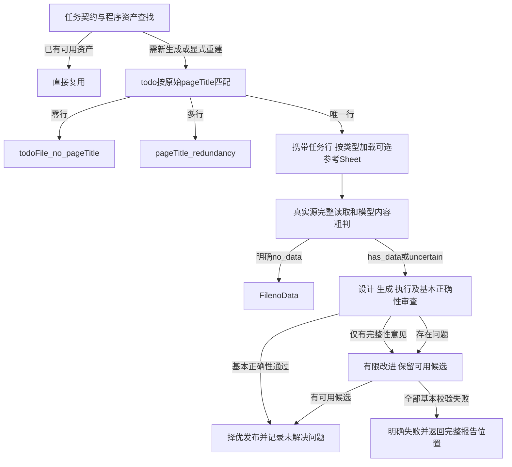

# V2任务参考与宽松校验

日期：2026-10-20；适用版本：0.2.2。任务/参考查找约定继续有效；候选保留、有限完整性改进及报告以[最新说明](V2候选保留与质量报告.md)为准。

## 1. 持续维护三份工作簿

默认放在agent/rule/，文件路径和名称均可配置。新增任务、修改规则或添加Sheet无需修改代码；每次实际生成读取当前磁盘快照并计算SHA256，不依赖固定的测试案例、任务行数、Sheet名称或进程启动时的旧缓存。程序只打开配置的正式文件，不枚举Excel的`~$`临时文件。

| 文件 | 约定 |
|---|---|
| todo.xlsx | 第1行表头，C=DataSourcePathCode、E=pageTitle；任务Sheet名称可变，其他带表头的列一并传入 |
| IndicatorName_Excel_Md.xlsx | Excel/CSV及PDF、图片、DOC等Markdown生成链路的名称拼接参考，按路径代码精确选Sheet |
| rule_html.xlsx | HTML/HTM/SHTML生成链路的名称和正则参考，按路径代码精确选Sheet |

todo中所有符合C/E表头约定的Sheet共同参与匹配，其他说明Sheet不当作任务表。表头约定用于读取校验，不固定任何业务来源。pageTitle必须是原始完整文本；不去空格、不改斜杠、不做模糊匹配，也不先以fileType消除重复。生成文件名的反斜杠转下划线规则不用于任务匹配。

DataSourcePathCode建议维护为文本，特别是19位编码和前导零。程序不将文本转浮点；安全范围内的整值数字可转等值文本。Excel已经损失精度的长数值不反推Sheet，任务信息仍可继续用于生成。C列空值同样不影响唯一任务进入生成。

两个参考工作簿按原单元格位置传递选中Sheet的全部非空内容，保留首行，不假定存在表头、不固定行数。未找到同名Sheet或选中Sheet为空时，参考列表为空，直接携带任务信息继续；不增加“无名称/正则参考”等缺失标志、告警或模型说明。

整个文件缺失/无法读取、损坏、超限、todo没有符合约定的表头属于REFERENCE_*读取或配置错误，与正常缺少同名Sheet区分。每个工作簿使用一次读取的bytes快照，记录实际内容hash；三份文件各自维护，不声称实现跨文件的联合版本事务。

## 2. 程序查找和生成顺序



三个业务错误码保持精确大小写。任务匹配失败在源下载、模型预检和Skill加载前返回。预检模型只判断真实源内容，不接收task_info、references或GZK，避免把参考中存在指标误判为输入有数据。

生成模块接收同一份task_info和references快照，用于设计、生成、修复和审查。task_info保存任务行字段、文件hash、Sheet及行号；reference保存文件hash、Sheet、用途与单元格位置。生产解析器继续只下载业务文件，不需要读取项目工作簿。

## 3. 参考的作用与冲突

IndicatorName_Excel_Md.xlsx相当于原GZK_IndicatorName/指标名称拼接逻辑_分路径代码.xlsx：A–J片段辅助理解真实源标签和名称拆解，K列辅助核对。rule_html.xlsx相当于原html/GZK_IndicatorName_html，正则必须在实际收到的转换Markdown上核验，不能因此改成读取原始HTML。

真实源文件提供数值、单位、统计期间和业务布局事实。参考行、名称或正则可能不全、过期或错误；冲突时在Design.reference_conflicts或Review.reference_conflicts明确参考位置、实际源位置及采用源事实的依据，继续按真实文件生成。不能因规则库有名称就造数据，也不能因为未列名称就删除Python的有效源记录。已按源事实解决的参考冲突不构成失败。

生成设计仍须明确指标名称逻辑、指标单位取值逻辑、单位位置、截止日期逻辑和实际位置。任务信息中的示例和布局描述是参考，不固定未来文件的行列。名称括号单位保留、零/负数/精度保留、无单位用“-”、无可靠日期留空等现有约定继续有效。

Markdown提示词在平台运行时继续按GZK.GZKJG精确唯一筛选并输出out_data五字段。生成前的名称参考与运行时筛选是不同环节；外部框架没有新增目标提取模型执行。

## 4. 宽松完整性与基本正确性

以下产生warning，不阻止已有有效结果发布；其中明确的漏提取或旧格位消失可以触发有限改进，设计/审查section覆盖本身不反复触发检查：

- 设计未列出全部源Sheet/section；
- 审查引用未覆盖全部表块；
- 相较同源旧候选少了数据格位，且没有逐项排除解释；
- 模型发现其他漏提取或覆盖改进建议。

Review.approved表示基本正确性判断，quality_findings承载完整性建议。若模型负面结论仅涉及漏项，使用rejection_kind=coverage，程序将其作为非阻塞意见；错误输出或混合问题使用correctness。旧审查格式未填rejection_kind时按correctness处理，不靠搜索自由文本猜测拒绝原因。

仍保留实际执行、非空ExcelData、四字段类型、严格JSON、源数值一致性、单位/日期来源和逐条真实源位置检查；机械失败的候选不进入保留集合。模型语义审查继续记录问题；无已批准版本时，基本可用Python可带usable_with_warnings标记保留，原始拒绝不改写。审查虚构引用不能产生accepted结论，但不抹去已通过真实源基本校验的代码。Markdown保留结构、五字段及语义审查要求。ready不承诺全量覆盖或语义全部通过。

Review.reviewed_refs还可以包含已选参考的`file:sheet!A1:K36`地址/范围。程序仅以本次已提供的参考快照验证文件/Sheet身份、边界及是否包含真实参考内容；未知文件、错误Sheet或越界范围仍拒绝。参考引用不计为源表覆盖，也不能用于业务记录evidence。这样既接受合法的参考审查证据，也保留输入源数据检查。

## 5. 版本、重试与复用

新生成工作区和不可变资产目录保存generation_context.json。manifest记录generation_context_sha256及其相对runtime的路径。模型操作指纹包含实际task_info、references、指令及schema，维护内容变化后不复用旧上下文回复。

恢复候选时重新读取当前任务表和可选参考，重验源SHA256。design_context.json绑定设计上下文、Skill和profile指纹；指纹变化或旧任务无此标记时重新形成设计，然后重新执行和审查保存候选，不继承旧批准结论。

已有资产命中不读取当前工作簿或源文件，也不调用模型；已有请求结果保持幂等。更新资料不会自动替换现有资产。新请求强制重建示例：

```powershell
cd D:\EDBPythonCode\dc_workflow\agent
python run_agent.py run --example example --source-path runtime/source_cache/example.xlsx --rebuild
```

原任务需要继续时使用`run --task-id TASK_ID --retry --rebuild`；同时添加`--resume-candidate`可重验已有候选并恢复同源较早可用版本。机械失败的候选不会覆盖可用资产；有限改进仍有问题的可用代码会明确标记并保存完整报告。

## 6. 配置和验证入口

默认配置已写入.env.example，用户现有.env不需修改：

```dotenv
DC_RULE_DIR=rule
DC_TODO_FILENAME=todo.xlsx
DC_INDICATOR_REFERENCE_FILENAME=IndicatorName_Excel_Md.xlsx
DC_HTML_REFERENCE_FILENAME=rule_html.xlsx
DC_MAX_RULE_BYTES=100000000
```

相对rule_dir按agent工程根解析，独立runtime不会改变默认规则资料位置。check-env显示实际rule_dir。原ReferenceProvider仍支持显式文本参考；新增RuleContextProvider用于程序任务/工作簿查找，Skills和Tools仍仅预留。

验证证据见[V2实施与验证记录](V2实施与验证记录.md)和[测试记录](../tests/验证记录.md)。当前自动化回归包含动态维护、首行保留、类型路由、重复/无匹配、错误码、参考贯穿、恢复设计失效、缓存边界及完整性不阻断等场景。

0.2.2最新全量254项64.19秒、Ruff及60文件格式检查通过，旧候选真实源回放及报告见[候选保留说明](V2候选保留与质量报告.md)。0.2.1的8条任务路由和真实模型新生成结果属于历史独立证据，不证明全量覆盖或新版本平台执行。
