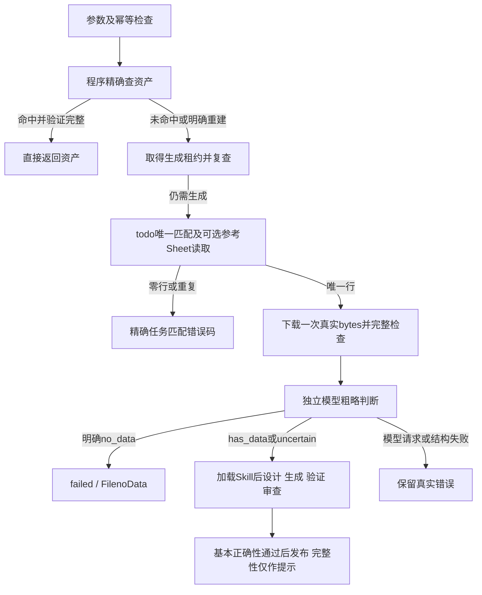

# 外部智能体框架 V2 迭代实施方案

最后同步：2026-10-20（北京时间）；当前版本0.2.2。任务/参考程序查找继续有效，新增可用候选保留、有限完整性改进与完整报告，最新契约见[候选保留与质量报告](V2候选保留与质量报告.md)。验证结果见[V2实施与验证记录](V2实施与验证记录.md)。最初设计稿保存在runtime/implementation_backups/v2-before，作为历史参考。

阶段结论：用户已确认第二版暂时迭代完成；本文作为已实施方案保留。第三版需求将在新会话明确，最新实际状态和后续阅读顺序见[V2总结与V3交接](V2阶段总结与V3交接.md)。

关联：[README](../README.md)、[项目记忆](../../PROJECT_MEMORY.md)、[状态与目标](../../PROJECT_STATUS_AND_GOALS.md)、[设计指导书](../外部智能体框架设计指导书.md)。

## 1. 最新实施范围

用户在方案基础上明确选择：

1. 实现code分类、pageTitle实际命名和程序定位。
2. 暂时直接调用模型粗略判断内容，仅明确无数据时返回FilenoData，其他判断继续生成。
3. Skills和Tools只预留目录或接口，未来再实现。
4. 新生成前按原始pageTitle精确匹配todo.xlsx；零行/多行返回todoFile_no_pageTitle/pageTitle_redundancy；唯一行按C列代码选取类型对应的可选参考Sheet。
5. 三工作簿持续维护，每次生成读新快照，不写死业务任务；无Sheet直接携带任务信息继续、不加缺失说明。参考冲突以本次真实源为准。
6. 在能提取真实有效数据时允许部分结果。完整性、section覆盖和旧格位消失为质量warning，不单独导致生成失败；错误数据和执行/接口/源证据问题仍修正。
7. candidate-0等Python通过基本校验立即保留；后续修复失败/中断/时限耗尽择优回退。优先语义已接受版本，无此版本时基本可用代码明确标记usable_with_warnings，不能将未解决模型语义问题说成通过。Markdown仍需语义接受。
8. 默认总修复4轮，其中单纯完整性改进最多2轮，连续2轮无择优进展提前停止。维护逐任务完整JSON/Markdown报告和跨任务JSONL问题总账，返回绝对路径。

因此，原设计中“程序先判定、可选模型、不确定待复核”的建议被本次用户决定替代；新Skill/Tool注册器和原生工具调用不纳入本版。

V1成功案例继续作为基线：上街区xlsx、资产版本a02241d6-77a7-4e6f-992a-4a5e4a0b42ef、原代码SHA256为8b1fcfc0046ac3994ab6113abed9e23e89036877271113c89da2013f3791a366。其平台通过结论来自用户确认，V2没有重新操作平台。

## 2. 当前职责与目录

框架代码在src/dc_agent中按domain、ports、application、assets、orchestration、generation、inspection、references、validation、infrastructure、entrypoints划分。普通应用服务管理任务、复用、参考查找、预检和发布；生成图处理设计、生成、验证、审查与修正。

关键实现：

| 模块 | 职责 |
|---|---|
| [application/service.py](../src/dc_agent/application/service.py) | 任务生命周期、缓存与生成调用边界 |
| [application/preflight.py](../src/dc_agent/application/preflight.py) | 真实源检查适配、独立模型判断、成功操作缓存 |
| [references/workbooks.py](../src/dc_agent/references/workbooks.py) | 当前todo唯一任务与可选名称/正则Sheet的程序精确读取 |
| [assets/layout.py](../src/dc_agent/assets/layout.py) | 精确类型映射、文件名与碰撞键 |
| [assets/store.py](../src/dc_agent/assets/store.py) | 文件完整性、候选/版本、旧资产迁移和发布恢复 |
| [orchestration/workflow.py](../src/dc_agent/orchestration/workflow.py) | 参考上下文及产物契约贯穿设计/生成/修复/审查；基本正确性、覆盖建议和有限修正 |
| [infrastructure/storage.py](../src/dc_agent/infrastructure/storage.py) | 既有SQLite表、条件租约检查、事务内发布回调 |
| [infrastructure/locking.py](../src/dc_agent/infrastructure/locking.py) | 同code目录跨线程和跨进程发布互斥 |
| [ports](../src/dc_agent/ports/__init__.py) | 现有边界及预留SkillProvider、ToolRegistry协议 |

config.py保留在原包根，避免改变工程根的计算。run_agent.py及兼容dc_agent.cli仍可运行；pyproject与包版本均为0.2.2。rule根及三个文件名可配置；本轮.env只同步修复参数4/2/2，其他设置保留。

## 3. 资产定位与命名

| fileType | 分类 | 后缀 | 实际读取内容 |
|---|---|---|---|
| xls/xlsx/csv | code/excel/具体fileType | .py | fileMd5对应Excel/CSV |
| html/htm/shtml | code/html/具体fileType | .py | markdownMD5对应Markdown |
| md/markdown/pdf/png/jpg/jpeg/doc/docx | code/md/具体fileType | .md | markdownMD5对应Markdown |

文件名只将pageTitle反斜杠替换为下划线；不同fileType不合并。保留原pageTitle与规范fileType计算source_key，不用业务文件名代替来源身份。

同类型下甲\乙与甲_乙、大小写/NFC等形成的路径碰撞返回ARTIFACT_PATH_COLLISION；非法字符、保留名和过长文件名返回INVALID_ARTIFACT_NAME，不静默改名。对Windows深层版本路径使用文件系统长路径适配。

程序按精确键查SQLite当前指针，再核对类型目录、业务文件名、身份、当前/版本正文与哈希。未登记的同名文件不使用，不让模型选择文件。

```text
code/<excel|html|md>/<fileType>/
  <业务文件名>.py或.md
  .staging/<task_id>/<attempt>/<业务文件名>.py或.md
  .versions/<source_key>/<version>/<业务文件名>.py或.md
```

返回元数据含layout_version=2、content_root=code、content_path与version_path。正文路径相对于code根，验证报告路径仍相对于runtime。历史任务重放在版本更新后指向其不可变正文。

## 4. 内容预检与生成顺序



预检模型只接收实际文件检查内容、fileType及处理路径，不接收GZK、任务行、名称参考或历史excel_data/out_data。Excel检查保留全部Sheet、合并范围和类型，XLS仍直接经过xlrd原始bytes读取；Markdown保留原文。不会把参考含有指标名误判为输入有数据，也没有另写程序数值阈值替代模型。

模型返回verdict及简短reason：has_data、uncertain均允许生成；只有no_data拦截。零、负数、数值字符串有效，缺单位/日期或GZK未覆盖不构成无数据。成功获取的零字节输入也交给模型判断；格式损坏、二进制内容与Markdown路径不相容、读取范围超限和传输失败分别报告。

预检与生成复用同一份source.bin和inspection。恢复候选先核对源SHA256，发生变化时不覆盖原证据。成功判断按实际内容、规范、模型及请求上下文指纹在原任务中复用；新任务不按pageTitle跳过源判断。

缓存命中不读取当前源或工作簿、不调用模型，返回preflight.status=not_run。此时ready表示资产可服务，不表示本次源文件已检查。维护参考后需要按需显式重建；已有请求仍保持幂等。恢复候选的设计由实际任务/参考上下文及Skill/profile指纹决定是否重新形成。

## 5. 错误和预算

保留框架Result外层以及生产main(params)/ExcelData协议。FilenoData、todoFile_no_pageTitle、pageTitle_redundancy精确保留大小写；任务匹配错误stage为resolve_rule_context。FilenoData示意如下：

```json
{
  "status": "failed",
  "artifact": null,
  "error": {
    "code": "FilenoData",
    "stage": "preflight",
    "retryable": false,
    "message": "实际输入文件中没有可提取的有效业务数据",
    "reason": "模型提供的简短判定原因",
    "report_ref": "本次preflight.json路径"
  }
}
```

模型超时/截断/格式错误保留MODEL_*错误；原始格式与超限使用FORMAT_UNREADABLE/SOURCE_INSPECTION_LIMIT；下载错误仍是DOWNLOAD_FAILED。预检失败不进入代码修正或发布，不能停用旧的正常资产。

预检默认输出预算800、等待上限90秒，与全局输出/任务总时间共同约束。配置项为DC_MODEL_PREFLIGHT_MAX_TOKENS、DC_PREFLIGHT_TIMEOUT；正常生成流程总时间包括预检。接口和模型诊断沿用已验证的Chat/Responses实现，成功操作与受限metrics单独保存。

## 6. 发布、迁移与恢复

验证通过后先写不可变版本及新manifest，再在同code目录发布锁内执行：SQLite条件写取得写锁并校验有效租约 → 保存发布记录 → 原子替换当前文件 → 切换数据库指针 → 提交并移除发布记录。无有效租约的旧任务不能替换当前正文。

文件系统与数据库不是共同事务。下次受协调的访问会根据已提交指针及发布记录恢复正文/owner；数据库提交前中断恢复旧版本，提交后中断保留新版本。半成品和孤立版本不自动激活。

首次命中V1登记资产时自动复制原始bytes到code，保留原版本及SHA256，并写独立v2_manifests；不改旧manifest或源文件。没有更改既有SQLite表结构，也不需要新依赖或数据库列迁移。一个code根只允许绑定一个runtime数据库。

上街区资产已实际迁移和复用；原始文件、历史候选、语义审查及V1正文暂时保留。不可变版本可追溯，尚未新增手动版本切换CLI。

## 7. Skills和Tools边界

skills/与tools/已创建README；ports中预留SkillProvider.load(task)、ToolRegistry.describe(kind)/invoke(tool_id,args,context)。本版没有新清单加载器、工具注册器或原生tool-calling。

现有generation.SkillRegistry继续只读外部Skill，包内适配更新为source_rules_v2，使用程序已提供的任务/可选参考，缺Sheet直接继续。不同产物的asset_contract从设计阶段贯穿全部调用，并追加到系统指令：Python的GZK仅诊断，不设计运行时白名单；Markdown继续精确筛选五字段。普通应用服务掌握查找与发布。

## 8. 验收与后续

已覆盖类型分离、业务命名、碰撞/非法名称、V1迁移、无数据拦截、uncertain继续、缓存无模型调用、模型错误、同源恢复、原始源值/日期、发布中断和线程/进程协调；新增动态任务/参考、首行、跨阶段上下文、设计指纹和宽松完整性。具体数量及真实验证边界以[实施与验证记录](V2实施与验证记录.md)为准。

原始公司案例用于本地迁移和实际执行；真实模型内容判断先用纯人工合成文件验证，再经用户明确授权对公司案例实际预检，返回has_data。此前用户确认的平台测试保留为V1证据，本版没有新增平台验收。

后续再实现Skills/Tools注册器、更多真实HTML/Markdown样本、服务器和平台API通信。上述后续能力不作为本版已完成项。
