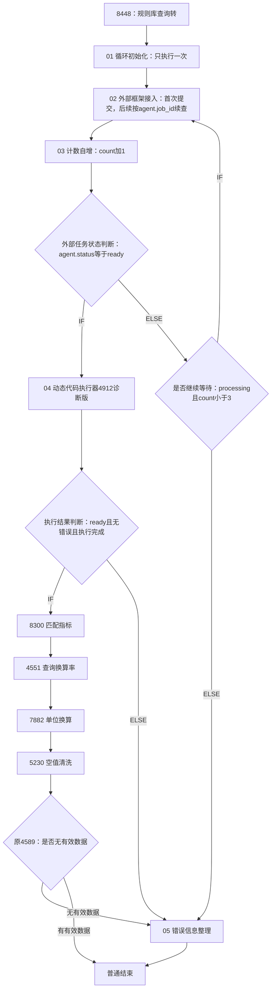

# V3 循环接入工作流节点配置手册

日期：2026-10-25。本版按用户要求简化：**只新增一个整型变量count，agent使用当前13个String子字段；01节点只初始化count。** 条件节点直接判断agent和count，不再增加中间字段、最终结果包装变量或新的agent子字段。

2026-10-26恢复确认：02接入节点整体读取agent作为输入并整体写回agent。首次空值时提交任务，后续回环直接使用agent.job_id续查；按本手册此配置执行。

完整脚本见 [循环接入方案目录](工作流节点代码/循环接入方案/README.md)。平台由用户亲自配置，本机代码与离线验证不能替代真实平台验收。

最新离线验证见 [实施与验证记录](V3循环接入实施与离线验证记录.md)。

## 1. 工作流连线



回边只回到02，不能经过01、2229、2442或8448。初始化只执行一次，后续循环继续查询相同job_id。原8300、4551、7882、5230和4589保留，05只处理错误出口，不再增加成功结果整理节点。

两个IF/ELSE节点完成ready、继续等待、错误三路分流。如果平台支持三个互斥出口，可合并前两个条件节点，分别配置ready、processing且count小于3、其余。

平台需支持节点回环和读取最新全局变量，先做短计数测试确认；若要求专用循环组件，就把02、03及状态判断放入该组件。多个互斥分支汇入05时，应是任一路到达即可执行，不能等待全部上游同时到达。

## 2. 变量配置

| 变量 | 类型 | 用途 |
|---|---|---|
| count | Integer/整型 | 本轮唯一新增变量；01写0，03每轮加1 |
| agent | 原Array<Object> | 当前13个String子字段，每次恰好一条对象，由02/04/05更新 |
| excel_data | 沿用现有类型 | 4912的ExcelData写入此变量 |
| out_data | 沿用现有类型 | 原后半链更新，05在错误时清空 |

fileMd5、pageTitle、title、fileType、publictime、GZK.GZKJG、unitArray沿用。最大轮数直接在条件节点填整数常量3，不另建最大轮数变量。

agent当前13个String字段：status、stage、job_id、PythonFile、PythonCode、code_sha256、artifact_version、cache_hit、quality_status、warning_summary、error_code、message、elapsed_seconds。

错误码和摘要分别复用agent.error_code、agent.message。平台执行结果也更新现有agent字段：平台阶段用platform_前缀，工作流阶段用workflow_前缀。这是工作流本次结果快照，不会修改服务端任务状态。

脚本按agent父数组整体映射，不同时写父变量和叶子。条件选择已有agent.status等子字段：平台显示单值String时使用“等于”；显示String数组时，按平台实际能力使用“包含元素ready”等精确元素判断，不用子串匹配。每次只有一条对象，无需新增中间路由变量。

以下引用采用现有前缀#template_config__0__，现场前缀不同则以变量选择器为准。

## 3. 节点01：循环初始化

代码：[01_循环初始化.py](工作流节点代码/循环接入方案/01_循环初始化.py)。新增Python3节点，入口main(params)，放在8448之后、02之前。超时120秒，异常重试0次。**无输入。**

| 返回键 | 写入全局变量 | 值 |
|---|---|---|
| count | count | 整数0 |

01只做计数初始化，不处理agent、excel_data、out_data或任何其他变量。代码如下，只配置count一项输出：

```python
def main(params):
    return {"count": 0}
```

不能放在回边中，否则count会被反复重置。02整体读取agent父变量作为输入；首次新工作流保持平台默认空值，脚本支持空值、空数组或13字段全空对象。02取得任务后写回真实agent，后续回环读取其中的job_id继续查询。01不负责初始化或清空agent。

## 4. 节点02：外部框架接入，循环版

代码：[02_外部框架接入_循环版.py](工作流节点代码/循环接入方案/02_外部框架接入_循环版.py)。替换现有接入节点。Python3，入口main(params)，超时120秒，异常重试0次；上游为01及回边，下游03。

只有02需要配置API_BASE_URL和API_TOKEN，保留现在已联通的地址及令牌，不把0.0.0.0作为调用地址。令牌不写入agent或输出。

| 输入参数 | 类型 | 引用 |
|---|---|---|
| fileMd5 | String | #template_config__0__fileMd5 |
| pageTitle | String | #template_config__0__pageTitle |
| title | String | #template_config__0__title |
| fileType | String | #template_config__0__fileType |
| publictime | String | #template_config__0__publictime |
| GZKJG | 沿用原类型 | #template_config__0__GZK.GZKJG |
| agent | Array<Object> | #template_config__0__agent，整个父变量 |

**输入整体读取agent，输出整体写回agent→全局agent。** 首次值为空时也保留此输入映射。02不映射count，不把控制字段加入POST正文，当前服务禁止额外业务请求字段。接入脚本只选取当前13字段，旧服务响应中的额外字段直接忽略，不要求平台保留旧字段；后台接口保留旧客户端兼容，不需要为此修改服务配置。

GZKJG支持对象数组或该数组的一层JSON字符串；没有有效规则名称时返回without_GZKJG，不联网。首次agent为空时POST /v3/excel/jobs取得job_id，随后GET查询；后续轮次从agent.job_id直接GET /v3/excel/jobs/{job_id}，不再重复POST。继续使用同一个任务，不重置截止时间或生成预算。每轮业务输入保持一致；count只决定是否继续循环，不是后台任务身份。

本轮最多主动等待105秒，ready或终态错误立即返回；窗口结束仍未完成就正常返回真实processing，不再抛DC_AGENT_RETRY组成等待。HTTP连接和读取超时受本轮剩余时间约束，单次服务端长轮询最多20秒。

配置、连接、HTTP、协议、入参或交付校验失败时返回agent诊断，不伪装成processing。首次POST连接中断、尚未取得job_id时，应说明受理状态不确定，不能认定后台没有任务。

现场若原已提供稳定workflow_run_id，可保留可选输入且每轮同值；本方案不要求新增该全局变量，也不使用count、时间戳或逐轮随机UUID替代它。

## 5. 节点03：计数自增

代码：[03_计数自增.py](工作流节点代码/循环接入方案/03_计数自增.py)。新增Python3节点，入口main(params)，超时120秒，异常重试0次。放在02之后、状态判断之前。

| 方向 | 参数或返回键 | 类型 | 映射 |
|---|---|---|---|
| 输入 | count | Integer | #template_config__0__count |
| 输出 | count | Integer | #template_config__0__count |

只做整数校验和count+1，不读取agent、不判断状态。count不能配置为字符串或布尔值。

## 6. 条件节点：外部任务状态判断、是否继续等待

| 节点 | IF条件 | IF去向 | ELSE去向 |
|---|---|---|---|
| 外部任务状态判断 | agent.status等于ready | 4912 | 是否继续等待 |
| 是否继续等待 | agent.status等于processing，**且**count小于整数常量3 | 回02 | 05 |

继续等待的两项条件使用AND，不能用OR。按平台叶子类型配置精确相等或精确元素判断；count用数值比较。

3是总轮数：processing时1→继续、2→继续、3→停止。第三轮ready仍优先进入4912。failed、review_required、invalid_input及未知状态直接进入05，不继续消耗等待轮数。

## 7. 节点4912：动态代码执行器，诊断版

代码：[04_动态代码执行器_4912_诊断版.py](工作流节点代码/循环接入方案/04_动态代码执行器_4912_诊断版.py)。替换4912代码，保留节点ID。Python3，入口main(params)，超时120秒，异常重试0次；下游执行结果判断。

| 输入参数 | 类型 | 引用 |
|---|---|---|
| agent | Array<Object> | #template_config__0__agent |
| fileMd5 | String | #template_config__0__fileMd5 |
| pageTitle | String | #template_config__0__pageTitle |
| title | String | #template_config__0__title |
| fileType | String | #template_config__0__fileType |
| publictime | String | #template_config__0__publictime |

| 返回键 | 类型 | 写入变量 |
|---|---|---|
| ExcelData | 沿用原类型 | excel_data |
| agent | Array<Object> | agent |

保留ready、版本、质量状态、文件名及源码SHA256校验，之后才编译、加载并真实调用解析器main。解析器只收到五个业务字段，不收到agent、GZK、计数或令牌，自身仍使用code/msg/ExcelData接口。

成功时agent.status仍为ready，stage为platform_execute_complete，error_code为空，message为平台执行成功摘要。失败时ExcelData为空，使用现有agent字段描述交付、编译、加载、运行或结果校验错误，stage使用platform_前缀。后台job状态不受影响。

保留四字段、有限数值、严格JSON校验，零值有效，空ExcelData不视为成功。不伪造名称、数据、单位或日期。独立执行命名空间不等于安全沙箱。

## 8. 条件节点：执行结果判断

使用三项AND条件：

1. agent.status等于ready。
2. agent.error_code为空字符串。
3. agent.stage等于platform_execute_complete。

IF接8300，ELSE接05。第三项明确4912确已完成，防止将刚交付代码的ready误当平台执行成功。全部使用已有agent字段。

## 9. 原后半链与4589

保留8300→4551→7882→5230→4589的顺序、原脚本与业务配置；不增加成功结果整理节点。单位不匹配仍交给4551/7882。

| 原节点 | 主要输入→变量 | 主要输出→变量 |
|---|---|---|
| 8300 | ExcelData→excel_data；GZKJG→GZK.GZKJG；publictime→publictime；其他原输入保留 | OUTDATA→out_data；unitArray→unitArray |
| 4551 | raw_unit→unitArray.indicator_unit；target_code→unitArray.KB_unit | 原raw_unit/target_code/convert_ratio映射保留 |
| 7882 | OUTDATA→out_data；unitArray→unitArray，注意大小写 | OUTDATA→out_data |
| 5230 | OUTDATA→out_data | OUTDATA→out_data |

原4589“无有效数据”分支补接05，“有有效数据”分支继续普通结束。以现场条件确认IF/ELSE对应含义，不仅按分支文字猜测；原无出边的空结果路径需要补齐。

原节点超时和重试不因新脚本重试0次而改变。已知原5230可能通过or空字符串把数字0当空，本轮未修改；若出现应定位后处理，不能让生成代码伪造数据规避。

## 10. 节点05：错误信息整理

代码：[05_错误信息整理.py](工作流节点代码/循环接入方案/05_错误信息整理.py)。新增Python3节点，入口main(params)，超时120秒，异常重试0次。**仅错误出口使用**，上游为状态/次数判断退出、4912失败、原4589无数据路径；下游普通结束。

| 输入参数 | 类型 | 引用 |
|---|---|---|
| agent | Array<Object> | #template_config__0__agent |
| count | Integer | #template_config__0__count |

| 返回键 | 类型 | 写入变量 |
|---|---|---|
| agent | Array<Object> | agent |
| out_data | 沿用原类型 | out_data，空数组 |

| 收到状态 | 整理结果 |
|---|---|
| failed/review_required/invalid_input | 保留原错误码、阶段及摘要，不用“未就绪”覆盖根因 |
| processing | 代表次数用尽；failed、workflow_wait、WORKFLOW_WAIT_TIMEOUT，message注明外部最后观测仍processing、已完成轮数及job_id |
| ready | 此处来自4589无数据出口；后处理诊断，stage为workflow_postprocess、错误码OUT_DATA_EMPTY，说明解析执行完成但后续无有效输出 |
| 未知或不合法状态 | 可读协议诊断，不循环 |

错误摘要和排查位置都复用agent.message，没有新子字段。错误时清空out_data，不能塞入伪造错误指标，也不能携带旧成功数据。05正常返回表示诊断已提交，agent仍体现业务失败或需审查。

## 11. 普通结束与查看错误

成功由4589直接结束，错误由05结束。若结束节点可选返回字段，选择现有out_data、agent；直接查看agent.status/stage/error_code/message，以job_id关联本机服务日志。不增加最终JSON包装变量。

agent原本含PythonCode，若界面支持选择子字段，可只展示需要的诊断子字段以避免冗长代码，不为此再建一套变量。

框架原报告仍保存在本机agent/runtime/tasks/<内部task_id>/quality_report.md及相邻文件，平台不配置报告引用字段。job_id与内部task_id不同，不能直接代入tasks目录。平台执行或后处理错误不会自动写入后台报告，具体位置直接记录在agent.message，不声称已保存文件。

已有服务端错误透传补丁需重启本机服务加载，地址和令牌不变；实际错误阶段和脱敏摘要优先返回，例如MODEL_STREAM_ERROR对应build_design。04/05的工作流局部更新不覆盖后台状态。

## 12. 延长等待时间

条件常量3，每轮最多105秒，主动等待约315秒，平台开销另计。当前配合后台360秒总时限、300秒生成预算；不能写成精确360秒。

以后只改继续等待条件的整数常量并同步后台预算。例如改为小于7，并在agent/runtime/service/service.env调整以下预算后重启：

```dotenv
DC_API_JOB_TIMEOUT=720
DC_API_GENERATION_TIMEOUT=660
DC_TASK_TIMEOUT=720
```

这是示例，不代表实际配置已改。预算从首次受理起计算，查询不重置时限。服务先结束就保留原错误码，工作流先用完轮数就WORKFLOW_WAIT_TIMEOUT；已失败任务不会复活。相同输入在900秒幂等窗口内可能取得旧任务，测试时核对job_id，不逐轮生成新身份。

## 13. 配置与验证顺序

1. 只新增整型count。如果已按上一版创建额外变量，先解除相关映射和条件引用，本方案不再使用。
2. 无网络短测试验证回环：0→1回到同一脚本，再读取1→2退出，确认最新全局值可见。
3. 01无输入，仅配置count一项输出，只在循环外执行；不要给01配置其他变量映射。
4. 02保留已联通URL及令牌，输入与输出均整体映射agent父变量；03只映射count。配置状态判断和整数常量3。
5. 04输出ExcelData及agent；执行结果判断使用三项AND条件。
6. 保留原后半链，4589无数据出口接05；05输入agent/count，输出agent/out_data，再接普通结束。
7. 真实测试首轮ready、相同job_id多轮processing、最后一轮ready、轮数用尽、外部失败、空GZK、4912异常及最终out_data空。
8. 连续成功后再失败，确认旧out_data被清空，错误仍有具体原因。

硬超时、进程强制终止及结束节点不可用时Python无法保证输出，需要平台异常路径或日志；原业务节点自身抛错也不会自动被05捕获，本轮不修改这些原节点的执行逻辑。

离线验证使用受控HTTP、虚拟时间及真实执行的测试代码，不调用DC或真实模型。平台回环、叶子条件能力和实际全流程仍由用户亲测，证据见 [实施与离线验证记录](V3循环接入实施与离线验证记录.md)。
