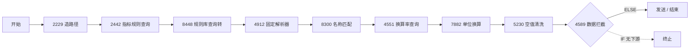
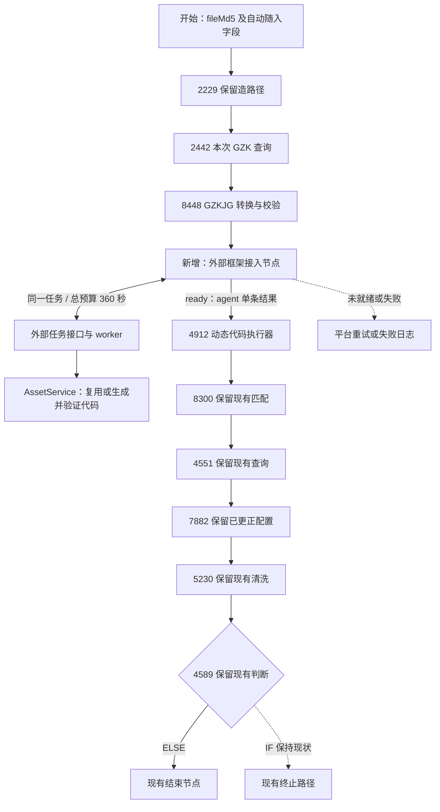

# V3：外部智能体框架接入测试工作流的设计思路

日期：2026-10-20（北京时间）。状态：本设计已按用户授权实施为 0.3.0，用户随后确认真实工作流整体测试通过。本文保留设计依据；向他人介绍优先阅读 [整体技术说明](V3整体流程与技术实现说明.md)，实际模块、启动命令和验证边界以 [本机指南](V3本机启动与联调指南.md) 及 [实施记录](V3实施与验证记录.md) 为准。

框架基线：`dc_workflow/agent`，版本 0.2.2。目标工作流：`excel-Agent-test1020`，ID `2112366700040351745`，本地资料位于 `excel-Agent-test1020_docs/`。

本方案的核心是：**工作流把本次文件及规则上下文交给外部框架，外部框架返回经过验证的固定版本代码，4912 在平台中实际运行该代码，再沿现有匹配、单位换算和清洗链输出结果。** 用户的日常操作保持为传入 `fileMd5`、指定 `pageTitle` 并触发一次工作流。

用户本轮要求优先于旧交接文档中“第三版待启动、通信后置”的阶段描述：现在正式进入 V3 接入设计；本轮仍只形成思路，不开始编码、部署或修改平台。

本次用户确认的约束优先于下文历史快照：2229 保持“造路径”职责，不承担入参整理或请求 ID 初始化；fileMd5 由用户在测试入口传入，title 等字段随文件自动传入；2442、8448 继续提供本次 GZK；4912 改为动态执行器；7882 的输入名已由用户更正为 unitArray，后半链本轮保持现状。等待暂按用户指定的 **360 秒总预算**设计，不新增多段等待节点或要求修改为 900 秒。

用户最新选择一个名为 agent 的主变量及子字段，仿照 out_data 配置。当前详细清单以 [agent 变量与节点配置手册](agent变量与节点配置手册.md) 为准；此前 agent_result 和多个顶层代码字段的方案已替换。

## 1. 阶段目标与成功口径

需要完成以下闭环：

1. 用户向测试工作流提供本次真实文件的 `fileMd5` 和准确的栏目路径 `pageTitle`。
2. 工作流按该路径查询本次 `GZK`，转换为 `GZKJG`，把有效上下文提交给外部框架。
3. 外部框架按 `pageTitle + fileType` 精确复用代码；没有代码或显式重建时，检查实际文件、读取任务与参考资料、生成代码、实际验证、有限修正并保存版本。
4. 工作流自动获得完整代码正文及其版本、SHA256，交给平台执行节点。
5. 平台执行代码，产出 `ExcelData`，完成规则匹配、必要的单位换算与清洗。
6. 用户亲自检查本次平台输出，确认名称、数值、单位、统计截止日期正确。

必须区分“外部任务 ready”“平台代码执行成功”“最终业务结果正确”。HTTP 200、返回代码、非空结果或固定条数，均不能单独代表 V3 成功。验收至少覆盖一次真实新生成和一次资产复用；只验证已有缓存不能证明生成接入已完成。

本阶段首先打通当前 Excel 测试链路。既有 XLS/CSV 能力可以沿用，但不据此宣称它们已通过平台验收；HTML、Markdown、Skills/Tools 注册、批量调度、生产总工作流改造及入库不自动纳入本轮。

## 2. 阅读范围与证据边界

已完整阅读测试包的 README、说明文档 01—07 及连线附录，阅读 6 份节点脚本原文、rule206 SQL 模板，并对照逐节点原始 JSON 和画布截图。两套导出脚本副本的 bytes 已核对一致。

同时核对了框架的 V2 交接、运行说明、候选保留策略、项目记忆，以及 `Task`、`Result`、`AssetService`、`Repository`、`ArtifactStore`、下载器、规则读取器、CLI 和候选执行器等相关实现。

主要依据：

| 资料 | 用途 |
|---|---|
| [测试包 README](excel-Agent-test1020_docs/README.md)及[节点清单](excel-Agent-test1020_docs/工作流说明文档/02_流程编排与节点清单.md) | 工作流身份、节点、连线、超时与重试 |
| [字段说明](excel-Agent-test1020_docs/工作流说明文档/03_数据模型与字段.md)、[脚本详解](excel-Agent-test1020_docs/工作流说明文档/04_节点详解_脚本节点.md) | 脚本接口与全局字段映射 |
| [脚本原文目录](excel-Agent-test1020_docs/工作流脚本原文/)及[原始节点目录](excel-Agent-test1020_docs/_raw/nodes/) | 以实际配置核对说明中的概括 |
| [rule206 SQL](excel-Agent-test1020_docs/外部规则与资产/rule_206_SQL模板.md) | 指标库与单位转换查询 |
| [V2 交接](../docs/V2阶段总结与V3交接.md)、[候选保留与报告](../docs/V2候选保留与质量报告.md) | 已有能力、质量状态和历史验收边界 |
| [领域契约](../src/dc_agent/domain/__init__.py)、[应用服务](../src/dc_agent/application/service.py)、[资产库](../src/dc_agent/assets/store.py) | 可以直接复用的内部接口 |
| [项目记忆](../../PROJECT_MEMORY.md) | 用户此前倾向同步等待、真实源优先及职责分工 |

本轮是对本地快照的静态分析，没有访问在线工作流、探测网络、重新生成代码或重跑业务文件。说明中的历史调试结果不是本次运行结果；源表具体拆解与日期可用性，仍需实施时检查实际文件。以下新增节点、字段及 HTTP 路径均为拟议设计，不是平台或框架已存在的能力。

## 3. 对现有工作流的具体理解

### 3.1 当前编排

画布为 11 节点、10 连线，另有不在画布上的虚拟模板配置节点。当前没有 Agent、大模型、人工标注、文件类型分流或分支汇合。应用为手动运行，快照中的 `tableName=null`，不能把结束节点名称“发送”解释为已验证入库。

### 3.2 导出快照中的逐节点配置与处理职责

下表记录原文档快照，超时/重试和 2229、7882 的描述不覆盖用户本次确认的实际运行方式与更正。

| 节点 | 当前输入与输出 | 处理细节 | 超时 / 重试 |
|---|---|---|---|
| start | 声明 18 个采集字段，包括 `fileMd5/pageTitle/title/fileType/publictime` | 无高级配置，无外部工作流依赖；全局模板有 22 个字段 | 不适用 |
| 2229 `造路径` | 没有有效业务输入；输出 `pageTitle/title` | 写死上街区路径和“2026年2月份经济月报*地方经济”，会覆盖运行时对应字段 | 120 秒 / 0 |
| 2442 `预标注-指标代码单位` | `pageTitle` → `GZK.ZBDM/ZBMC/ZBDW/indicator_release_frequency` | rule206，节点旧组号 7167；地方经济组按路径精确查询，SQL 上限 5000 | 规则节点未配置脚本超时 |
| 8448 `预标注_规则库查询转` | `GZK` → `GZK.GZKJG` | 按最长列长度组合，短列补空；规则名、代码、单位、比例、频率进入对象数组 | 120 秒 / 1 |
| 4912 `预标注_表格解析` | `fileMd5/title` → `ExcelData` → 全局 `excel_data` | 下载源文件，openpyxl 打开“主要经济指标”；固定 4 个行块及列映射；日期从运行时标题的唯一年月取月末 | 120 秒 / 0 |
| 8300 `预标注_表格数据匹配` | `ExcelData/GZKJG/PLPL/publictime` → `OUTDATA/unitArray` | 源名与规则名去首尾空白后精确相等；每条取首个命中规则；未匹配源记录保留于 `excel_data`，不进入 `out_data` | 120 秒 / 0 |
| 4551 `预标注_转换率查询` | 两侧单位集合 → 查询结果列 | rule206，节点旧组号 3549；查询 `raw_unit IN (...) AND target_code IN (...)` | 规则节点未配置脚本超时 |
| 7882 `指标单位清洗` | `OUTDATA` 和单位查询结果 → `OUTDATA` | 按单位对查比例，用 Decimal 相乘；查不到比例默认 1，非法数值当前会默认 0 | 120 秒 / 0 |
| 5230 `内审_数据为空清洗` | `OUTDATA` → `OUTDATA` | 删除代码、数值或日期缺失的记录；全部为空时制造 `empty` 占位 | 120 秒 / 0 |
| 4589 `发放_数据拦截` | 读取全局 `out_data` | IF 的三个条件用 AND；IF 无下游，ELSE 接 end | 不适用 |
| end `发送` | 输出上下文 | 保存过历史调试快照；该快照不证明后续运行结果 | 不适用 |

4912 当前返回 `code/msg/ExcelData`，还提供 `_dc_validate(params)`，用于在验证模式返回每条记录的名称、数据、单位和日期来源引用。这个证据入口适合外部框架的本地验证，正式平台执行仍应调用 `main(params)`。

### 3.3 必须保持的映射

| 脚本参数 / 返回键 | 工作流全局位置 | 说明 |
|---|---|---|
| 8448 返回 `GZKJG` | `GZK.GZKJG` | 原始配置声明为 String，但脚本实际返回数组 |
| 4912 返回 `ExcelData` | `excel_data` | 后续 8300 的入参名仍为 `ExcelData` |
| 8300 返回 `OUTDATA` | `out_data` | 7882、5230 沿用 `OUTDATA` 参数名 |
| 8300 返回 `unitArray` | `unitArray` | 脚本实际为字典内的平行数组；全局声明为 `Array<Object>` |
| 4551 返回 `raw_unit` | `unitArray.indicator_unit` | 原始 JSON 中的真实映射，不应另读不存在的结果列 |
| 4551 返回 `target_code` | `unitArray.KB_unit` | 与查询返回的 `convert_ratio` 同行绑定 |

平台按节点的 `fieldName` 组装参数，大小写需要逐项核对。不能只看全局字段名相同，就认定脚本会读到值。

### 3.4 用户反馈后的判断

1. **7882 参数名更正已完成。** 用户已将 `unitarray` 改成 `unitArray`；旧快照中的差异仅保留溯源，不再列为待修任务，本轮不重复修改。
2. **title 自动随文件传入已确认。** 接入节点使用工作流中本次实际传入的 title，不再把“另建 MD5 到标题元数据服务”作为前提。旧 2229 快照曾含固定 title，不能据此否定用户确认；实施时只核对实际字段流转，不主动重构 2229。
3. **GZKJG 的实际类型在新接入边界处理。** 保留 2442、8448 的既有职责，接入节点按实际收到的数组或 JSON 字符串做一次明确解码与校验，不先改动这两个节点。
4. **后半链保持现状。** 4589 的 AND 语义、非法值默认值、零值及单位对等旧静态观察，降为真实联调时的观察项。只有本次真实输入与日志证明它们影响结果时，再单独定位，不预先纳入接入改造。

原说明文档 07 建议的模糊匹配、同义词替换、自动去重等仍不符合项目约定，本方案不采用。

## 4. 两字段输入如何形成完整任务

用户在测试入口传入 fileMd5，2229 继续提供测试用 pageTitle；用户已确认 title 等字段自动进入工作流。新接入节点读取这些现成字段和 8448 的 GZKJG，构造内部 Task，不要求用户额外手填标题、请求 ID 或外部任务 ID。

| 内部字段 | 自动来源与约束 |
|---|---|
| `pageTitle` | 2229 继续造出的测试栏目路径；用于规则查询、todo 精确匹配和资产身份，不按相似路径替换 |
| `fileMd5` | 用户本次提供；从既有下载服务获取真实 bytes，不引入人工选文件接口 |
| `GZKJG` | 本次运行的 2442 → 8448；过滤无效规则名，至少有一个有效名称才进入框架 |
| `fileType` | 优先读取工作流随文件带入的实际类型；缺失才在接口边界识别，并与真实 bytes 核对 |
| `title` | 随 fileMd5 自动传入的本次文章标题，原样传给框架和 4912，不写死或用 pageTitle 代替 |
| `filename` | 若平台已经提供则透传；没有则保持可选，不为首版接入新增元数据查询模块 |
| `publictime` | 使用平台实际带入的字段；没有则为空，不作为统计期替代值 |
| `request_id` | 优先使用平台真实运行标识；没有时按稳定业务输入计算请求指纹，由服务端绑定任务，详见专门节点设计 |
| 任务与参考 | 程序精确读取 `rule/todo.xlsx` 的任务行，按 C 列路径代码定位可选参考 Sheet |

### 4.1 类型识别

工作流已有 fileType 时先使用并按现有契约规范化；缺失时才增加 Task 构造前的类型识别。真实 bytes 校验沿用 gzip 包装、XLS/OLE 特征、XLSX ZIP 工作簿结构等检查；CSV 需要明确文本与表格证据，未知格式不能自动归为 CSV 或 Markdown。

V3 接口可以在下载前先做自身的 todo 唯一性校验，保持无任务或重复任务时不进入下载和模型调用；其结果及参考快照应传递给实际生成过程，避免校验后又读取成另一份任务。该 API 入站检查与 V2 CLI 的“缓存先行”是不同入口行为，不能暗中改变原 CLI 缓存语义。

确实需要识别类型而下载的 bytes 由本次上下文持有，生成继续使用同一份 bytes。正常已带入 fileType/title 的缓存路径保持轻量，不为了获得已有字段额外下载或调用模型。

### 4.2 日期直接使用本次自动传入的上下文

日期处理按每条数据绑定：先看真实表内标题、表头、行期间和对应数据列，再使用规则明确允许的当前文件元数据。月、季、半年和年度分别取期末，不用编制、下载或运行时间补统计期。

用户已确认 title 等字段随文件自动传入，外部框架和平台正式执行都使用同一个本次 title。生成代码仍依据实际源表和已核对规则决定统计期取值，不能把任何标题中的数字都默认解释为统计期间。

本轮不新增文章元数据 API，也不因旧快照缺少查询接口而阻塞设计。只有实际运行出现字段缺失、错误覆盖或无法确定统计期时，才记录具体输入与来源进行诊断；不补猜日期，也不要求用户每次额外填一个外部框架专用标题。

## 5. 推荐的接入架构

保留外部资产生产与平台正式执行的分工。外部框架已有本地真实 bytes 验证，它不是平台执行的替代品；不直接把外部验证结果写进 `excel_data` 代替运行代码。

首版只新增一个外部接入脚本节点，改造 4912，并新增必要模板变量。其余节点保持现状。接入或执行异常通过平台原有重试/失败机制和外部任务报告追踪；不为本轮预先增加后半链判断、清洗或错误分支。新节点 ID 由平台生成。

## 6. 超时与等待：按 360 秒总预算设计

按用户指定，首版以 360 秒作为这次接入等待的总预算，使用平台现有 120 秒时限及重试能力；不新增等待节点，不调整为 900 秒。这里是设计预算，不将“120 秒 + 3 次重试”误写成一条可连续等待 360 秒的 HTTP 连接；“3 次”是否包含首次以平台实际计数为准，本方案仍保守按 360 秒控制。

### 6.1 一次尝试与总预算分开

每次节点尝试最多 120 秒，实际脚本按约 115 秒主动等待，留约 5 秒收尾。按三次尝试约 345 秒估算，360 秒为后端硬上限，不保证平台等待满 360 秒。第一次创建任务后，外部 worker 持续运行；下一次节点重试查询原任务，不能重新开始生成。有限长轮询最多 20 秒，具体请求等待参数小于本次节点剩余时间。

建议 V3 远程生成预算先设约 300 秒，给排队、传输、资产发布、取回代码和平台重试衔接预留约 60 秒；这是可校准的首版参数。已有本地 CLI 的 600 秒默认预算不在本轮文档阶段修改，实际服务接入时按单任务配置覆盖，并统一使用从首次受理起算的绝对截止时间。重试不能重置预算。

### 6.2 未完成状态如何触发重试

接入节点收到 processing 时继续有限等待；接近本次时限仍未就绪，应通过平台能够识别的可重试失败信号结束本次尝试，下一次提交相同业务请求取得原 job。需要用受控延迟任务验证“抛异常/返回码/节点超时”中哪种信号确实触发平台配置的重试，不能默认返回非零 code 就一定重试。

节点被杀前尚未写回的输出不能当成持久状态。因此任务身份和第一次受理时间保存在服务端；不能仅依赖尚未输出的 agent.job_id。最终只有 ready 才写回代码并进入 4912；即使平台将异常处理为普通返回，4912 也必须检查 agent 中唯一记录的 status，拒绝非 ready。

### 6.3 超时后的结果

外部服务在本次绝对预算内尽量形成终态：已有基本可用候选时沿用 V2 的择优保留和质量标记；没有可用代码时明确失败并保留报告，不能把半截代码交给平台。平台窗口耗尽但外部仍在运行时，两者状态分别记录，不宣布成功。

首轮记录各阶段耗时、重试次数、是否复用同一个 job 和最终状态。如果后续大量超时，再讨论扩大时限、拆分等待或恢复机制；本轮不提前优化为多节点等待架构，也不承诺所有现有 600 秒生成任务都能在 360 秒内完成。

## 7. 外部接口与任务生命周期

### 7.1 拟新增的 HTTP 边界

以下路径由实施时新增，不是 DC 平台既有 API。

| 接口 | 作用 | 结果约束 |
|---|---|---|
| `POST /v3/excel/jobs` | 校验请求、持久化并提交任务，尽快返回 | 返回 `job_id`；同 ID 同输入返回原任务，输入冲突明确拒绝 |
| `GET /v3/excel/jobs/{job_id}` | 查询阶段、终态、错误和结果元数据 | 查询本身不触发生成；可加有上限的等待参数，ready 时可一并返回固定正文 |
| `GET /v3/excel/jobs/{job_id}/artifact` | 可选的独立正文接口 | 仅 ready 可取；返回固定版本、hash、PythonFile、PythonCode；首版可由状态接口一并返回，减少往返 |
| `GET /v3/excel/jobs/{job_id}/reports/{report_name}` | 获取允许的质量报告 | 报告名受白名单约束，不按任意本地路径读文件 |
| 健康检查接口 | 验证服务存活与必要配置 | 不读业务文件、不调用模型，不以健康检查代表模型和平台都已通过 |

工作流发出的业务请求包含本次 `fileMd5/pageTitle/GZKJG`、随文件进入的 `fileType/title/publictime` 及稳定幂等键。原始 `GZKJG` 应是 JSON 数组；若平台给出 JSON 字符串，则仅在边界解码一次并校验。幂等键不要求 2229 产生，详见第 7.3 节。

网络入口不接受 `source_path/reference_paths`、任意代码正文、任意下载基址或本地命令等 CLI 开发参数。服务端自行装配既有下载、参考、模型和执行器配置。凭据留在服务端和平台受控配置中，不进入生成代码或业务输出。接入节点只将手册选定的 14 个字段投影到 agent，不透传完整响应。

### 7.2 服务端如何复用现有能力

HTTP 入口和任务 worker 包装现有 `AssetService`，不另写一套生成流程，也不通过 shell 拼接 CLI 命令。

建议首版为一个部署实例、一个生成 worker，复用现有 SQLite、文件资产与租约。HTTP 接收提交和查询，worker 独立执行耗时任务；请求断开不影响 worker。新增集成任务表保存排队、原始请求摘要、已解析任务、关联框架任务 ID 和结果引用。

提交应先落库再返回，不能只启动一个无法追踪的后台线程。重启时识别未完成任务，核实 worker 与租约状态；首版可以明确标为中断后支持受控恢复，不宣称已经具备任意阶段自动恢复或 exactly-once。

当前 `Result.status=processing` 不等于已有可自动查询到完成结果的后台作业：`AssetService.run()` 本身是同步入口，租约竞争时还可能只返回 processing。V3 必须补真实队列、状态驱动和等待关系，不能只把现有返回结构包成 HTTP 就算完成。

### 7.3 请求、资产与并发分别管理

- 优先使用平台已经提供的稳定工作流运行 ID 作为 request_id，不改造 2229。`rid` 未被证明是工作流运行 ID，不能直接代用。
- 若没有可读的运行 ID，接入节点对固定工作流身份和本次 fileMd5、原始 pageTitle、fileType、title、publictime、GZKJG 等规范序列化输入计算请求指纹。服务端以该指纹在本次有效期内创建或取得同一个 job；重试不使用新 UUID、当前时间或每次变化的字段。
- 请求指纹只代表相同业务输入，不能声称它能区分两次完全相同的手工测试。没有运行 ID 时，相同输入在有效期内按同一任务处理；正常成功可返回同一代码，过期后的新任务仍按资产缓存复用。失败任务的重试/重建需要明确生命周期，不能永久缓存失败，也不能每次重复请求都立即重开。
- `job_id` 标识 V3 接口持久任务；框架 `task_id` 在内部 Task 建立后关联，二者不要混同。
- `pageTitle + fileType` 继续是资产复用键；不能改成按 MD5 或标题模糊搜索。
- 同显式 `request_id` 的业务输入不同应报 `IDEMPOTENCY_CONFLICT`。类型和上下文首次确定后持久化，重试不重新拼出不同 Task 导致幂等冲突。输入指纹已包含实际输入变化，不与显式 ID 冲突语义混同。
- 不同请求对同一资产键并发生成时串行处理。只有完整业务输入确实一致时才可关联同一运行任务；不同文件可以等待代码生成后复用代码，但正式执行仍读取各自文件。
- `processing` 任务必须最终被唤起、复用生成结果或进入明确失败状态，不能因第一次未取得租约就永久悬挂。

### 7.4 返回固定代码版本

现有 `Result.artifact` 主要返回文件与报告路径，并不直接返回代码正文。V3 需要增加服务端的资产读取与输出装配：

1. 从该任务已经选定的资产元数据取得版本及 `content_hash`。
2. 使用 `ArtifactStore` 的路径边界和 hash 校验机制，读取不可变 `version_path`，不临时再取“当前最新版”。
3. 返回纯源码字符串 `PythonCode`，不附 Markdown 围栏或模型解释；`PythonFile` 使用已登记业务文件名。
4. 平台按 UTF-8 原文重算 SHA256，核对路径身份、fileType、版本、产物契约 `main-ExcelData-v1` 后再执行。
5. 拒绝空正文、截断、版本/hash 不一致或资产身份不符；不会改读另一个同名文件兜底。

Windows 本地文件路径对平台执行容器没有意义，不能只返回 `D:\...\parser.py` 让平台直接打开。即使同源的当前资产在稍后被重建，本次工作流也应执行之前绑定的同一版本。

代码版本 hash 与源文件 hash 分别记录。缓存资产报告中的 `source_sha256` 是其历史验证源，不能当成本次 MD5 下载到的文件 hash，也不能据此宣布本次文件已在外部重新验证。

## 8. 工作流节点具体怎么改

### 8.1 start、2229：保留现有职责

fileMd5 由用户在平台测试入口亲自传入，title 等上下文随文件自动传入。2229 继续为测试造 pageTitle，不改为入参整理节点，不在此处初始化请求 ID、清洗结果或增加外部框架逻辑。

新增接入节点读取现有全局字段，执行自身必要的入参校验。成功返回时写入本次的代码和结果变量；失败不得让 4912 使用旧调试代码。原快照中 2229 曾写固定 title，后续仅核对实际运行是否仍存在该覆盖，不按旧快照自行重写用户节点。

### 8.2 2442、8448：提供本次真实 GZK

2442 保留地方经济查询组和 pageTitle 精确查询，先不修改 SQL 或误将旧组号替换成文档里的雪花 ID。返回为空时先定位路径、规则路由或规则覆盖，不为此修改正确的解析器。

8448 保留列式转行式职责和现有映射，本轮不增加字段或重写。新接入节点检查实际收到的 GZKJG，必要时解码一次 JSON 字符串，并按框架 Task 契约校验有效规则名和代码。运行值不符时报告具体输入，不修改相邻元素补值。

### 8.3 新增接入节点：请求、等待和结果解包

放在 8448 后、4912 前，首版新增一个 Python3 脚本节点，暂称“外部框架接入”。输入为现有 fileMd5、pageTitle、fileType、title、publictime、GZKJG 及平台已提供的可选运行标识。

节点负责构造稳定请求、创建或取得外部任务、按本次剩余时间等待、在平台重试后继续取得原任务、校验 ready 结果，并整体写回父变量 agent：其中的唯一对象含 status、PythonCode、PythonFile、版本/hash、质量与错误等 14 个字段。完整配置见 [agent 变量与节点配置手册](agent变量与节点配置手册.md)。

它不承担表格解析，不调用模型生成自身，不把外部验证数据伪装成平台执行结果。只有 ready 且代码身份和正文检查通过才进入 4912；失败、review_required、invalid_input 或 processing 不继续执行。

### 8.4 4912：改成平台动态执行器

将现有上街区专用解析器从节点职责中移出，保留在原快照作为历史基线；运行时代码来自外部框架。可以参考生产工作流的[通用 Excel 执行器](../../workflow/工作流脚本原文/09_excel_python_执行_4912.py)，但不能照搬后就声称已经适配。

新的输入包括整个 agent 父变量、fileMd5/title，以及当前 fileType、publictime、pageTitle 等现有字段。包装器严格检查 agent 为长度 1 的数组，从唯一对象读取 status、PythonFile、PythonCode、artifact_version 和 code_sha256，无须再建顶层代码变量。执行前验证 ready、非空正文、hash 和版本；契约在接入边界检查为 main-ExcelData-v1。在独立字典作为 globals/locals 的命名空间中编译和加载，确认 main 可调用，再传入当前文件参数执行。

代码命名空间与包装器隔离，避免覆盖包装器 `main` 或平台日志依赖的 `datetime` 等全局绑定；隔离字典不是安全沙箱，不把这两件事混为一谈。平台脚本保持轻量，不在平台里安装 LangGraph 或整个外部框架。

只把受信的解析参数传给目标 `main`，不透传服务令牌、PythonCode、内部状态和任意本地路径。若正式允许 filename，则与本地 `Task.parser_params()` 和生成契约一并维护。

执行后检查：返回字典、`code=0`、`ExcelData` 是有效数组、记录含四核心字段、严格 JSON 可序列化且无 NaN/Infinity。数值不强制转 float，不四舍五入；零值有效，单位缺失使用 `-`，无可靠日期保持空并诊断。

成功仍映射 `ExcelData → excel_data`，不改变后续 8300 的入参接口。失败由 4912 的包装器按平台可识别的执行失败机制终止并保留具体原因，不能只返回一个可能被忽略的非零 code 后继续下游；首版不为此修改整个后半链。

### 8.5 8300：保留现有匹配

本轮不修改 8300 的名称匹配逻辑、字段或单位集合。4912 保持 ExcelData 接口后直接接回此节点。框架生成的 Python 仍先保留真实源记录，GZK 用于设计审查和平台下游匹配，不能反向造名、造值或在生产解析器中建立白名单。

真实测试若发生 excel_data 非空、out_data 为空，再按源表、当前 GZK 与名称精确比较定位；不以接入为由预先增加模糊匹配、标准化或去重。

### 8.6 4551、7882：保留查询与已更正配置

用户确认后半链基本正确，并已更正 unitArray 参数名。本轮保留 4551 查询、7882 换算代码及既有字段语义，不再安排一次相同的命名修复，也不改变最终单位字段口径。真实结果核对仍需关注原值、单位对和比例，有具体差异再定位。

### 8.7 5230、4589、end：保持原链路

本轮不改 5230 的清洗、占位、4589 的判断和现有终止路径，不新增 valid_data_count 或重构成功/失败分支。接入状态与质量信息写入 agent 子字段，供平台调试和输出查看；业务结果仍由现有后半链产生。

接入和执行阶段要自行阻止未就绪或失败代码进入下游。若后半链真实测试异常，先保留当次源 bytes、代码版本、GZK、excel_data、out_data 和平台日志，再讨论具体修复，不把旧静态观察自动当作当前故障。

## 9. 拟新增字段及平台映射

只新增 agent 一个父变量，按 out_data 的已有方式配置为 Array<Object>；每次单文件测试写入一条对象结果，子字段全部 String。

| 子字段 | 用途 |
|---|---|
| status、stage、job_id | 接入状态、阶段及对外持久任务编号 |
| PythonFile、PythonCode | 已登记文件名及完整代码正文 |
| code_sha256、artifact_version | 校验正文和追踪固定版本 |
| cache_hit、quality_status、warning_summary | 是否复用、当前质量与未解决问题摘要 |
| error_code、message、report_ref、elapsed_seconds | 失败定位、完整报告与累计耗时 |

不再建立 agent_result、agent_status 或顶层 PythonFile/PythonCode。接入节点整体输出 agent，4912 整体读取 agent，避免叶子字段引用产生单元素数组后被当成源码字符串。业务结果仍是 ExcelData → excel_data；后半链 OUTDATA → out_data 不变。

失败过程中尚未写回的变量不能承担跨重试持久化，外部服务仍是任务状态来源。父变量形态、所有 14 个子字段及完整节点映射见 [配置手册](agent变量与节点配置手册.md)。

## 10. 外部框架需要改哪些位置

以下是设计期计划范围；实际文件已创建，最终职责和路径以 [实施记录](V3实施与验证记录.md) 为准。

| 位置 | 计划改动 | 目的 |
|---|---|---|
| `entrypoints` 新增 HTTP 入口 | 请求/响应转换、鉴权、提交、状态、正文及报告接口 | CLI 与网络入口共用应用服务 |
| `application` 新增集成任务服务 | 上下文解析、任务持久化、排队、worker 调度和等待关系 | HTTP 断开不丢任务，轮询不重新生成 |
| 服务装配 | 将 CLI 的构造逻辑提到可复用装配位置 | HTTP 层不依赖命令行 argparse 或复制配置逻辑 |
| `domain` 的 API 契约 | 外层允许待解析 fileType；内层 `Task` 仍严格校验 | 两字段入口与已有内部契约兼容 |
| `infrastructure/source.py` 的必要适配 | 沿用下载并复用 bytes；实际缺 fileType 时才补识别 | 不重复查询已由平台提供的 title 等字段 |
| `references/workbooks.py` | 必要时拆出按 pageTitle 查询任务的可复用方法，传递同次快照 | 支持 Task 构造前校验，不写死 Sheet 或行号 |
| `infrastructure/storage.py` 或独立 Repository | 增加集成任务状态、输入摘要及框架任务关联 | 先受理、后执行，支持幂等与可追踪等待 |
| `assets/store.py` 的读取边界 | 按选定版本安全读取并返回正文 | 不向平台暴露服务器文件路径，不读串版本 |
| `application/service.py` 的调用适配 | 沿用资产查找与生成；必要时接入预解析上下文 | 不另写候选、审查和发布链路 |
| `Task.parser_params`、生成/验证契约 | 原有 fileMd5/title/publictime 接口继续使用，确有需要再扩展 | 本地与平台读取同一次输入 |
| 配置与运行说明 | 服务监听、可达地址、令牌、360 秒远程总预算、并发及报告访问 | 远程任务单独限时，不擅自覆盖本地配置及密钥 |
| `tests` | 增加有针对性的接口与桥接回归 | 重点验证幂等、状态、正文和参数映射 |

LangGraph 编排、模型传输、候选保留、有限修复、严格源值检查、资产目录与发布租约继续复用。除实际联调证明有问题外，不把本次接入扩成重写整个框架。平台节点脚本的后续草案、配置映射和联调证据可放在本 V3 目录；框架正式实现仍进入既有 `src/dc_agent`。

## 11. 质量策略与失败归因

V2 允许机械校验通过、仍有模型语义问题的 Python 资产以 usable_with_warnings 保留。接入时保留该约定，不暗中升级成“有 warning 就禁止返回代码”。平台接收 agent.quality_status、warning_summary 和 report_ref；完整 semantic_status、selection 及各轮报告留在服务端，用户可按 job_id 和报告引用回查。

2026-10-20 的交接快照中，上街区当前指针记录为版本 `ee451d7c-e1ac-441d-86ef-eddc0de80645`、任务 `33b26313-5733-45a7-a344-f041804a7005`，保留 candidate-0 的 67 条，质量为 `usable_with_warnings`；报告仍有销售额口径、NFKC 和证据引用问题。实现前需重新核对指针；历史 `a02241d6` 的用户平台通过结论不能套用到这个版本。

带告警代码可以验证通信与平台执行，但有实际错误的记录不能因链路跑通就记为业务验收通过。也不要求为了 V3 宣称“逐格提全”；完整性沿用有限改进策略，实际输出的每条记录仍须正确。

| 现象 | 优先检查 | 不应采取的处理 |
|---|---|---|
| 服务不可达 / 超时 | 执行容器到服务的路由、地址、进程、请求 ID | 不归因为解析器没提取数据 |
| GZK 为空 | 本次 pageTitle、2442 路由、规则查询及缓存状态 | 不在代码中伪造规则或随意改名 |
| todo 无匹配 / 多匹配 | 动态任务表与精确路径 | 保留 `todoFile_no_pageTitle/pageTitle_redundancy` 原错误码 |
| `FilenoData` | 原文件检查与模型内容判断 | 不把下载错误、缺日期或 GZK 未覆盖报成无数据 |
| 外部 ready，平台代码失败 | 固定版本、依赖、下载 bytes、参数映射、真实日志 | 不用外部本地验证结果替代平台运行 |
| `excel_data` 非空、`out_data` 为空 | 非空 GZK 精确比较及原始名称语义回归 | 不为增加命中数破坏真实名称 |
| 匹配成功、转换值不对 | 7882 输入大小写、SQL 三列配对、比例和原值 | 不把缺比例默认为 1 或非法值改成 0 |
| 日期为空 | 原始表内期间、本次元数据、缓存代码的日期依赖 | 不写死样例标题、月份或当前日期 |

新增集成错误码可以包括 `AGENT_UNREACHABLE/WAIT_BUDGET_EXCEEDED/ARTIFACT_HASH_MISMATCH/DATE_CONTEXT_MISSING/PARSER_EXECUTION_FAILED/NO_RULE_MATCH/UNIT_CONVERSION_MISSING`。实现时统一定义；既有框架错误码及报告引用透传，不全部压成“执行失败”。

## 12. 部署与平台能力的前置核验

用户最新明确当前只在本机测试全流程：外部框架在现有电脑上提供服务，DC 测试工作流实际调用；本机已直接连接公司内网。迁移公司服务器是未来必做项，不提前纳入当前设计、实现或验收。具体落地见 [本机通信与全流程联调方案](本机通信与全流程联调方案.md)。

本轮只需一个平台能够访问的本机服务实例，不以生产部署或强制 Docker 为前提。需要真实验证平台执行环境能访问本机服务，以及本机框架能访问原文件下载地址和已配置模型接口。

平台中的 `localhost` 指向平台运行环境，不能直接填开发机 localhost；`0.0.0.0` 是监听地址，也不是给平台调用的目标地址。具体主机、端口与网络放通在实施时按实际环境确定，本轮不臆造。

首轮应核验：

1. 按用户指定的 360 秒预算核对 120 秒尝试的实际重试触发、计数和间隔，不以扩容等待时限为本轮前置条件。
2. 脚本出网、服务可达性、接口认证及请求/返回大小。
3. PythonCode 长字符串和换行、中文、反斜杠能否原样传递并通过 hash。
4. `GZKJG/unitArray` 的真实传入类型及节点字段名映射。
5. fileMd5 自动带入的 title、fileType 等字段在接入节点和 4912 处值一致，2229 的造路径职责保持。
6. 平台 Python 版本及 requests/openpyxl/xlrd 等实际依赖；本地通过不自动证明这些一致。
7. 平台怎样处理脚本返回非零 code、异常和条件失败，避免错误结果继续走成功链。

这些核验决定节点布局和服务参数，不在本轮设计中冒充已通过。

## 13. 建议实施顺序

| 步骤 | 工作内容 | 完成证据 |
|---|---|---|
| V3-0 固定基线 | 保存目标测试流导出、框架版本、当前资产和原始样本身份 | 可回查的配置、版本与 hash；不覆盖原快照 |
| V3-1 核验接入参数 | 网络、120 秒尝试的重试信号、代码长度、GZK 类型及随文件字段 | 一个接入节点、360 秒总预算可观测；title 等现有字段传递一致 |
| V3-2 服务化现有框架 | 持久任务、worker、幂等、状态与固定版本正文接口 | 本地接口契约测试；真实生成另记，模拟响应不作模型实测 |
| V3-3 接上平台执行 | 保留 2229，新增接入节点和变量，4912 动态加载 | 平台自动取得已有代码并运行；版本/hash 与服务一致 |
| V3-4 观察原后半链 | 直接接回既有节点；7882 参数名更正记为已完成 | 真实结果核对；没有具体故障证据不改下游 |
| V3-5 冷启动生成 | 使用隔离的集成资产库或显式重建验证真正生成路径 | 新生成任务、模型日志、验证报告、正文版本以及平台运行对应一致 |
| V3-6 用户验收 | 用户只填两个字段触发，检查生成、复用和业务结果 | 用户本次平台测试反馈及真实输出；据此判定第三阶段成功 |

冷启动测试优先使用配套隔离 runtime/code 根，避免改坏既有资产；一个 code 根仍只绑定一个 runtime 数据库。也可以使用受控重建开关，但不能删除当前资产来“制造未命中”。重建属于测试/维护操作，日常运行不要求用户填写该开关。

在平台执行出错后，首版先完整回传证据，再按明确原因修复或显式重建；不自动把所有平台异常送回模型无限生成。

## 14. 验收矩阵

| 场景 | 预期行为与验证重点 |
|---|---|
| 真实冷启动 | 单次工作流触发 → 新生成/验证/保存 → 正文返回 → 平台执行 → 正确业务输出；不得手工粘贴代码 |
| 资产复用 | 同 pageTitle/type 的另一次运行复用固定版本，无生成模型调用；平台仍对本次文件实际执行 |
| 同来源新期间文件 | 不复用旧数据和旧日期；源表、元数据与对应列期间正确绑定 |
| 入口传入 fileMd5、2229 造路径 | title 等字段随文件自动进入并透传，用户不额外填写请求 ID 或外部任务 ID |
| 无可靠日期 | 明确日期上下文诊断和来源不足，不伪造日期或宣布成功 |
| GZK 无效 / 为空 | 不进入生成，报告规则上下文问题 |
| todo 零行 / 多行 | 精确原错误码，无生成模型调用，不模糊匹配其他路径 |
| 有任务但缺参考 Sheet | 按 V2 约定携带任务信息继续，不把正常可选分支升级为错误或新增缺失提示 |
| 请求提交后连接断开 | 同 request_id 查回同 job，不重复模型生成；异输入同 ID 明确冲突 |
| 同资产键并发 | 明确排队或共享同输入任务，无永久 processing、无资产串写 |
| 生成超过一次 120 秒尝试 | 平台重试承接同一外部 job，360 秒总预算不重置，不重复生成 |
| 接入总预算耗尽 | 外部明确终态或标明仍运行，平台不得执行半截代码；记录真实耗时后再考虑优化 |
| ready 但正文/hash 错误 | 4912 前拦截，不尝试执行截断或串版本代码 |
| 平台解析异常 | 显示语法/依赖/下载/参数等阶段，不当作空数据静默结束 |
| 原始 0、负数和高精度值 | 保留有效数值；不转 0、不舍入、不误删 |
| 不同单位、非 1 比例 | 核对现有链路的结果；差异按原值、单位和比例定位，不预先改实现 |
| 缺比例或非法数值 | 记录实际表现与源事实，有具体问题再处理，不伪造验收通过 |
| 空数组 / empty 占位 / 正常数组 | 观察现有 4589 运行，不以旧快照推定线上故障，不先改分支 |
| 源表重复、规则未覆盖 | 源记录不默认去重或按库造名；匹配筛选及未覆盖原因可复查 |
| usable_with_warnings | 原告警和语义问题可见；不把 ready 自动等同业务正确 |
| XLS、多 Sheet、多期间等扩展样本 | 涉及这些格式时用真实 bytes 验证，XLS 必查 xlrd ctype，分别记录实际验收范围 |

针对每个真实业务案例，保留 fileMd5、原始 pageTitle、解析后 fileType、日期上下文来源、请求/任务 ID、代码版本/hash、cache_hit、平台执行日志、`excel_data`/匹配数/最终有效数以及代表性源格位对照。输出条数用于发现异常，不预设为 17、21、62 或 67。

代码生成或修复仍遵守项目原始语义回归：逐段区分业务名称、单位、统计期间、位次/脚注；所有 Sheet、关键表头、类型、合并范围与代表性数值回查原始 bytes。匹配数提升不能代替源语义正确性。

## 15. 本轮交付与后续落点

本次修订明确：2229 保留造路径，fileMd5 由用户传入、title 等自动随入；2442、8448 继续提供本次 GZK；8448 与 4912 之间只新增一个接入节点，使用 agent 主变量下的 14 个子字段接收选定结果；4912 整体读取 agent 并动态执行；后半链保持现状，7882 参数名已更正。

360 秒作为本次远程调用的总预算，外部服务持久化任务以承接平台重试。下一步重点是确定模板变量映射、稳定任务身份、平台实际可重试失败信号和远程任务预算的传递，详见专门的接入节点设计。本轮不编写实现代码。

本轮没有修改实现代码、原始工作流资料、模型配置、规则工作簿或资产指针，没有安装依赖、启动后台服务、请求模型或操作在线工作流，也没有新增平台验收结论。
