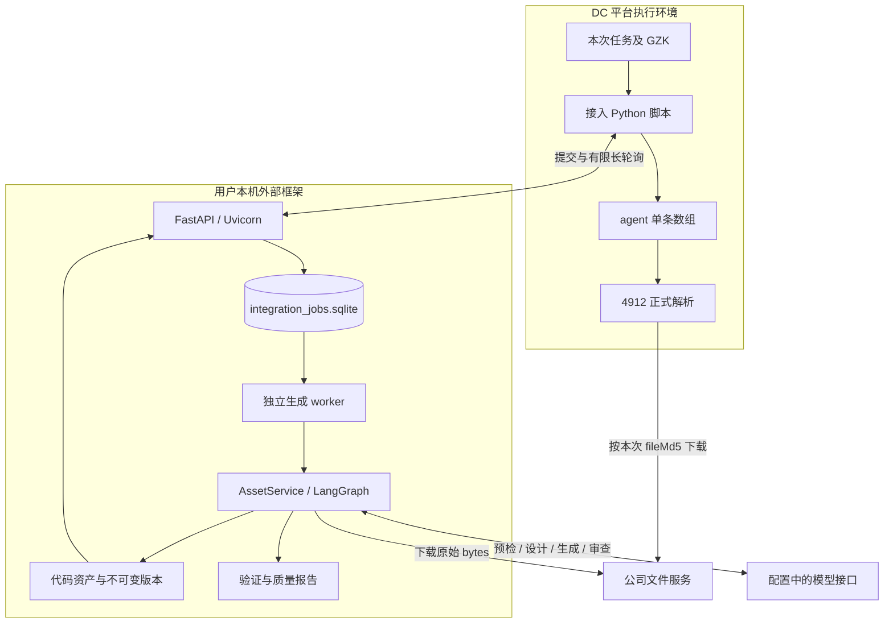
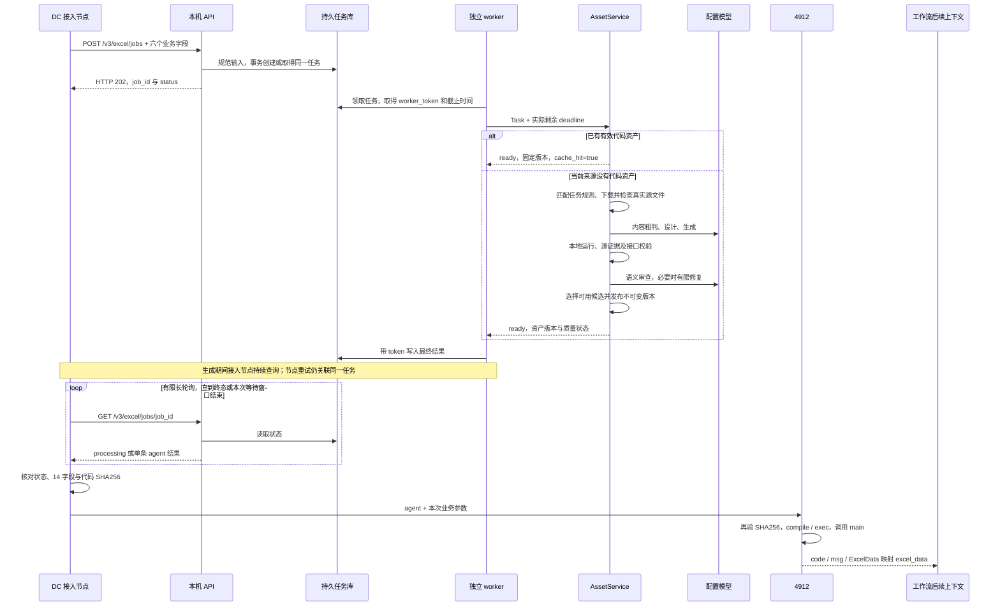
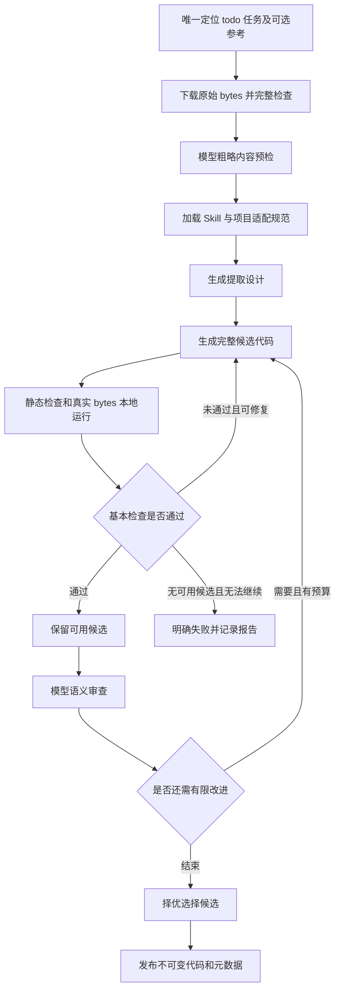

# V3 外部智能体框架接入 DC 工作流：整体流程与技术实现说明

版本：V3 Demo / 工程代码 0.3.0 及后续 HTTP 422 诊断补丁。  
日期：2026-10-20。  
适用范围：当前 Windows 本机、Conda `dc` 环境、Excel/CSV 测试工作流。  
验收状态：**用户已确认，DC 测试工作流调用外部框架生成代码、取回代码、动态执行并输出结果的整体流程已测试通过。** 此结论来自用户亲自测试反馈；本文不额外推定平台运行次数、生成耗时、模型用量、最终条数或全部来源覆盖率。

本文以当前源码为依据，从 DC 的“外部框架接入”节点讲到外部框架内部，再回到动态代码执行器 4912。适合用于方案介绍、技术交接和后续扩展讨论。操作步骤另见 [本机启动指南](V3本机启动与联调指南.md)，平台字段配置见 [节点代码与映射](工作流节点代码/README.md)。本文示例中的请求与返回结构用于讲解，真实运行值以当次任务为准，不应硬编码进生产解析器。

## 阅读导航

| 介绍对象 | 建议阅读 |
|---|---|
| 需要先理解价值与整体关系的同事 | 第 1—3 节、第 18 节 |
| 需要配置 DC 节点的同事 | 第 4—6 节、第 13—15 节 |
| 需要维护外部框架的开发者 | 第 7—12 节、第 16—17 节、附录 |
| 需要评估后续正式运行的同事 | 第 8 节、第 16—18 节 |

## 1. 这版 Demo 实现了什么

V3 将“准备解析代码”和“在工作流中正式解析文件”连接成一条自动链路。

用户发起 DC 测试任务，提供 `fileMd5` 并指定来源路径 `pageTitle`。工作流准备本次指标规则后，把任务信息提交给用户电脑上的外部框架。外部框架先查找已登记的解析资产；没有资产时，下载真实源文件，结合规则和生成规范调用模型，生成 Python 解析器，并执行验证、有限修复和资产发布。工作流随后取得完整源码，由 4912 在平台环境正式执行，产出 `ExcelData`，交给原有后半链。

这一链路交付给平台的主要产物是**可执行的解析代码**。外部框架本地运行得到的数据用于验证代码；本次正式业务数据仍由平台对本次文件执行解析代码产生。

已形成的能力包括：

1. 工作流直接通过 HTTP 调用本机框架，无需人工复制每次生成的解析代码。
2. 新来源缺少代码时，可以进入生成、验证、审查与有限修复流程。
3. 同一来源后续任务可以复用已有解析器，并使用新的 `fileMd5` 和标题执行。
4. 长任务与短 HTTP 请求分离，工作流重试可以继续查询同一后台任务。
5. 返回的代码有版本、质量状态、SHA256 和报告引用，可以核对本次实际执行的产物。

此前框架已具备的生成与验证能力在 V3 中继续复用。V3 的主要新增内容是 HTTP 接入、持久任务及独立 worker、代码交付适配、平台接入脚本和动态执行器。

## 2. 工作流位置与职责分工

### 2.1 当前工作流中的连接关系


| 部分 | 职责 | 主要输入/输出 |
|---|---|---|
| 测试入口、2229 | 准备本次文件信息和测试来源路径 | `fileMd5`、`pageTitle`、`title` 等 |
| 2442、8448 | 查询并整理本次 GZK | `GZK.GZKJG` |
| 外部框架接入节点 | 提交任务、查询状态、验证返回代码、写回 `agent` | 六个业务字段 → 单条 `agent` |
| 外部框架 | 查资产；必要时生成、验证、修复、发布；返回固定版本源码 | 任务 → 代码资产及交付状态 |
| 4912 | 检查交付结果，加载源码，调用解析器并检查返回数据 | `agent` + 本次业务参数 → `ExcelData` |
| 原后半链 | GZK 匹配、单位处理、清洗及已有输出逻辑 | `ExcelData` → `excel_data` → 后续结果 |

2229 按用户要求继续保留造路径职责；2442、8448 继续提供本次 GZK。用户已经将 7882 的输入名称修正为 `unitArray`。V3 的主体改造集中于接入节点、外部框架和 4912。

### 2.2 两个执行环境



平台脚本运行在 DC 的执行环境；外部服务运行在用户电脑。二者通过 HTTP 交换 JSON，不共享本地 Python 对象或文件系统。平台取得的是源码文本，不需要打开用户电脑的 `code/` 目录。

## 3. 一次新代码生成任务的完整时序



图中的本地生成与工作流查询可以交错进行。API 接收某一次 GET 请求，并不负责在该请求里重新执行整个生成过程。

## 4. 接入节点：输入与请求构造

源码：[外部框架接入.py](工作流节点代码/外部框架接入.py)。平台入口为 `main(params)`。

### 4.1 输入契约

| 参数 | 平台来源 | 用途 |
|---|---|---|
| `fileMd5` | `fileMd5` | 下载本次 Excel/CSV 的文件标识；必需非空字符串 |
| `pageTitle` | `pageTitle` | 精确定位业务来源、任务规则和解析资产；必需非空字符串 |
| `fileType` | `fileType` | 选择 `xls`、`xlsx` 或 `csv` 路线 |
| `title` | `title` | 本次文章标题，规则允许时参与统计期间解析 |
| `publictime` | `publictime` | 本次外部发布日期，允许空字符串 |
| `GZKJG` | `GZK.GZKJG` | 本次指标规则对象数组，也接受该数组的 JSON 字符串 |
| `workflow_run_id` | 可选的稳定平台运行 ID | 平台实际提供时用于明确区分一次运行及其重试 |

接入脚本只挑选这些字段，不把整个 `params`、模型配置、服务令牌或本机路径发送给生成任务。

`fileType` 会去首尾空白、转小写并去掉一个前导点，例如 `.XLSX` 规范为 `xlsx`。空值和不支持的类型直接报错，不默认猜为 xlsx。`GZKJG` 至少需要一条有效指标名；8448 产生的尾部空名称行交由服务端 Task 过滤并记录数量。

### 4.2 请求示例

以下用已讨论过的案例说明字段形态；平台每次读取本次输入，而不是使用固定示例值：

```json
{
  "fileMd5": "C02BBD1DEB3A82CCA96B66D873969E18",
  "pageTitle": "上街区人民政府\\政务公开\\政府信息公开\\法定主动公开内容\\统计信息\\统计月报",
  "fileType": "xlsx",
  "title": "上街经济动态2026年3月*地方经济",
  "publictime": "2026-05-07 00:00:00",
  "GZKJG": [
    {
      "rule_indicator_code": 1100202045,
      "rule_indicator_name": "规模以上工业增加值比去年同期±%",
      "rule_constant_name": "%",
      "rule_unit_ratio": "",
      "indicator_release_frequency": "月"
    }
  ]
}
```

实际案例有 21 条规则，这里只展示其中一条。整数型规则代码由内部 Rule 校验转换为文本，字符串编码继续保留文本语义。

### 4.3 HTTP 调用设置

接入脚本使用 `requests.Session`，关闭环境代理 `trust_env=False`，通过请求头传 `Authorization: Bearer <独立服务令牌>`。禁止自动跟随重定向，避免在未知目标继续发送认证请求。

脚本先 POST，再用返回的 `job_id` 进行 GET。每次 GET 可请求服务等待一小段时间后再返回，这就是有限长轮询；不是把整个生成过程装进一个超长 HTTP 请求。

## 5. HTTP 服务：校验、受理与查询

服务入口：[run_service.py](../run_service.py)、[server.py](../src/dc_agent/entrypoints/server.py)。路由实现：[http.py](../src/dc_agent/entrypoints/http.py)。

### 5.1 技术组成

| 技术 | 在本项目中的实际用途 |
|---|---|
| FastAPI | 声明 HTTP 路由、请求校验、生命周期和响应 |
| Uvicorn | 运行 ASGI 应用并监听本机端口 |
| Pydantic / pydantic-settings | 严格请求及内部对象契约、配置加载、SecretStr 凭据字段 |
| requests | DC 接入脚本中的 HTTP 客户端 |
| SQLite / sqlite3 | V3 集成任务持久化、事务幂等与领取/完成条件 |
| multiprocessing / threading | 独立 worker 进程及监督线程 |
| SQLAlchemy / SQLite | 原框架的任务、阶段事件、来源租约和资产登记 |
| LangGraph / SQLite checkpoint | 生成、验证、审查、修复和选择的有界编排 |
| httpx / SSE 解析 | 框架访问配置模型及流式响应处理 |
| openpyxl / xlrd / csv | 原始 Excel/CSV 检查及生成解析器使用的基础依赖 |
| hashlib / JSON / AST / subprocess | 正文指纹、结构化通信、静态检查和本地候选执行 |

### 5.2 公开接口

| 方法和路径 | 行为 | 成功响应 |
|---|---|---|
| `GET /health` | 最小健康状态，不调用模型或下载文件 | HTTP 200，状态和协议版本 |
| `POST /v3/excel/jobs` | 创建新任务或找到相同任务 | HTTP 202，`job_id/status` |
| `GET /v3/excel/jobs/{job_id}` | 查询；可带 `wait_seconds` | HTTP 200，`{"agent": [...]}` |
| `GET /v3/excel/jobs/{job_id}/reports/{report_name}` | 取得允许访问的报告 | 报告内容 |

除健康接口外，业务接口均检查 Bearer 令牌。公开请求只支持 Excel/CSV 的有限字段；拒绝额外本机路径、模型凭据、强制重建和候选恢复参数。

POST 即使找到已 ready 或已失败的任务，也使用 HTTP 202 返回受理对象；完整源码仍由随后 GET 取得。GET 的 HTTP 200 表示查询成功，是否能执行要继续检查 `agent[0].status == "ready"`。

### 5.3 两层参数校验

第一层由 `ExcelJobRequest` 检查公开协议：字段是否缺失、字符串类型、长度、fileType 枚举、额外字段、GZK 数组形态等。

第二层构造内部 `Task`：核对该链路必需的文件标识和 GZK，过滤空指标名，验证指标代码等内部契约。规范化后的内部 payload 才进入持久队列。

校验失败返回 HTTP 422，没有成功创建生成任务。新增的 [input_errors.py](../src/dc_agent/integration/input_errors.py) 会提供安全的字段位置、错误类别、输入类型及 `diagnostic_id`，区分 `request_schema` 和 `task_contract`。它不返回完整拒绝值、异常上下文或令牌。

## 6. 为什么使用 `agent` 变量

`agent` 是平台模板中的 `Array<Object>`；每个单文件任务恰好一条记录，14 个子字段全部为 String。这样可以将交付状态、代码和诊断放在同一父变量中传给 4912，并适配平台已核对的变量类型。

| 字段 | 表示什么 | 何时使用 |
|---|---|---|
| `status` | ready / processing / failed / review_required / invalid_input | 4912 的首要执行条件 |
| `stage` | queued、running、complete 等集成阶段 | 定位等待、结束、中断或交付故障 |
| `job_id` | 对外持久任务 ID | 重试关联、查询和报告入口 |
| `PythonFile` | 业务 `.py` 文件名 | 编译标识与日志定位，不是远程磁盘地址 |
| `PythonCode` | 固定版本的完整源码 | 4912 编译和执行的正文 |
| `code_sha256` | 正文原始 UTF-8 字节 SHA256 | 检测截断、改写或串版本 |
| `artifact_version` | 不可变代码版本 | 标识本次交付的代码资产 |
| `cache_hit` | 字符串 true / false | 是否复用了已有登记代码 |
| `quality_status` | accepted / usable_with_warnings | 说明当前代码的质量状态 |
| `warning_summary` | 选中版本的质量问题摘要 | 快速了解待复核项 |
| `error_code` | 明确业务或系统错误码 | 失败定位；ready 时为空 |
| `message` | 固定、简要的结果说明 | 解释复用、生成或失败 |
| `report_ref` | 相对 API 报告路径 | 需要全文诊断时访问 |
| `elapsed_seconds` | 从首次受理起算的耗时字符串 | 观察耗时；重试不重置 |

`stage` 当前反映集成队列阶段，生成图中的详细步骤存于内部任务事件和报告，不应把它描述成前端实时展示每一步模型进度。

处理中的结果不交付代码。终态失败会清空 `PythonFile/PythonCode/code_sha256/artifact_version`，避免上一次源码被误用。令牌、完整历史候选、源文件全文、本地运行数据和内部模型上下文不作为 `agent` 的额外字段返回。

处理中返回的结构示例如下；编号与耗时仅为示意：

```json
{
  "agent": [
    {
      "status": "processing",
      "stage": "running",
      "job_id": "00000000-0000-4000-8000-000000000001",
      "PythonFile": "",
      "PythonCode": "",
      "code_sha256": "",
      "artifact_version": "",
      "cache_hit": "",
      "quality_status": "",
      "warning_summary": "",
      "error_code": "",
      "message": "Waiting for the persistent task to complete",
      "report_ref": "",
      "elapsed_seconds": "12.35"
    }
  ]
}
```

## 7. 持久任务：让重试继续查询同一件事

实现：[jobs.py](../src/dc_agent/integration/jobs.py)。数据库位于 `runtime/integration_jobs.sqlite`。

### 7.1 任务记录保存什么

核心字段包括：对外 `job_id`、幂等身份、规范化输入指纹及 payload、首次受理时间、总截止时间、状态与阶段、生成截止时间、worker 所有者及 token、下次可领取时间、最终结果和错误码。

SQLite 启用 WAL；提交与领取等关键路径使用事务。提交时的 `BEGIN IMMEDIATE` 将“查已有记录”和“插入新记录”放在同一写事务中，避免两个同时到达的相同请求分别创建任务。

### 7.2 两种幂等身份

**存在真实稳定运行 ID 时：** 使用 `run:<workflow_run_id>`。相同 ID 和相同规范化输入返回原任务；同一 ID 改换输入返回 HTTP 409，避免把两个不同任务混成一次运行。当前实现中，这一运行 ID 的绑定不会在 900 秒后自动失效。

**没有稳定运行 ID 时：** 对规范化 payload 做稳定 JSON 序列化并计算 SHA256，使用 `input:<fingerprint>`。默认在首次创建起 900 秒的窗口内复用相同任务；仍在运行的同身份任务也继续复用。重复提交不滑动延长首次截止时间或重新给生成预算。

这意味着完全相同输入的两次手工测试，在该窗口内也可能返回同一任务。输入指纹是回退方案，不能宣称它能识别每一次独立的人工点击。只有平台实际提供稳定 ID 时才传 `workflow_run_id`，不在每次重试中生成随机 UUID。

900 秒是复用窗口，不是记录自动删除期限；当前没有历史集成任务的自动清理机制。

### 7.3 几种关键标识与指纹各解决什么

| 标识 | 计算或来源 | 解决的问题 |
|---|---|---|
| 对外 `job_id` | 集成任务创建时生成 UUID | 这一次持久任务怎样查询 |
| 内部 `task_id` | 原框架 Repository 注册任务时生成 | 生成事件、候选及报告属于哪个内部任务 |
| 资产 `source_key` | SHA256 of `[pageTitle, 规范化fileType]` | 这个来源应复用哪套解析代码 |
| `code_sha256` | 固定版本源码字节 SHA256 | 收到的代码正文是否完整一致 |

worker 为内部 Task 设置稳定 `request_id="http-v3-" + job_id`。因此同一持久任务不会在每次尝试时向原框架注册一个无关请求。内部 `task_id` 与对外 `job_id` 是两个不同编号。

### 7.4 状态变化

通常为 `queued → processing → ready`。无法提供可交付代码时进入 failed/review_required/invalid_input 等终态；`queued` 对外统一表示 processing。领取时写入 worker token，完成时只允许匹配 token、仍处于 processing 且未超过总截止时间的任务写回结果，这是一种带所有权条件的完成保护。

它防止过期或失去所有权的 worker 用迟到结果覆盖任务终态。原框架的资产发布还有另一层来源租约，两者分别保护集成任务结果和当前代码资产。

## 8. 独立 worker 与时间预算

实现：[worker.py](../src/dc_agent/integration/worker.py)。

### 8.1 进程组成

正常启动为一个 Uvicorn/API 进程、一个独立生成 worker，以及 API 进程内的监督线程。Windows 使用 `multiprocessing.get_context("spawn")` 创建 worker；worker 在自己的进程里重新创建队列连接、AssetService、模型适配器和 Repository，不共享跨进程数据库连接。

当前一个 worker 串行处理任务，适合单文件人工测试。每完成一个任务，关闭其应用资源，再领取下一任务。HTTP 查询由 API 持续响应，模型生成不会占用整个请求处理生命周期。

启动时通过 `.integration-service.lock` 避免同一 runtime 同时存在多个该服务的管理者。监督线程观察 worker 存活与任务截止，异常退出时按条件标记中断并有限重启；不是无限重试所有失败任务。

### 8.2 默认预算

| 控制层 | 默认值 | 具体含义 |
|---|---:|---|
| 接入脚本一次主动等待 | 115 秒 | 给平台单次 120 秒限制留收尾余量 |
| HTTP 连接超时 | 最多 5 秒 | 按本次剩余时间进一步缩短 |
| HTTP 读取超时 | 最多约 22 秒 | 配合最多 20 秒的服务长轮询 |
| 服务端一次长轮询 | 最多 20 秒 | 期间反复读取持久状态 |
| 生成截止 | 首次受理起约 300 秒 | 包含排队、规则读取、下载、模型及本地验证 |
| 集成任务总截止 | 首次受理起 360 秒 | 超期结果不接受，监督器启动终止处理 |
| 原本地 CLI 任务预算 | 默认 600 秒 | 非 HTTP 调用沿用原方式 |

关键计算为：

```text
deadline_at = created_at + api_job_timeout
generation_deadline = min(created_at + api_generation_timeout, deadline_at - 15)
remaining = generation_deadline - 当前墙上时间
传给 AssetService 的 deadline = 当前 monotonic 时间 + remaining
```

首次受理后的排队时间也占生成预算，不能在 worker 领取后重新获得 300 秒。下载、模型和候选执行都使用实际剩余时间；两次候选执行也共用同一个截止时间。

生成预算结束后，已经验证过的可用候选仍可以进入回退选择与发布，最终集成结果必须在总预算内完成。360 秒是截止与监督依据；监督线程有轮询间隔，操作系统终止和资源清理也需要时间，不能将其理解为所有进程物理上精确在第 360.000 秒消失。

按三次 115 秒主动等待估算约 345 秒；这与 360 秒后台硬兜底有区别。平台实际重试次数、间隔由平台配置决定，不应仅凭 demo 成功推断所有慢任务都能等待满 360 秒。

这里的 360 秒只约束外部持久任务，不包含整个 DC 工作流或后续 4912 的执行时间。4912 的运行仍受平台自身节点限制。

### 8.3 断线、竞争与重启

- HTTP 断线：不取消后台任务，下一次相同输入提交仍找到原 `job_id`。
- 本次节点等待窗口耗尽：抛出含 job_id 的 `DC_AGENT_RETRY`，由平台配置的重试承接。
- 来源资产正在被别的框架调用生成：AssetService 可返回 processing，worker 延后重新领取同一集成任务，不重新计算生成截止。
- 服务正常停止或异常重启：已领取任务明确标记中断；未领取队列保留原截止，不获得新预算。
- worker 超期：在当前 Windows/local 范围内尝试终止所拥有的进程树并拒绝迟到结果。

持久化保证可查询和可定位，不等于任意步骤自动断点续算。LangGraph checkpoint 和模型操作日志保留下来，也不能据此把当前公开 API 描述为“无条件从中断位置恢复”。

## 9. AssetService：先查代码，再决定是否生成

实现：[service.py](../src/dc_agent/application/service.py)，装配入口为 [bootstrap.py](../src/dc_agent/bootstrap.py)。

### 9.1 代码复用分支

框架按 `pageTitle + fileType` 精确定位资产，核对数据库登记、业务路径、来源身份、当前版本与 SHA256。磁盘上存在一个同名文件，并不代表它可被直接使用；必须有对应的合法登记。

缓存命中时返回 ready、资产元数据及 `cache_hit=true`。**这一分支不下载本次源文件，不运行本次内容预检，也不调用模型重新生成。** 后续 4912 仍会用本次 fileMd5 正式下载并执行解析代码。

因此换一个同来源的新文件通常可复用代码；换文件不表示一定需要重新生成。如果来源版式发生变化，已有解析器也可能不再适用，仍需实际执行与结果核验。当前公开接口没有自动检测所有模板漂移或强制重建参数。

### 9.2 新生成分支

没有可用资产时先取得来源租约，防止同来源并发发布。拿到租约后再次查询资产，避免等待期间已有其他调用完成生成。

仍未命中时才进入以下步骤：



实际图由 LangGraph 的 inspect/design/generate/validate/review/repair/finalize 节点组成。图中的 inspect 阶段接收上游已经准备的源检查，不代表同一源文件被反复从网络下载。

## 10. 规则、源事实与模型上下文怎样形成

### 10.1 程序定位任务规则

[WorkbookRuleContext](../src/dc_agent/references/workbooks.py) 在新生成时读取当前 `rule/todo.xlsx` 快照。通过 C/E 列表头识别有效任务 Sheet，以 E 列 `pageTitle` 原始文本精确匹配：

| 命中数 | 结果 |
|---:|---|
| 0 | `todoFile_no_pageTitle`，不进入下载或生成 |
| 多于 1 | `pageTitle_redundancy`，避免来源歧义 |
| 1 | 取得任务行、位置、路径代码和元数据继续 |

再按 C 列 `DataSourcePathCode` 的精确文本，从 `IndicatorName_Excel_Md.xlsx` 查同名 Sheet。找到时携带实际参考内容及位置；找不到是允许的可选分支，继续使用任务信息和真实源文件。

这些工作簿服务于设计和审查。不能把参考名当作源表必然存在的指标，也不能为匹配参考或 GZK 反向补造数据。每次实际生成读取新快照并保存内容指纹，缓存命中不因规则文件更新自动重建。

### 10.2 下载与原始文件检查

文件提供器按本次 `fileMd5` 从配置的文件服务下载原始 bytes，限制下载大小和等待时间。文件服务基址与框架 API 基址是两个不同地址。

[inspection](../src/dc_agent/inspection/readers.py) 检查文件真实容器、工作表、单元格和数据类型等内容：XLSX 使用 openpyxl，原始 XLS 使用 xlrd，CSV 使用相应文本/表格读取；gzip 包装按实际 bytes 识别并处理。检查结果携带源 SHA256、section、单元格引用、值及布局信息，成为后续证据核验基础。

任务目录保存 `source.bin`、`inspection.json`、`generation_context.json`，分别对应实际输入、源结构和当次任务/参考快照。模型依赖这些真实内容分析，不只依赖文件名或历史模板。

### 10.3 内容粗判

[ContentPreflight](../src/dc_agent/application/preflight.py) 调用模型粗略判断真实输入是否存在可提取业务数据：

- `has_data`：继续。
- `uncertain`：继续，避免因不确定过早丢弃真实数据。
- `no_data`：以 `FilenoData` 终止，并保存理由与报告。

这个阶段只看真实源检查内容，不用 GZK 或参考库中的名称证明文件有数据。它是粗判，不能代替后续实际运行、逐条证据和语义审查。

### 10.4 Skill 与项目适配

[SkillRegistry](../src/dc_agent/generation/skills.py) 对本链路读取 `excel-rule-parser-codegen/SKILL.md`，叠加项目 `profiles/source_gzk.md` 中的 `source_rules_v2` 适配规范，并记录两个内容 SHA256。

这里的 Skill 是供生成和审查读取的规则文本适配。当前没有启用通用工具注册器，也不是模型能够任意调用本机工具的运行环境。

## 11. 模型如何生成、审查和修复代码

### 11.1 分阶段的结构化调用

[Generator](../src/dc_agent/generation/generator.py) 使用同一个配置模型适配入口承担不同阶段的职责；不要求每个阶段配置一个独立模型。

具体调用分工是：内容预检由 ContentPreflight 调用同一 ModelGateway；design、generate、review 由 Generator 承接。下面将这些阶段放在同一表中，是为了展示完整生成链路。

| 阶段 | 结构化结果 | 关键内容 |
|---|---|---|
| 内容预检 | 内容判断对象 | verdict、reason |
| design | `Design` | 名称逻辑、单位逻辑与位置、日期逻辑与位置、覆盖范围、限制、参考冲突 |
| generate_N | `Candidate` | 完整 content、证据模式和证据协议 |
| review_N | `Review` | approved、具体问题、核对位置、正确性/纯覆盖分类及质量意见 |

调用要求返回符合 schema 的 JSON，并由 Pydantic 再验证。生成解析器必须保持 `main(params) → code/msg/ExcelData`，每条数据具备四核心字段。模型输出不是被直接信任的最终业务结果，而是进入执行与证据关卡的候选。

### 11.2 GZK 在这条链路中的位置

Excel/CSV 解析器以真实源表和已核对规则组织候选记录。GZK 是生成/审查诊断和平台后续匹配依据，不作为生成 Python 运行时的输出白名单。

因此生成代码不要求从参数读取 GZK，也不为了命中指标库而删除源表真实有效记录、改写正确名称或补造单位/日期。后续 8300 仍执行工作流原有匹配逻辑。Markdown 的 GZK 五字段强制筛选属于另一条链路，不混入本 V3 Excel API。

### 11.3 模型传输与操作日志

[ModelGateway](../src/dc_agent/infrastructure/model/gateway.py) 通过 httpx 调用已配置的 Chat Completions 或 Responses 协议。启用流式时，请求中实际发送 stream 设置，并解析对应 SSE 事件、完整终态和结构化内容；不是仅把普通响应分块读取。

设计、生成、审查具有不同输出 token 上限，实际调用还受全局上限、模型等待时间、有限重试和任务剩余时间约束。超出上下文大小限制会明确失败，不静默截断源检查内容。模型地址、名称和密钥来自服务端配置，不随任务传入。

成功结构化操作保存到 `model_journal/`。相同操作名、系统规范、上下文和 schema 的成功记录可复用；metrics 记录传输与用量等诊断。日志不是对外返回的隐藏推理，也不是任意上下文都能复用的模型答案缓存。

### 11.4 有限修复与候选保留

默认总修复最多 4 轮，其中已获正确性接受后的质量改进最多 2 轮，已有可用版本后连续 2 轮无择优进展可提前停止，并始终受任务预算约束。质量改进可能来自漏提取、覆盖回退等建议，不只对应单一完整性检查。

[CandidatePool](../src/dc_agent/orchestration/candidates.py) 独立保留已经通过运行契约、真实源证据等基本检查的 Python 候选。之后某次修复损坏代码、模型断流或预算耗尽时，可以选择先前候选，而不是把之前可用的结果一起丢弃。

排序优先考虑语义审查状态，再比较实际不同数据格位覆盖等条件；同等时稳定保留较早候选。不按重复输出条数或 GZK 命中数量奖励候选。

质量状态为：

- `accepted`：语义已接受，且选中结果未携带当前选择报告中的 warning。
- `usable_with_warnings`：基本可用，但可能有覆盖建议、语义审查未完成或未解决问题等 warning。

Python 的基本可用候选即使语义意见未全部解决，也可能按既有策略带警告交付。原始拒绝意见仍保存在历史 review/validation 中；不能把 ready 或本次 demo 验收解释为所有候选、所有来源业务语义均已证明。

## 12. 本地代码验证具体做什么

实现：[Validator](../src/dc_agent/validation/validator.py)、[LocalProcessRunner](../src/dc_agent/infrastructure/execution.py)、[执行子程序](../src/dc_agent/infrastructure/_runner.py)。

### 12.1 静态与接口检查

AST/compile 检查源码可解析、存在正确 `main` 入口、导入处于允许集合，并拒绝部分明显不适合解析器的动态执行或交互操作。检查本身不构成完整安全证明。

### 12.2 以真实 bytes 运行

本地 runner 创建独立临时输入/输出目录，用当前 Python 解释器的 `-I` 模式启动子进程。执行子程序把候选中的约定下载请求映射到本次已经下载的实际源 bytes，以便验证同一份输入、避免验证阶段重复访问文件服务。

执行子程序还拒绝其他约定外网络连接；这些运行期约束配合静态检查用于当前受控验证，不应扩大解释为完整操作系统隔离。

这不是用预期答案替换解析结果：候选仍真实读取、解析原始字节并执行其代码。运行环境不继承模型/API 凭据，结果由文件回传，要求为严格 JSON，限制结果大小并处理超时。

### 12.3 四核心字段与源证据

检查非空 `ExcelData`、有效名称和单位、有限数值及日期等接口条件。零值有效；无明确单位时使用 `-`，无法可靠确定日期时按规则留空，不补猜。

每条记录还应有真实来源证据，说明名称片段、数值、单位和日期引用了哪些原始单元格或被允许的运行时字段。验证器检查引用存在、数值一致、有关单位/期间引用等条件；模型审查进一步评估名称层级和业务归属。机械核验不能替代全部业务语义判断。

### 12.4 两种证据模式

- `sidecar`：Candidate 附带与本次输出记录对应的证据列表。
- `runtime`：代码提供 `_dc_validate(params)`，实际运行时动态生成逐条证据。验证器分别运行生产 `main` 和证据入口，要求业务结果一致，额外证据单独核验。

`_dc_validate` 用于框架内部验证，4912 正式执行只调用 `main`。两次运行不各自获得一整份新任务预算。

### 12.5 验证与正式执行的边界

本机验证确认代码在本次真实样本上的运行与证据情况；4912 在平台环境再次正式执行，验证平台依赖、下载和当前业务参数。二者都需要存在，因为本地审查数据不能替代平台本次实际结果。

本地子进程和 4912 的独立字典都用于隔离运行状态，**不等于执行任意不可信代码的安全沙箱**。当前 demo 使用受控环境和已有检查，服务器正式运行前仍需专门设计执行边界。

## 13. 代码发布、版本与完整性交付

实现：[ArtifactStore](../src/dc_agent/assets/store.py)、[AssetLayout](../src/dc_agent/assets/layout.py)、[delivery.py](../src/dc_agent/integration/delivery.py)。

### 13.1 目录组织

```text
agent/
  code/
    .runtime.json                         code 与 runtime 的绑定
    .owners/                              当前业务文件所有者元数据
    excel/xlsx/
      <pageTitle替换后的名称>.py           当前代码文件
      .staging/<task_id>/<attempt>/...     候选代码
      .versions/<source_key>/<version>/... 不可变历史正文
  runtime/
    integration_jobs.sqlite               V3 对外任务
    tasks.sqlite                          原框架任务/事件/租约/资产登记
    tasks/<task_id>/                       候选、审查和质量报告
    artifacts/<source_key>/<version>/     设计、验证和上下文快照
    v2_manifests/                         沿用的资产 manifest 目录名
```

`v2_manifests` 是历史目录命名，V3 沿用已有发布实现；它不代表 V3 没有保存版本元数据。其他 Excel 类型位于各自 `xls/csv` 子目录。

业务文件名只将 `pageTitle` 中的反斜杠替换为下划线，再加 `.py`。非法文件名、身份碰撞和未登记同名文件明确报错，不做相似来源猜测。

### 13.2 发布保护

发布为选中候选生成版本 UUID，写入不可变正文、内容 hash、源 hash、Skill/profile/context 指纹、契约、验证路径和质量信息。

跨进程发布锁、来源租约及 token 条件更新协调当前资产切换；发布 journal 配合原子文件替换支持中断后的文件/登记一致性恢复。这里的恢复是发布一致性恢复，与重新启动整个生成任务不同。

### 13.3 为什么返回不可变版本

API 交付时使用任务绑定的 `version_path`，不重新跟随当前业务文件指针。即使后续同来源又发布新版本，旧任务也应取得自己绑定的正文。

交付层核对来源 key、原始 pageTitle、规范 fileType、`python_excel` 类型、`main-ExcelData-v1` 契约、版本格式、确定的版本路径、目录边界、质量状态和代码 hash，再按 UTF-8 解码。以 bytes 读取避免文本模式把 CRLF 自动改为 LF，确保平台对收到源码重新编码后能得到相同 SHA256。

SHA256 用于检测正文是否一致，并不是数字签名，也不能单独证明代码安全。调用授权由独立访问令牌承担。

## 14. 代码回到接入节点后发生什么

GET 返回 `{"agent": [record]}`。接入脚本要求恰好一条对象记录，挑选约定的 14 个 String 字段，检查 job_id 与当前查询一致、状态属于已知集合、耗时格式和 cache_hit 合法。

ready 还必须具备有效文件名、非空完整源码、固定版本、合法质量状态和空 error_code。脚本计算：

```python
actual = hashlib.sha256(record["PythonCode"].encode("utf-8")).hexdigest()
```

并用 `hmac.compare_digest` 与交付 hash 比较。检查通过才将单条数组整体写回模板 `agent`。不拆成互相独立的顶层代码变量，也不把处理中的旧源码带到后续。

报告引用是形如 `/v3/excel/jobs/<job_id>/reports/quality_report.json` 的相对路由，应拼到同一服务基址并携带令牌访问。允许的文件名是 quality_report.json、quality_report.md、validation.json、selection.json，且实际存在才提供。报告接口不接受任意本地路径。

## 15. 动态执行器 4912：正式运行代码

源码：[动态代码执行器_4912.py](工作流节点代码/动态代码执行器_4912.py)。

### 15.1 输入与再次检查

4912 接收整个 `agent` 父数组，以及本次 `fileMd5/title/publictime/fileType/pageTitle` 五个业务字段。再次检查单条数组、14 字段类型、ready 状态、任务和版本、质量、文件名、非空源码及 SHA256。

这样执行器自身就具备拒绝未就绪或损坏代码的能力，不仅依赖前一节点的正常分支。

这里对任务和版本的检查主要是字段存在性等交付契约检查。4912 不会再次请求远端验证 source_key；完整来源身份在服务交付层核对，返回 job_id 与当前查询一致性在接入节点核对。

### 15.2 独立命名空间加载

核心实现可概括为：

```python
namespace = {
    "__name__": "dc_agent_delivered_parser",
    "__file__": filename,
}
compiled = compile(source, filename, "exec")
exec(compiled, namespace, namespace)
parser_main = namespace.get("main")
if not callable(parser_main):
    raise RuntimeError("交付源码缺少可调用的 main(params)")
result = parser_main(business)
```

生成代码的 import、函数及变量进入独立字典，避免直接覆盖包装器或平台的 `main`、datetime 等绑定。包装器也为自己的依赖使用 `_agent_` 别名。

这不限制候选代码本身能够做的一切。它没有把 `exec` 变成安全沙箱，也不在平台里再启动一套外部智能体生成流程。

### 15.3 传给业务解析器的参数

```python
business = {
    "fileMd5": "本次文件标识",
    "title": "本次标题",
    "publictime": "本次发布日期",
    "fileType": "本次类型",
    "pageTitle": "本次来源路径",
}
```

不传服务令牌、agent、GZK 或平台全部全局参数。解析器按既有下载接口获取本次原文件并执行自身提取逻辑；不是读取外部框架验证时保存的 ExcelData。

### 15.4 返回结果检查

正式契约为：

```json
{
  "code": 0,
  "msg": "success",
  "ExcelData": [
    {
      "indicator_name": "源表与规则支持的完整指标名",
      "indicator_data": "0.0000",
      "indicator_unit": "-",
      "end_date": ""
    }
  ]
}
```

包装器要求数字成功码 0，拒绝把布尔 False 当成功码；msg 为字符串，ExcelData 为非空对象数组。每条具备四核心字段，名称和单位非空，日期为有效 ISO 日期或空串，数据是有限数值或数值字符串，整体可严格 JSON 序列化且无 NaN。

验证数值字符串时可以临时移除显示千分位逗号，但输出原值不变；不做四舍五入、单位换算、去重或业务改名。代码语法、依赖导入、下载、运行或结果契约失败均抛错，不正常返回空数组掩盖失败。

### 15.5 接回原后半链

平台将 4912 返回的 `ExcelData` 映射为模板 `excel_data`，原有 8300 从中匹配 GZK，再进入单位处理、清洗及原输出流程。

因此本版扩展的交接点是“外部交付代码 → 平台执行代码 → 原数据链路”，不要求重写整条工作流。

## 16. 配置、日志与常见故障

### 16.1 两套配置

| 配置位置 | 内容 |
|---|---|
| 工程 `.env` | 原模型、文件下载、规则、执行器等配置 |
| `runtime/service/service.env` | API 监听、独立访问令牌和远程预算等 |
| 平台接入脚本常量 | `API_BASE_URL` 与相同的服务 `API_TOKEN` |

启动器先读取原 `.env`，再读取独立服务配置；操作系统环境变量仍按 settings 机制参与配置。`init-config` 以独占创建方式生成随机令牌，已有文件不覆盖。服务要求至少 24 字符的令牌。正常启动命令在用户本机执行：

```powershell
conda activate dc
cd D:\EDBPythonCode\dc_workflow\agent
python run_service.py check-config
python run_service.py serve
```

平台通过真实任务请求即可验证，不要求平台有 PowerShell。用户此前的 POST 422 已证明当次地址可达，随后整体测试也已由用户确认通过。`0.0.0.0` 是监听地址；访问日志中的远端 IP 是平台请求来源，二者都不应被误当成本机调用基址。

当前使用公司内网 HTTP 与 Bearer 令牌，传输本身没有 HTTPS 加密。未来服务器正式接入时再按实际网络和管理要求补充，不能把本机 demo 等同于已经完成生产部署。

### 16.2 定位顺序

| 现象 | 所在阶段 | 先看什么 |
|---|---|---|
| 连接失败/超时 | 平台 → 本机网络 | 服务是否在线、本机地址与端口、实际网络可达性 |
| HTTP 401 | 接口认证 | 平台与服务的独立令牌是否一致 |
| HTTP 422 | 入参校验 | phase、字段、input_type、diagnostic_id；尤其 fileType 和 GZK 形态 |
| HTTP 409 | 幂等身份 | 同一 workflow_run_id 是否换了业务输入 |
| processing 长时间未结束 | 持久任务/生成 | 原始截止时间、队列与内部任务事件 |
| FilenoData | 内容粗判 | 真实下载和 preflight 报告 |
| todoFile_no_pageTitle / pageTitle_redundancy | 规则定位 | todo 的精确来源路径和重复任务行 |
| MODEL_* | 模型传输/输出 | 当次 metrics、操作阶段、终态和 schema 情况 |
| ARTIFACT_CORRUPT | 代码交付 | 登记身份、不可变版本路径和 hash |
| DC_AGENT_NOT_READY | 4912 入口 | agent 的 status/error_code/job_id |
| DC_AGENT_EXECUTION_ERROR | 平台正式执行 | 依赖、下载、业务运行和返回契约 |

HTTP 422 的历史排查见 [专门记录](HTTP422联调排查.md)。用户随后反馈整体测试通过，但未另行提供该次 422 的最终字段归因，本文不将“fileType 缺映射”等候选写成已证实根因。

### 16.3 报告位置

内部任务目录保留 inspection、preflight、design、candidate-N、validation-N、review-N、selection、retained_candidates、result、failure 和完整 quality_report 等文件，具体按实际执行阶段产生。

`runtime/diagnostics/quality_issues.jsonl` 是跨任务问题总账；HTTP 参数诊断位于 `runtime/diagnostics/http-input-errors/<diagnostic_id>.json`。对外 job 结果保存内部 task_id 的映射信息，便于从平台编号追到本机报告。

## 17. 验证证据与本次验收

证据按来源分别记录：

| 证据 | 已知结果 | 能说明什么 |
|---|---|---|
| V3 初次工程全量回归 | 381 项通过，80.72 秒 | 原能力与 V3 协议/预算/执行等工程回归 |
| 422 补丁相关回归 | 117 项通过 | HTTP、节点与真实回环通信仍通过 |
| 新增字段诊断测试 | 16 项通过 | 两阶段诊断、白名单输出和前置 fileType 校验 |
| 现有实际资产的下载 mock 回归 | 四组标题，各 67 条，与直接 main 一致 | 新执行器可承接当时选定的真实资产 |
| 用户亲自测试 DC 工作流 | 已确认整体流程测试通过 | 本版“生成 → 返回 → 平台执行”目标已实现 |

这些数量来自不同批次，不能相加冒充某次重新执行的全量测试数量。历史 67 条和旧资产版本也不能替代本次平台最终条数。

本次用户的测试确认是 V3 阶段验收依据。开发侧未在本轮文档编写中另行请求模型、操作平台或重跑真实任务，也未取得足以补写精确耗时、用量和新资产版本的新增平台导出。

已有技术证据见 [V3 实施与验证记录](V3实施与验证记录.md)、[422 调查摘要](../runtime/diagnostics/v3-422-investigation.json) 及 [422 补丁验证摘要](../runtime/diagnostics/v3-422-validation-summary.json)。

## 18. 这个 Demo 的价值与当前边界

### 18.1 已经可以向他人展示的能力

可以用下面一段话介绍：

> DC 工作流提供本次文件标识、来源和指标规则，通过 HTTP 向外部框架申请解析代码。框架先复用已登记代码，没有代码时基于真实文件和规则调用模型生成，并经过本地执行、源证据与语义审查后发布固定版本。工作流取回源码并校验完整性，再由平台动态执行器用本次文件正式解析，结果接回原有业务链路。长任务通过持久任务编号与重试衔接，代码版本和质量报告可以追踪。

技术上，这个 demo 已把模型生成能力转化为工作流可调用的代码交付服务，并保留平台原有的数据处理职责。用户已通过真实任务验证这条链路成立。

### 18.2 后续扩展应沿用的边界

当前公开 API 只面向 Excel/CSV，原框架的 HTML/Markdown 能力不等于已通过这套 V3 API 验收。当前为 Windows 本机、单 worker、人工测试场景，不承诺高并发、多主机、多租户或无人值守生产运行。

未来明确需要迁移到公司服务器，届时应专门处理部署、配置与资料路径、资产/数据库迁移、模型和文件服务网络、执行隔离、进程树或容器清理、认证及运维等问题。V3 的 HTTP 契约、应用装配和交付边界有助于迁移，但服务器工作尚未实施。

同时，已有资产复用不自动识别所有源格式变化；持久任务不等于任意步骤自动恢复；ready 不等于所有记录全部正确且提取完整；SHA256 不等于代码安全认证。正式推广时应在本版已验证的链路之上，按真实来源和运行要求逐项扩展。

## 附录 A. 源码导航

以下路径均相对于工程 `D:\EDBPythonCode\dc_workflow\agent`，链接可直接定位当前源码：

| 关注点 | 源码入口 |
|---|---|
| DC 提交与查询 | [外部框架接入.py](工作流节点代码/外部框架接入.py) |
| DC 正式执行 | [动态代码执行器_4912.py](工作流节点代码/动态代码执行器_4912.py) |
| 服务启动与独立配置 | [server.py](../src/dc_agent/entrypoints/server.py) |
| HTTP 路由 | [http.py](../src/dc_agent/entrypoints/http.py) |
| 公开请求和 agent 字段 | [contracts.py](../src/dc_agent/integration/contracts.py) |
| 安全参数诊断 | [input_errors.py](../src/dc_agent/integration/input_errors.py) |
| 持久任务和幂等 | [jobs.py](../src/dc_agent/integration/jobs.py) |
| worker 及监督 | [worker.py](../src/dc_agent/integration/worker.py) |
| 不可变代码交付 | [delivery.py](../src/dc_agent/integration/delivery.py) |
| 公共应用装配 | [bootstrap.py](../src/dc_agent/bootstrap.py) |
| 查资产/新生成总入口 | [service.py](../src/dc_agent/application/service.py) |
| 规则快照和定位 | [workbooks.py](../src/dc_agent/references/workbooks.py) |
| 原始 bytes 检查 | [readers.py](../src/dc_agent/inspection/readers.py) |
| 内容模型预检 | [preflight.py](../src/dc_agent/application/preflight.py) |
| Skill 文本适配 | [skills.py](../src/dc_agent/generation/skills.py) |
| 结构化模型操作 | [generator.py](../src/dc_agent/generation/generator.py) |
| 模型传输 | [gateway.py](../src/dc_agent/infrastructure/model/gateway.py) |
| 生成编排与候选选择 | [workflow.py](../src/dc_agent/orchestration/workflow.py)、[candidates.py](../src/dc_agent/orchestration/candidates.py) |
| 机械与源证据验证 | [validator.py](../src/dc_agent/validation/validator.py) |
| 本地候选执行 | [execution.py](../src/dc_agent/infrastructure/execution.py)、[_runner.py](../src/dc_agent/infrastructure/_runner.py) |
| 资产布局与发布 | [layout.py](../src/dc_agent/assets/layout.py)、[store.py](../src/dc_agent/assets/store.py) |
| 原框架持久化 | [storage.py](../src/dc_agent/infrastructure/storage.py) |
| 完整质量报告 | [diagnostics.py](../src/dc_agent/application/diagnostics.py) |

## 附录 B. 面向演示的讲解顺序

1. 先展示第 2 节总览，说明平台和外部框架分别在哪里运行、各自交付什么。
2. 用第 3 节时序，展示“提交取得 job_id → 后台生成 → 查询取得源码 → 平台执行”。
3. 展示两个节点映射及 agent 14 字段，解释工作流如何承接代码。
4. 进入生成链路，展示实际源检查、设计、候选、验证、审查与 selection 报告；不要只展示一段模型回复。
5. 对照版本和 SHA256，说明本次返回和执行的是哪一份代码。
6. 展示 4912 的调用结果及原后半链结果，以用户已确认的真实测试说明链路成立。
7. 最后讲清当前本机 demo 范围、代码质量状态，以及未来服务器化的工作边界。
