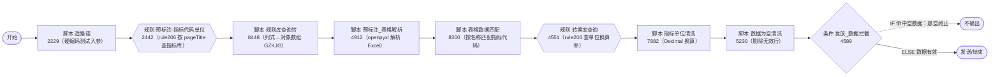

# 工作流说明文档 · excel-Agent-test1020

> 本文档由对 DC 工作流平台（DataCopilot，`service-2.example.invalid`）上的工作流进行**只读逆向审查**后生成，面向**人**与**其他智能体（如 codex）**。阅读本文档后，应能完整理解该工作流「做什么、怎么编排、每个节点如何实现、数据如何流转」，并据此开展后续改进。
>
> 审查全程**未对工作流做任何修改**；脚本代码为平台导出的**逐字原文**。

---

## 1. 工作流基本信息

| 项目 | 值 |
|---|---|
| 应用名称 | **excel-Agent-test1020** |
| 工作流 ID | `2112366700040351745` |
| 详情页 URL | `http://service-2.example.invalid/dcFlow/applicationManage/detail?workflowType=copy&workflowId=2112366700040351745` |
| 应用类型 | `app_center`（应用中心）；运行方式 `runType=manual`（手动触发） |
| 状态 | 生产 |
| 发布时间 | 2026-08-06 11:44:58 |
| 创建人 | 陆佳祎 |
| 目标结果表 | 无（`tableName=null`，本工作流不写库） |
| 规模 | 画布 **11 个节点 / 10 条连线**（另有 1 个虚拟“模板配置”节点） |

## 2. 一句话定位

这是一个**单站点、单文件类型（Excel）的结构化指标解析测试工作流**，是更大的生产工作流「地方经济运行自动工作流测试260928」（ID `2103026958354526210`）中 **Excel 解析链路的“独立试验/调试”版本**：

- 它**去掉了**生产工作流里的文件类型分流、路由 Agent、大模型、人工标注、内审规则库等复杂部分；
- 用一个**硬编码节点（造路径）直接注入测试用的 `pageTitle` 和 `title`**，跳过真实采集；
- 把原本由 Excel 路由 Agent 从 Skill 包中动态选择并交给“代码执行器”运行的**站点专属解析器（openpyxl 解析脚本）直接写死在脚本节点 4912 里**，便于脱离 Agent/Skill 单独调试解析逻辑；
- 跑通后，节点 4912 里的解析器代码通常会被抽取/封装成 Skill 资产，供生产工作流的 Agent 调用。

> 因此：**本工作流的核心价值在节点 `4912（预标注_表格解析）` 的解析脚本**；其余节点负责规则库匹配、单位换算、空值清洗与拦截，与生产工作流对应节点逻辑一致。

## 3. 端到端流程（线性，无分支汇合）

> IF 分支在画布上**没有连接任何下游节点（悬空）**，命中即流程终止；只有 ELSE（数据有效）才进入结束节点。

## 4. 文档目录

| 文件 | 内容 |
|---|---|
| [工作流说明文档/01_工作流总览.md](工作流说明文档/01_工作流总览.md) | 业务定位、与生产工作流的关系、端到端流程图、一次真实调试结果解读 |
| [工作流说明文档/02_流程编排与节点清单.md](工作流说明文档/02_流程编排与节点清单.md) | 11 节点总表（类型/名称/上下游/超时重试）、10 条连线明细、坐标 |
| [工作流说明文档/03_数据模型与字段.md](工作流说明文档/03_数据模型与字段.md) | 模板配置全局字段、各节点输入输出、关键数据结构（GZK/GZKJG/excel_data/out_data/unitArray） |
| [工作流说明文档/04_节点详解_脚本节点.md](工作流说明文档/04_节点详解_脚本节点.md) | 6 个脚本节点的逐行实现逻辑（重点：4912 解析器） |
| [工作流说明文档/05_节点详解_条件与规则节点.md](工作流说明文档/05_节点详解_条件与规则节点.md) | 条件节点 4589 的分支逻辑；2 个规则节点（rule206）的输入输出 |
| [工作流说明文档/06_外部依赖与运行环境.md](工作流说明文档/06_外部依赖与运行环境.md) | 动态查询规则 rule206、内网文件下载接口、Python 依赖（requests/openpyxl） |
| [工作流说明文档/07_改进建议.md](工作流说明文档/07_改进建议.md) | 面向 codex 的脆弱点、可改进点与改造建议（客观陈述） |
| [工作流说明文档/附录_连线明细与字段速查.md](工作流说明文档/附录_连线明细与字段速查.md) | 连线表、字段速查、节点 ID 尾号对照 |
| [工作流脚本原文/](工作流脚本原文/) | 6 个脚本节点 Python 代码的**逐字原文**（`.py`） |
| [外部规则与资产/](外部规则与资产/) | 动态查询规则 rule206 的完整 SQL 模板（Markdown）与原始 JSON |
| （原始界面截图未随脱敏版本发布。） | 平台编辑器画布截图 |
| `_raw/` | 从平台接口导出的原始 JSON、逐节点 JSON、分析脚本（溯源用，普通阅读无需打开） |

## 5. 阅读约定

1. **节点编号**：每个节点有平台内部 ID（形如 `script_1784000633609_4912`）。本文档统一用其**尾号**（如 `4912`）简称，尾号与中文名对照见 02 与附录。
2. **字段引用语法**：平台用 `#template_config__0__<字段>` 引用模板全局字段；嵌套字段用 `__` 连接，如 `GZK.ZBDM` 写作 `#template_config__0__GZK.ZBDM`。参数值数组首元素固定为 `#template_config__0__templateConfigId`。
3. **脚本原文**：`工作流脚本原文/` 中的 6 个 `.py` 与平台节点配置**逐字一致**（含空行、注释）；文档中引用代码时仅做讲解，**以原文文件为准**。
4. 数据来源：所有节点配置、规则、脚本均来自平台只读接口 `POST /dc-bot/dc/aiWorkflow/detail` 与规则中心接口；原始响应保存在 `_raw/`。
