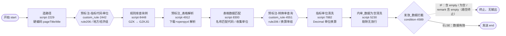

# 01 · 工作流总览

> 工作流：**excel-Agent-test1020**（ID `2112366700040351745`）｜状态：生产｜创建人：陆佳祎｜11 节点 / 10 连线。

## 1. 这个工作流是做什么的

把**一篇政府网站发布的 Excel 经济月报文件**（上街区“主要经济指标”表），解析成**结构化的指标记录**，再完成指标代码匹配、单位换算与空值清洗，最终输出可用于入库/下游的数据；若无有效数据则在条件节点拦截终止。

完整处理链如下：

1. **注入测试入参**（节点 2229 造路径）：当前版本直接返回固定的 `pageTitle`（页面栏目路径）与 `title`（文章标题），替代真实采集。
2. **按路径查指标规则库**（规则 2442 → 脚本 8448）：用 `pageTitle` 从 EDB 指标库查出该页面应有的全部指标（代码、名称、单位、披露频率），得到列式 `GZK`，再由 8448 转成对象数组 `GZKJG`。
3. **解析 Excel**（脚本 4912）：用入参 `fileMd5` 从内网文件服务下载 Excel，用 openpyxl 按**写死的行/列映射**解析出 `excel_data`（指标名、数值、单位、截止日期）。
4. **指标匹配**（脚本 8300）：把解析出的指标名与规则库 `GZKJG` 按名称精确匹配，挂上指标代码、库表单位，并收集去重单位形成 `unitArray`。
5. **查单位换算率**（规则 4551）：用“采集单位 + 库表单位”组合批量查询换算率，回填到 `unitArray`。
6. **单位换算**（脚本 7882）：用 Decimal 按换算率把数值换算到库表标准单位。
7. **空值清洗**（脚本 5230）：剔除代码/数值/日期为空的行；若全空则输出 `empty` 占位。
8. **发放拦截**（条件 4589）：仍含 `empty`（或整体为空）则命中 IF，**悬空终止**；否则走 ELSE 到结束节点输出。

## 2. 与生产工作流的关系（务必先理解）

本工作流是生产工作流「地方经济运行自动工作流测试260928」（ID `2103026958354526210`，47 节点）的**极简子集 / 调试台**。对比：

| 能力 | 生产工作流（47 节点） | 本工作流（11 节点） |
|---|---|---|
| 文件类型 | excel/html/md/json/txt 五路分流 | 仅 Excel（无分流） |
| 解析器来源 | 3 个路由 Agent（qwen-plus）依据 pageTitle 从 Skill 包选择解析器/提示词，再交“代码执行器”运行 | **解析器直接写死在脚本节点 4912**，无 Agent、无 Skill |
| 入参 | 真实采集的 18 个字段（fileMd5/pageTitle/title/fileType…） | 节点 2229 **硬编码** pageTitle/title；fileMd5 等仍需运行时传入 |
| 内审 | 空值/月末季末年末/代码长度/发布日期等多轮 | 仅 1 个空值清洗（5230）+ 1 个拦截条件（4589） |
| 人工标注 | 3 类标注任务 | 无 |
| 单位标准化决策表 | 含 rule404（2279 行 feel_table） | 不使用（直接走 rule206 换算率） |
| 结果 | 合并、发送、可能写库 | 仅输出到结束节点（不写库，tableName=null） |

**共享节点**：规则节点 2442/4551、脚本 8448/8300/7882/5230 与生产工作流中的同名节点（尾号相同）逻辑一致；解析脚本 4912 对应生产工作流里“Excel 解析器”被 Skill 化之前的形态。

## 3. 端到端流程图



平台画布截图见 （原始界面截图未随脱敏版本发布。）。

## 4. 一次真实调试运行的数据样例（来自结束节点留存的调试结果）

结束节点 `data.result` 中保存了一次成功调试运行（目标文件 `fileMd5=C02BBD1DEB3A82CCA96B66D873969E18`，对应上街区《2026年2月份经济月报*地方经济》）的完整上下文，可直观看到每个字段的形态：

- 规则库命中 **21 个指标**（`GZK`，列式：`ZBDM` 代码 / `ZBMC` 名称 / `ZBDW` 单位 / `indicator_release_frequency` 频率），经 8448 转为 `GZKJG` 对象数组；
- Excel 解析出 **60+ 行** `excel_data`（每行 `end_date / indicator_name / indicator_data / indicator_unit`）；
- 经 8300 名称匹配后，成功挂上指标代码的记录进入 `out_data`（示例中 17 条有效，含部分重复指标，如“规模以上工业增加值比去年同期±%”出现两次）；
- 该样例中采集单位与库表单位一致（万元、%），换算率均为 `1.0`，`unitArray.convert_ratio=[1.0,1.0]`；
- `end_date` 由标题解析：标题“2026年2月…”→ 月末日期 `2026-02-28`。

最终 `out_data` 记录示例：

```json
{
  "end_date": "2026-02-28",
  "indicator_data": "441442",
  "indicator_code": "1010103100",
  "publictime": "",
  "indicator_unit": "万元",
  "convert_ratio": "1",
  "indicator_name": "地区生产总值累计",
  "unit_ratio": "",
  "KB_unit": "万元",
  "remark": "",
  "indicator_release_frequency": null,
  "pushtime": null
}
```

> 该调试结果是平台保存在节点配置里的**历史运行快照**，用于理解数据形态；不是每次运行的固定输出。

## 5. 触发方式与输入

- 运行方式为**手动**（`runType=manual`）。开始节点声明了 18 个采集字段（见 03），但本工作流实际只依赖：`fileMd5`（下载文件）、`title`（解析统计期）、`pageTitle`（查指标库，当前被 2229 硬编码）、`publictime`（外部发布日期，当前为空）。
- 节点 2229 的存在意味着：**调试时无需真实采集**，只要运行时能提供 `fileMd5`（和 title），即可跑通解析链路。
