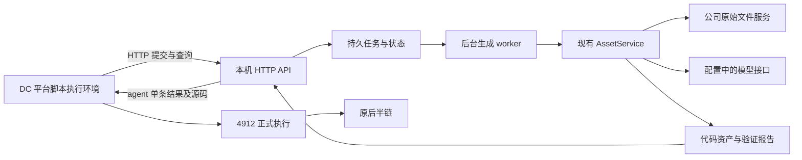

# 本机通信与全流程联调方案

日期：2026-10-20（北京时间）。状态：本方案已按用户授权实现为 0.3.0，用户已确认真实 DC 整体流程测试通过。本文保留通信设计依据，完整介绍见 [V3 技术说明](V3整体流程与技术实现说明.md)。实际命令见 [本机启动指南](V3本机启动与联调指南.md)，验证边界见 [实施记录](V3实施与验证记录.md)。平台继续由用户修改。

最新范围：当前只在本机运行外部框架，与现有 DC 测试工作流打通真实全流程。迁移到公司服务器是未来必须完成的工作，但不纳入本轮设计、实现或验收前置，不为此增加迁移工具或改造现有路径。

本方案沿用 [agent 变量与节点配置手册](agent变量与节点配置手册.md) 的父变量及 14 个字段，不改变 2229、2442、8448 或后半链。

## 1. 推荐的通信方式

在现有本地框架外增加一个 HTTP API 服务，工作流中的“外部框架接入”脚本主动调用它。API 管理持久任务并返回状态和结果，后台 worker 调用现有 AssetService 运行生成流程。工作流拿到代码后仍由 4912 正式执行。

本轮先完成该拓扑在用户电脑上的实际运行和用户工作流验收。服务调用基址独立配置，保留未来切换部署位置的接口边界，其余服务器问题另开后续工作。

当前已增加 HTTP 入口、持久集成队列与独立 worker，原 CLI 和同步应用服务保留。本机回环 HTTP 已验证；正常联调需按指南启动服务，平台到本机的可达性仍需真实验证。

## 2. 本机如何成为可访问的服务

推荐 FastAPI 负责 HTTP 契约、参数校验和路由，Uvicorn 负责运行 ASGI 服务。这是计划新增的薄入口，生成流程继续调用已有应用服务，不重写 LangGraph。FastAPI 官方文档说明了这种应用与 ASGI 服务程序的组合方式。[FastAPI 服务部署说明](https://fastapi.tiangolo.com/deployment/manually/)

用户在实现前已安装 FastAPI/Uvicorn；实现时实际核对为 fastapi 0.150.0、uvicorn 0.54.0，并已维护工程依赖声明，无需本轮再安装。

本机监听可选择已确认的公司网卡地址，或监听 0.0.0.0 并限制允许访问的来源。Uvicorn 默认绑定 127.0.0.1，显式设置 0.0.0.0 可使其在局域网接口监听；它不自动保证防火墙和网络路由可达。[Uvicorn socket 配置](https://uvicorn.dev/settings/)

| 地址 | 含义 |
|---|---|
| 127.0.0.1 / localhost | 调用方自己所在的环境；工作流脚本里填写它不会指向用户电脑 |
| 0.0.0.0 | 服务监听配置，不是工作流调用的目标地址 |
| 本机公司内网 IP + 端口 | 当前工作流应实际访问的地址 |
| 公司内网服务域名 | 后续服务器部署的稳定调用入口 |

通过主机地址读取到 service-6.example.invalid 及另一个 IPv4 地址。service-6.example.invalid 仅作为待核实的本机公司内网候选地址，尚未确认平台到它的可达性。正常服务默认端口 8765；工程冒烟使用隔离的 127.0.0.1 临时端口，测试后已停止，不能据此视为公司内网方向已通过。

实际验证分两步：本机自身请求健康接口确认服务存活；再由 DC 工作流脚本执行环境请求同一接口，确认网络方向正确。浏览器中能访问页面不能替代第二步，因为脚本实际运行在平台后端。

服务只需向工作流执行环境开放必要端口，并使用独立的接口访问令牌；模型凭据留在框架服务端。令牌不进入 agent、PythonCode 或普通业务日志。具体放通范围按公司实际网络规则确定，不在本轮修改防火墙或发布公网服务。

## 3. 需要明确的三条网络连接

| 连接方向 | 作用 | 验证内容 |
|---|---|---|
| DC 脚本执行环境 → 本机 API | 提交任务、查询状态、取回代码 | 本机实际网卡、监听端口、来源允许和认证 |
| 本机 worker → 公司文件服务 | 按 fileMd5 下载真实原始 bytes | 当前已配置下载基址及下载内容 |
| 本机 worker → 已配置模型接口 | 预检、设计、生成、审查 | 当前配置及真实调用表现 |

4912 还会按既有方式从公司文件服务下载本次文件正式执行。外部框架返回代码，不返回本地审查数据来替代这一步。

工作流调用外部框架的地址、框架下载原文件的地址、框架请求模型的地址是三个配置。迁移外部框架时，不应把解析器中的文件下载地址改成新框架 API 地址。

当前框架的下载基址为 http://service-1.example.invalid/api/file/download/。这是本地配置事实，不代表本轮已经探测该网络连接。

## 4. 拟实现的接口和调用过程

以下接口已实现；需启动本机服务并配置接入令牌后使用。

| 接口 | 用途 |
|---|---|
| GET /health | 判断 API 存活与协议版本；不自动请求模型或下载业务文件 |
| POST /v3/excel/jobs | 按稳定身份创建或取得持久任务，返回 job_id 与当前状态 |
| GET /v3/excel/jobs/{job_id} | 查询同一个任务；ready 时返回 agent 的 14 字段单条结果，含完整代码 |
| GET /v3/excel/jobs/{job_id}/reports/{report_name} | 根据允许的报告名获取质量报告，不接受任意本地路径 |

提交内容来自本次工作流：fileMd5、pageTitle、fileType、title、publictime、GZKJG，以及请求幂等身份。GZKJG 按约定转换为对象数组，其他字段读取平台本次输入；不上传本机路径或要求用户手工上传工作簿。

一次执行过程：

1. 接入脚本 POST 本次请求；API 先持久化，创建或找到任务 J。
2. worker 取得 J，构造严格 Task，调用 AssetService；缓存命中直接形成代码结果，未命中走既有生成、验证、有限修复和发布。
3. 脚本通过 GET 查询 J；每次查询只读状态，不再次调用生成入口。
4. ready 时，服务读取 J 绑定的不可变代码版本，验证正文 hash，生成选定的 14 字段。
5. 接入脚本验证响应，正常返回 agent 单条数组；4912 从中读取代码并执行，输出 ExcelData → excel_data。

POST 可用 202 表示已受理但未完成，GET 的 HTTP 200 表示查询成功；业务是否可执行始终看 agent.status，不把 HTTP 状态等同生成成功。

前台仍是用户触发一次工作流并等待结果。API 内部用持久任务处理长过程，不要求外部框架反向调用平台的工作流保存接口，也不需要回调修改用户的节点。

## 5. 为什么 API 和生成 worker 分开

API 需要在生成期间继续响应状态查询。首版建议一个 API 进程、一个独立生成 worker，在同一机器上运行，使用现有 SQLAlchemy/SQLite 基础增加集成任务表，先不引入 Redis、Celery 或强制 Docker。

集成任务表至少保存：对外 job_id、稳定请求身份、输入摘要、已解析上下文、内部 task_id、状态/阶段、首次受理时间、绝对截止时间、选定资产版本及结果/错误引用。

现有 AssetService.run 是同步入口，当前 processing 也可能仅表示租约竞争。网络接口不能把“返回 processing”当成已经有后台作业必定继续；新增 worker 必须实际驱动任务完成或进入明确失败。

请求断开不取消 J，平台重试仍找到 J。进程重启属于另一种情况：应识别遗留任务、检查租约并标明中断，按现有受控恢复策略处理，不承诺任意阶段自动恢复，也不把不明状态直接改成 ready。

独立 worker 与数据库驱动是本项目为重试和持续运行做的选择。FastAPI 的 BackgroundTasks 可用于响应之后的任务，但官方也区分了轻量任务与需要独立处理的重后台工作；不能仅靠进程内回调宣称本项目具备持久恢复。[FastAPI 后台任务说明](https://fastapi.tiangolo.com/tutorial/background-tasks/)

API 和 worker 各自按生命周期管理 Repository 与模型客户端，不跨进程共享一个临时内存对象或数据库连接。生成只使用框架已有的模型、规则和 Skill 适配，接入令牌不传给候选执行器。

## 6. 360 秒和平台重试如何衔接

保持已确认的 360 秒后端硬上限，平台单次节点尝试仍为 120 秒。实际接入脚本主动等待约 115 秒，留约 5 秒收尾，每个 HTTP 请求受本次剩余时间限制，服务端有限长轮询最多 20 秒。三次尝试约 345 秒主动等待，不保证当前平台运行能等到第 360 秒；实际重试次数和间隔需联调核实。

外部任务从第一次受理开始记录绝对截止时间。远程生成可先分配约 300 秒，其他时间预留给队列、网络、发布和返回；进入 AssetService 时传入实际剩余额度。HTTP 或平台重试不重新获得 300/600 秒预算。本地 CLI 的 600 秒配置保留。

重试识别优先采用平台实际提供的稳定运行 ID。没有时，接入脚本对工作流身份与本次固定业务输入计算指纹，服务在有界有效期内将同一指纹绑定到 J；相同输入的重复手工测试在该有效期内也会被视为同一个任务，不能将这种指纹说成唯一运行 ID。

即使第一次节点超时前 agent.job_id 未写回，下一次提交相同输入也能从服务端重新取得 J。不能每次尝试新建 UUID，也不能仅依靠脚本全局变量续跑。

processing 接近尝试时限仍未结束时，使用经实际平台验证的重试信号；失败返回码是否触发重试，需要受控延迟测试确认。预算内无可用代码则失败，已有基本合格候选按 V2 规则保留并标注质量；未完成代码不能进入 4912。

## 7. 我需要实现的工程改动

| 部分 | 改动 |
|---|---|
| HTTP 入口 | FastAPI 路由、请求/响应契约、令牌校验、健康和报告接口 |
| 应用装配 | 抽出 CLI 当前 build_service 的公共装配，供 API/worker 和原 CLI 复用 |
| 集成任务服务 | 稳定请求身份、先落库后受理、状态、预算和内部任务关联 |
| worker | 从持久队列取得任务，调用现有 AssetService，处理租约竞争和终态 |
| 代码交付适配 | 读取固定 version_path、核对 hash、只输出 agent 的 14 个字段 |
| 配置 | 服务监听、访问令牌、工作流调用基址、远程任务预算及目录 |
| 平台脚本草案 | 接入脚本主动提交和查询；4912 的通用加载包装器，交给用户配置 |
| 验证 | 协议、重试同任务、正文无损传输、预算和业务实际执行 |

服务端配置 DC_API_HOST、DC_API_PORT、DC_API_TOKEN 及预算参数已加入 Settings，通过独立 runtime/service/service.env 叠加原 .env；工作流脚本使用 API_BASE_URL 和 API_TOKEN 常量。原 .env 不修改；完整初始化命令见 [本机指南](V3本机启动与联调指南.md)。

首版完成后，本机测试期间需要保持服务进程、网络和电脑在线。调用基址独立配置，本机 IP 变化时更新该配置，不修改生成逻辑或 agent 字段。

## 8. 未来必做项，暂不展开

迁移到公司服务器明确保留为未来必须完成的工作。当前只保留服务基址可配置、通信契约与业务逻辑分离这两个自然边界，不设计服务器部署、操作系统适配、迁移工具或路径重写。

现有本机 Skill、code、runtime 和目录绑定本轮继续使用；它们不是当前本机测试的障碍。未来迁移再专门核对依赖、资料、资产、数据库和路径，不把该工作提前加入当前验收。

## 9. 后续落地顺序与当前状态

建议按以下顺序推进，不把网络问题和模型问题混为同一个错误：

1. 实现最小 API 和健康接口，在本机 dc 环境完成自身请求验证。
2. 用户通过 DC 脚本节点请求本机健康接口，确认真正的运行端到端网络方向。
3. 接上现有资产缓存，返回真实固定版本代码并核对 agent 映射与 SHA256。
4. 接上持久任务和 worker，用受控延迟验证跨 120 秒重试时只有一个 J。
5. 在已确认预算内做真实新生成，用户亲自运行工作流并核对结果。
6. 复测同来源的新运行和已有代码复用，确认没有复用旧数据、旧日期或重复生成任务。

工程实现阶段完成了服务与节点脚本、隔离回环 HTTP、真实 spawn worker 和脚本传输执行验证，以及当时真实代码与源 bytes 的执行器兼容回归；开发侧没有修改防火墙或平台。用户随后自行启动服务并亲自完成真实工作流测试，已确认整体通过。没有新增平台导出用于补写精确生成耗时或最终条数，本轮技术说明仅记录已知验收结论。
