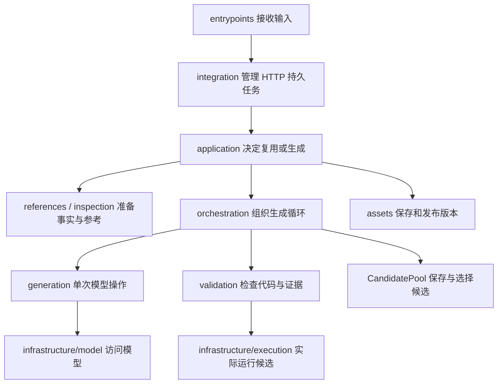

# 外部智能体框架源码学习计划与逐文件导读

日期：2026-10-21。依据当前 `agent/src/dc_agent` 源码整理，适用于已通过真实工作流测试的 V3 Demo。

2026-10-23 增补：新增 `validation/readiness.py` 和 `repair/`（问题会话、已验证记忆）。学习生成—验证主链之后，可按 [常见空结果诊断与修复记忆说明](V3常见空结果诊断与修复记忆说明.md) 第7—9节阅读这几个新增文件；下文原学习计划保留当时的结构说明。

学习目标：先能解释整体调用关系，再能跟踪一条任务，最后理解生成、校验、持久化和异常处理的细节。第一轮不要求记住每一行，也不需要先把所有依赖库系统学完。

本文是“怎样读代码”的指南。业务和技术全流程可对照 [V3 整体流程与技术实现说明](V3整体流程与技术实现说明.md)，实际平台脚本与配置见 [节点代码目录](工作流节点代码/README.md)。

## 1. 先区分工程目录与 Python 包

```text
agent/
  run_agent.py              本地命令行启动脚本
  run_service.py            V3 HTTP 服务启动脚本
  src/
    dc_agent/               真正的 Python 包
      __init__.py
      __main__.py
      cli.py
      config.py
      bootstrap.py
      domain/               任务、候选、报告等数据对象
      ports/                可替换依赖的接口约定
      entrypoints/          CLI、HTTP 及服务启动入口
      integration/          V3 持久任务、worker、交付协议
      application/          一次资产申请任务的总控
      references/           任务表和可选参考资料读取
      inspection/           真实源文件 bytes 的结构检查
      generation/           Skill 加载与单次模型操作
      profiles/             项目专用模型行为规范
      orchestration/        生成、校验、审查、修复的循环编排
      validation/           代码接口和源证据校验
      assets/               代码路径、版本、保存与发布
      infrastructure/       外部资源的实际访问实现
        model/              模型 HTTP 传输与流式响应解析
  tests/                    各模块的行为示例和回归测试
  code/                     已生成并登记的解析资产
  rule/                     todo 和参考工作簿
  runtime/                  任务数据库、中间结果、日志和报告
  workflow_agent_test_v3/
    工作流节点代码/          在 DC 平台运行的两个独立脚本
```

`src` 是源码存放目录，`dc_agent` 是 import 时使用的包名。`src` 下是“生成和交付解析器的框架”，`code/` 下才是“针对具体来源生成的业务解析器”。它们的修改目标不同。

两个 DC 节点脚本不在 `src` 中，因为它们被复制到平台运行，不直接导入用户本机的 `dc_agent` 包。

## 2. 用六个问题认识整体架构

| 先回答的问题 | 主要目录 | 通俗解释 |
|---|---|---|
| 外部怎样进入程序？ | `entrypoints` | 程序的入口 |
| 长任务怎样持续运行、被重试查询？ | `integration` | 工作流接入与后台任务管理 |
| 一次申请到底该复用还是生成？ | `application` | 一次任务的总控 |
| 生成过程中先做什么、失败后怎么办？ | `orchestration` | 生成流程的调度与分支 |
| 模型怎样被调用，结果怎样验证？ | `generation`、`validation` | 生成候选与检查候选 |
| 真实文件、模型、数据库、代码版本如何处理？ | `inspection`、`references`、`assets`、`infrastructure` | 具体资源与文件操作 |

`domain` 给这些模块提供共同的数据对象；`ports` 规定依赖必须提供什么方法；`config` 提供配置；`bootstrap` 将实际实现组装起来。



这是一张业务调用概览，不是全部 import 依赖图。CLI 可以绕过 HTTP 集成层，直接调用同一个 AssetService。

## 3. 第一轮先抓住两条主线

### 3.1 V3 平台调用主线

```text
本机启动：
run_service.py
  → entrypoints/server.py: main()
  → entrypoints/http.py: create_app()
  → WorkerSupervisor.start() 启动独立 worker

平台提交：
外部框架接入.py: main()
  → POST /v3/excel/jobs
  → ExcelJobRequest.task_payload()
  → JobStore.submit() 持久化

后台执行：
worker.run_once()
  → JobStore.claim()
  → bootstrap.build_service()
  → AssetService.run()
  → JobStore.finish()

平台查询与执行：
GET /v3/excel/jobs/{job_id}
  → delivery.public_result()
  → 返回 agent
  → 动态代码执行器_4912.py: main()
  → 调用交付代码中的 main(params)
  → ExcelData 映射 excel_data
```

启动服务、处理 HTTP 请求、worker 执行任务是不同阶段。HTTP 的 POST 处理函数不直接同步运行整个模型生成过程。

### 3.2 框架内部主线

```text
AssetService.run(task)
  ├─ 已有合法资产 → 返回 ready，cache_hit=True
  └─ 没有资产
       → 取得来源租约，再次查资产
       → WorkbookRuleContext.load()
       → 下载真实 bytes，inspect_source()
       → ContentPreflight.check()
       → GenerationWorkflow.run()
           → design
           → generate
           → validate
           → review
           → 有限 repair / 再次 generate
           → CandidatePool.select()
       → ArtifactStore.publish()
       → 记录质量报告并返回 Result
```

第一遍只需要能画出这两条线。暂时不深挖 SSE、数据库事务和进程树清理。

## 4. 阅读代码前需要掌握的数据对象

这些对象主要定义在 [domain/__init__.py](../src/dc_agent/domain/__init__.py)。

| 对象 | 可以怎样理解 | 关注的内容 |
|---|---|---|
| `Task` | 一次框架处理任务 | 来源、文件类型、文件标识、标题、GZK、派生 key |
| `Rule` | 一条 GZK 规则 | 指标名与代码的类型及有效性 |
| `Design` | 生成代码之前的提取方案 | 名称、单位、日期逻辑与位置 |
| `Candidate` | 某一轮生成的候选 | 完整源码、证据模式和证据 |
| `Evidence` | 一条输出的源位置说明 | 数值来自哪里，名称、单位、日期引用哪里 |
| `Review` | 模型语义审查意见 | 是否接受、具体问题、引用、正确性/覆盖分类 |
| `Check` / `Report` | 程序检查结果 | 哪项检查通过、失败或警告，以及实际记录 |
| `Result` | 框架最终返回对象 | ready/failed 等状态、资产或错误、报告 |
| `ContentDecision` | 内容粗判结果 | has_data / no_data / uncertain |
| `AgentError` | 带明确错误码的异常 | code、stage、retryable、details |

另外三个常见变量要区分：

- `raw`：原始文件 bytes。
- `inspection`：程序检查 raw 后形成的统一结构，含工作表/section、坐标和值等。
- `task_info/references`：从任务表与可选参考资料取得的业务规则，不能代替 raw 的真实事实。

### 三层输出不可混淆

1. 内部 `Result`：AssetService 的框架结果。
2. 对外 `agent`：从 Result 挑选出来的 14 字段交付对象。
3. 业务 `ExcelData`：解析器真正执行后得到的数据记录。

`ready` 表示有代码可交付；平台执行后的 `code=0` 表示解析器成功返回；最终结果是否符合业务仍由实际数据核验确认。

## 5. 建议学习计划：8 次，每次约 60—90 分钟

“一次”可以按你自己的时间拆成两段，不要求连续八天。每次完成一个可检查的成果，比读了多少行更重要。

| 次数 | 主题与阅读顺序 | 本次应能回答 | 学习成果 |
|---|---|---|---|
| 1 | 本文第1—3节 → `run_service.py` → `entrypoints/server.py` → `http.py` 路由 → `worker.run_once()` → `service.run()` 大分支 | 一次平台任务经过哪些进程和模块？ | 画出两条主线，标注平台、本机API、worker |
| 2 | `domain/__init__.py` → `config.py` → `ports/__init__.py` → `bootstrap.py` | Task、Candidate、Result 有什么区别？实际依赖怎样接进来？ | 给关键对象各写一句解释，画一张依赖装配图 |
| 3 | `service.py:run()` → `assets/layout.py` → `store.py:lookup()` → `storage.py:register/current/claim` | 什么情况下不调用模型？文件相同与来源相同有什么区别？ | 手工跟踪一条缓存命中路径 |
| 4 | `integration/contracts.py` → `jobs.py:submit/get/claim/finish` → `worker.py` → `delivery.py` → 回看 `http.py` | 重试为什么不重复生成？job_id 与内部task_id有什么区别？ | 画出状态变化和300/360秒预算起点 |
| 5 | `references/workbooks.py` → `infrastructure/source.py` → `inspection/readers.py` → `application/preflight.py` | 规则和真实数据怎样进入流程？为什么 no_data 与下载失败不同？ | 找一份历史 inspection/design 对照源位置 |
| 6 | `generation/skills.py` → `profiles/source_gzk.md` → `generator.py` → `workflow.py` 图连接与节点 | 模型每一阶段分别收到什么、返回什么？谁决定下一步？ | 画出 design/generate/validate/review/repair 图 |
| 7 | `validator.py` → `execution.py` → `_runner.py` → `candidates.py` → `store.py:publish` → `diagnostics.py` | 怎样验证代码？为何后续修复失败仍可保留旧候选？ | 解释一份 validation/review/selection 报告 |
| 8 | `model/gateway.py` → `chat_stream.py` → `responses.py` → `locking.py/files.py` → 对应 tests | 网络断流、发布中断、超时分别由谁处理？ | 不看文档复述一次新生成任务及三种失败路径 |

第一遍读 `workflow.py` 时，先看末尾 `graph = StateGraph(...)` 的节点和连线，再回到各个嵌套函数。不要从第1行一路逐行读到第622行才寻找整体流程。

### 如果 Python 工程代码还不熟

先补用得到的概念即可：类型注解、类与对象、异常、`with` 上下文管理器、字典/列表、JSON、`pathlib.Path`、`@property`。读到对应层时再补 Pydantic、Protocol、async/await、进程/线程、SQL 事务和 AST。

例如，遇到 `ModelGateway(Protocol)`，先理解成“只要对象提供 complete 方法就可被这里使用”；不必在第一轮研究类型检查器实现。

## 6. 逐目录、逐文件说明

阅读标记：**A** 为第一轮主干，**B** 为第二轮机制，**C** 为最后精读或按问题查阅。标记只表示阅读顺序，不表示文件重要程度。

### 6.1 包根目录：配置、装配和兼容入口

| 文件 | 作用与关键入口 | 阅读重点 | 顺序 |
|---|---|---|---|
| [__init__.py](../src/dc_agent/__init__.py) | 定义包说明及 `__version__` | 当前版本0.3.0；没有业务总流程 | C |
| [__main__.py](../src/dc_agent/__main__.py) | `python -m dc_agent` 的包执行入口，转到 CLI | 它启动本地CLI，不是HTTP服务 | C |
| [cli.py](../src/dc_agent/cli.py) | 为旧导入和调用方式保留的兼容入口 | 实际逻辑在 entrypoints/cli.py | C |
| [config.py](../src/dc_agent/config.py) | `Settings`：模型、目录、下载、runner、修复和API参数；解析路径与阶段输出预算 | 看配置名与用途，不需要读取真实密钥 | A |
| [bootstrap.py](../src/dc_agent/bootstrap.py) | `build_service(settings)`：组装 AssetService 与具体依赖 | 哪个对象实现模型、下载、规则、执行；CLI与worker共用 | A |

可以把 bootstrap 看作“把各个部件接起来”的文件。它创建组件，但不决定生成图每一步的顺序。

### 6.2 `domain/`：整个系统共用的数据语言

| 文件 | 作用与关键入口 | 阅读重点 | 顺序 |
|---|---|---|---|
| [domain/__init__.py](../src/dc_agent/domain/__init__.py) | Task、Rule、Design、Candidate、Evidence、Review、Check、Report、Result、ContentDecision、AgentError；以及稳定JSON、digest和名称标准化 | 先读对象字段，再读Task派生属性与校验器 | A |

这是 `__init__.py` 中的重要例外：它不是一个可以整体跳过的空文件，而是集中放了数据模型。

`Task.source_key` 对应来源资产身份，`Task.input_hash` 对应本次输入，`source_id` 对应要下载的文件标识。`Task.parser_params()` 整理本地候选验证所需的业务参数；它和平台4912传入的五字段契约要分别看清。

### 6.3 `ports/`：可替换组件的接口约定

| 文件 | 作用与关键入口 | 阅读重点 | 顺序 |
|---|---|---|---|
| [ports/__init__.py](../src/dc_agent/ports/__init__.py) | 使用 Protocol 定义 ModelGateway、SourceProvider、ReferenceProvider、RuleContextProvider、ExecutionRunner、SkillProvider、ToolRegistry | 关注方法签名：调用方需要什么能力；真实实现在哪个文件 | A |

这里的 ports 是架构上的“接口边界”，不是8765这样的网络端口。`ModelGateway.complete()` 规定模型调用能力，具体HTTP实现位于 infrastructure/model/gateway.py。

`ToolRegistry` 目前只是预留接口，不能因为看到 describe/invoke 就认为已经有通用工具执行系统。

### 6.4 `entrypoints/`：外部如何进入框架

| 文件 | 作用与关键入口 | 阅读重点 | 顺序 |
|---|---|---|---|
| [entrypoints/__init__.py](../src/dc_agent/entrypoints/__init__.py) | 包说明，没有业务实现 | 看一眼即可 | C |
| [entrypoints/server.py](../src/dc_agent/entrypoints/server.py) | `initialize_config/load_settings/main`：初始化独立API配置，检查配置，启动Uvicorn | 与根run_service.py的关系；配置叠加；启动不等于受理任务 | A |
| [entrypoints/http.py](../src/dc_agent/entrypoints/http.py) | `create_app()` 定义认证、生命周期、health、submit、query、report及422处理 | submit只是入队；query从持久结果交付；worker在lifespan中启停 | A |
| [entrypoints/cli.py](../src/dc_agent/entrypoints/cli.py) | `load_task/check_model/main`：本地命令分派、样例/JSON任务适配、检查与运行/重试入口 | 先看main命令分支，再看load_task；CLI也调用同一AssetService | B |

对新手来说，HTTP和CLI相当于两种“进门方式”。进入核心后没有两套互相独立的生成框架。

### 6.5 `integration/`：V3对接工作流的专用层

| 文件 | 作用与关键入口 | 阅读重点 | 顺序 |
|---|---|---|---|
| [integration/__init__.py](../src/dc_agent/integration/__init__.py) | 包说明 | 无额外运行逻辑 | C |
| [integration/contracts.py](../src/dc_agent/integration/contracts.py) | `ExcelJobRequest`、`AGENT_FIELDS`、`TERMINAL`：公开入参、14字段、终态集合 | 外部请求先校验，再转内部Task；API只开放Excel/CSV | A |
| [integration/jobs.py](../src/dc_agent/integration/jobs.py) | `JobStore`：SQLite提交、查询、领取、完成、延后、失败、恢复和超时 | 先submit/get，再claim/finish，最后事务、token和recover | B |
| [integration/worker.py](../src/dc_agent/integration/worker.py) | `run_once()` 执行一个任务；`WorkerSupervisor` 管spawn进程和监督；`terminate_worker_tree`做结束处理 | 先run_once，再start/_worker_main，最后_monitor/stop | B |
| [integration/delivery.py](../src/dc_agent/integration/delivery.py) | `public_result/read_code/report_paths/scrub`：从内部结果构造agent，读取固定版本，校验身份/hash并提供报告 | 内部Result如何收敛为14字段；为什么不用可变current文件 | B |
| [integration/input_errors.py](../src/dc_agent/integration/input_errors.py) | `validation_diagnostic()`：只返回/记录安全的校验位置、类型、阶段和诊断编号 | 这是422诊断，不是Task业务校验规则本身 | C |

本层解决的是“平台如何稳定申请并取得代码”。实际生成决策仍在 application/orchestration。

### 6.6 `application/`：一次资产申请任务的总控

| 文件 | 作用与关键入口 | 阅读重点 | 顺序 |
|---|---|---|---|
| [application/__init__.py](../src/dc_agent/application/__init__.py) | 包说明，没有导出业务对象 | 不必精读 | C |
| [application/service.py](../src/dc_agent/application/service.py) | `AssetService`：注册任务、资产复用、来源租约、准备生成、发布、错误和资源释放 | `run()` → `_generate()` → `_prepare()`；最后读finally与错误映射 | A |
| [application/preflight.py](../src/dc_agent/application/preflight.py) | `inspect_source()` 统一格式检查入口；`ContentPreflight.check()`调用模型粗判是否有数据 | 真实bytes检查与模型粗判是两步；只有no_data拦截 | B |
| [application/diagnostics.py](../src/dc_agent/application/diagnostics.py) | `diagnostic_paths/record_diagnostics`：聚合候选、验证、审查、选择和中断，生成完整报告及JSONL总账 | 它汇总检查结果，不负责执行具体检查 | C |

`service.py` 是最值得反复回来的文件。读其他模块时始终问：它在 service 的哪一步被调用？

### 6.7 `references/`：读取业务任务与参考资料

| 文件 | 作用与关键入口 | 阅读重点 | 顺序 |
|---|---|---|---|
| [references/__init__.py](../src/dc_agent/references/__init__.py) | 导出 `WorkbookRuleContext` | 为调用方提供简短导入路径 | C |
| [references/workbooks.py](../src/dc_agent/references/workbooks.py) | `WorkbookRuleContext.load()`：读取快照，精确定位todo唯一行，按路径代码选可选参考Sheet | `_task_info()`定位任务，`load()`组装上下文，`_open()`处理文件快照 | B |
| [references/evidence.py](../src/dc_agent/references/evidence.py) | `reference_ref_exists()`：检查模型审查引用的参考位置是否在本次已提供快照中 | 审查引用有效性；不搜索任意磁盘资料 | C |

这个目录读取的是规则，不是本次待提取的真实数据文件。

### 6.8 `inspection/`：把原始文件变成可核验的事实结构

| 文件 | 作用与关键入口 | 阅读重点 | 顺序 |
|---|---|---|---|
| [inspection/__init__.py](../src/dc_agent/inspection/__init__.py) | 导出 `InspectionError/inspect_bytes` | 简化其他模块导入 | C |
| [inspection/readers.py](../src/dc_agent/inspection/readers.py) | `inspect_bytes()` 统一入口；`_xlsx/_xls/_text/_unwrap`等按实际bytes读取内容、处理容器并保留位置和类型 | 先看统一输出，再看你关心的Excel类型；最后看压缩/大小/公式限制 | B |

它产生 inspection，不直接把复杂业务表解析成最终四字段。业务解析器仍要生成并执行。

### 6.9 `generation/`：单次模型操作的封装

| 文件 | 作用与关键入口 | 阅读重点 | 顺序 |
|---|---|---|---|
| [generation/__init__.py](../src/dc_agent/generation/__init__.py) | 导出 `Generator/SkillRegistry` | 没有额外生成循环 | C |
| [generation/skills.py](../src/dc_agent/generation/skills.py) | `SkillRegistry.load()`：按kind读取对应SKILL.md，叠加项目profile并记录hash | Skill在这里作为文本规范；不启动通用技能执行器 | A |
| [generation/generator.py](../src/dc_agent/generation/generator.py) | `Generator.call/design/generate/review`：构造阶段指令和schema、调用gateway、校验返回模型并保存成功日志 | 单次模型操作怎样形成；谁传上下文；相同操作怎样复用 | A |

这里回答“这一轮怎样请求模型”。需要不需要下一轮，由 orchestration 决定；HTTP怎样发出和SSE怎样解析，由 infrastructure/model 负责。

### 6.10 `profiles/`：本项目对模型的行为规范

| 文件 | 作用 | 阅读重点 | 顺序 |
|---|---|---|---|
| [profiles/source_gzk.md](../src/dc_agent/profiles/source_gzk.md) | `source_rules_v2`项目适配文本，规定源事实、规则/GZK角色、名称/单位/日期、输出契约、证据和质量策略 | 与generator/workflow的当次产物契约一起看；文件名为历史命名 | A |

这是模型输入的一部分，虽不是.py，也直接影响生成行为。profile中保留侧档证据描述，而当前Python新生成的当次 parser_contract 明确指定 runtime 证据协议，并优先于侧档描述；不能只看一份规范就忽略更具体的当次契约。

### 6.11 `orchestration/`：决定每一步的顺序与分支

| 文件 | 作用与关键入口 | 阅读重点 | 顺序 |
|---|---|---|---|
| [orchestration/__init__.py](../src/dc_agent/orchestration/__init__.py) | 包说明 | 无额外图逻辑 | C |
| [orchestration/workflow.py](../src/dc_agent/orchestration/workflow.py) | `FlowState`、`load_saved_candidate()`、`GenerationWorkflow.run()`：定义节点、连接图、保存checkpoint、处理中断与候选回退 | 先图连接，再state/context，再节点，最后恢复和异常 | A概览 / B精读 |
| [orchestration/candidates.py](../src/dc_agent/orchestration/candidates.py) | `CandidatePool.observe/score/best/select`：保留、评分并选择可用候选，形成质量和fallback信息 | 为什么最新代码未必最好；基本可用与语义接受怎样区分 | B |

`workflow.py` 的run内部有多个嵌套函数。它们定义出来后作为LangGraph节点注册，不是按源文件行号定义完就立即顺序执行。

### 6.12 `validation/`：检查候选代码及其结果

| 文件 | 作用与关键入口 | 阅读重点 | 顺序 |
|---|---|---|---|
| [validation/__init__.py](../src/dc_agent/validation/__init__.py) | 导出 Validator 与几个公共检查工具 | 实现仍在validator.py | C |
| [validation/validator.py](../src/dc_agent/validation/validator.py) | `Validator.validate()`、`_static/_evidence/_prompt`；辅助number/source_cells/check_design | 静态→实际执行→四字段→逐条证据；GZK统计为诊断；prompt分支暂后读 | B |
| [validation/source_values.py](../src/dc_agent/validation/source_values.py) | `positive_percentage_points/title_month_end`：保守识别明确源语义或标题中唯一月期 | 小函数可先读，理解不可靠时返回None的设计 | B |
| [validation/candidate_repairs.py](../src/dc_agent/validation/candidate_repairs.py) | `RepairProposal/propose_regex_escape_repair/preserves_source_records`：针对已知过度转义提出局部修复，并检查已验证记录保持 | 修复提案还要真实运行验证；不是任意正则自动修复器 | C |

Validator给出检查结果，CandidatePool决定哪些候选可保留和最终选哪一个，diagnostics汇总报告。三个职责不能混为一谈。

### 6.13 `assets/`：代码和版本怎样存放与切换

| 文件 | 作用与关键入口 | 阅读重点 | 顺序 |
|---|---|---|---|
| [assets/__init__.py](../src/dc_agent/assets/__init__.py) | 包说明 | 无业务导出 | C |
| [assets/layout.py](../src/dc_agent/assets/layout.py) | `AssetLayout`：pageTitle转换文件名、类型目录、current路径与碰撞比较 | 路径计算本身不写文件；适合用来入门 | A |
| [assets/store.py](../src/dc_agent/assets/store.py) | `ArtifactStore.lookup/save_candidate/publish/verify_historical`及内部恢复：登记、正文hash、owner、runtime绑定、不可变版本、发布journal | 第一遍lookup，第二遍publish，最后_recover/_publish一致性 | B |

资产文件实际存取与发布在这里；任务、事件、来源租约、当前资产登记的数据库操作由 infrastructure/storage.py 承担。

### 6.14 `infrastructure/`：外部资源的实际操作

| 文件 | 作用与关键入口 | 阅读重点 | 顺序 |
|---|---|---|---|
| [infrastructure/__init__.py](../src/dc_agent/infrastructure/__init__.py) | 集中导出write_json、模型适配器、源文件与文本参考提供器等 | 只是便于调用，不是运行总入口 | C |
| [infrastructure/source.py](../src/dc_agent/infrastructure/source.py) | `FileSourceProvider.read()`按任务标识下载bytes或使用本地开发源；`LocalReferences.load()`读显式提供的小型文本参考 | 取得bytes；LocalReferences不负责todo/名称Excel工作簿 | B |
| [infrastructure/storage.py](../src/dc_agent/infrastructure/storage.py) | `Repository`用SQLAlchemy访问tasks.sqlite，管理任务、事件、来源租约与资产登记 | register/current→claim/release→activate，理解token条件保护 | B |
| [infrastructure/execution.py](../src/dc_agent/infrastructure/execution.py) | `LocalProcessRunner/DockerRunner`：准备执行输入，创建运行环境，限时执行并读取严格JSON结果 | 先LocalProcessRunner.run，再辅助函数；Docker可最后读 | B |
| [infrastructure/_runner.py](../src/dc_agent/infrastructure/_runner.py) | 实际子进程入口：安装本次下载mock、加载候选、调用入口、限量日志和结果回传 | 与execution.py一父一子；不作为用户命令直接运行 | B |
| [infrastructure/files.py](../src/dc_agent/infrastructure/files.py) | `filesystem_path/write_json`：Windows长路径适配、小型JSON临时写入再替换 | 为什么不直接覆盖正式JSON | C |
| [infrastructure/locking.py](../src/dc_agent/infrastructure/locking.py) | `publication_lock`：跨进程短文件锁，区分Windows与POSIX实现 | 锁的范围、超时及finally释放；不是数据库来源租约本身 | C |

`execution.py` 是父进程的执行适配器，`_runner.py` 是被复制到临时目录、由独立Python解释器启动的子程序。本地子进程隔离不等于完整安全沙箱。

### 6.15 `infrastructure/model/`：模型网络协议细节

| 文件 | 作用与关键入口 | 阅读重点 | 顺序 |
|---|---|---|---|
| [model/__init__.py](../src/dc_agent/infrastructure/model/__init__.py) | 子包说明 | 无额外模型逻辑 | C |
| [model/gateway.py](../src/dc_agent/infrastructure/model/gateway.py) | `ChatCompletionsGateway.complete()`、`model_transport_error()`：配置模型请求、选择协议、执行HTTP、限时重试、错误分类和metrics | 先看输入/返回与请求构造，再看重试循环；类名兼容保留，也支持Responses | B |
| [model/chat_stream.py](../src/dc_agent/infrastructure/model/chat_stream.py) | `ModelResponseReader`：解析Chat Completions普通JSON/SSE、分块/分行内容、终态、用量和错误 | 最后精读；按read→事件解析→结束校验分层理解 | C |
| [model/responses.py](../src/dc_agent/infrastructure/model/responses.py) | `ResponsesResponseReader`：处理Responses协议的正文与流式事件 | 与chat_stream职责相似，但事件格式不同；复用部分基础解析 | C |

不要从SSE解析器开始理解“智能体”。这些文件负责网络可靠性，不决定指标名称、单位、日期或生成循环。

## 7. 为什么要拆成这些目录

先理解职责分离，不必先记架构流派名称。

| 看起来相似的模块 | 实际区别 |
|---|---|
| service / workflow / generator / gateway | 一次任务总控 / 候选循环顺序 / 单次模型操作 / 模型HTTP传输 |
| source / readers / workbooks | 获取原始bytes / 检查真实数据 / 读取业务规则参考 |
| domain / integration.contracts | 框架内部数据契约 / 面向工作流的有限公开协议 |
| jobs / storage | V3 HTTP持久任务库 / 原框架任务、事件、租约及资产登记库 |
| layout / store / Repository | 计算业务路径 / 管代码文件和发布 / 管数据库记录 |
| validator / CandidatePool / diagnostics | 检查具体候选 / 保存并选优 / 汇总完整报告 |
| worker监督 / runner限时 / publication_lock | 管生成进程生命周期 / 管一次候选执行 / 管短时间文件操作互斥 |

### 一个具体的“接口与实现”例子

1. `ports.ModelGateway`规定提供`complete(...)`。
2. `Generator`调用这个接口，不负责HTTP请求细节。
3. `infrastructure.model.gateway.ChatCompletionsGateway`实现实际调用。
4. `bootstrap.build_service()`把这个实现交给应用组件。
5. 测试可以放入`ScriptedModel`，提供同样的complete方法，用受控回复学习流程。

这就是依赖可替换的实际意义。它使得学习和测试生成流程时不必每次请求真实模型。

## 8. 怎样阅读一个较长文件

每个文件先填写下面这张小卡片：

```text
这个文件解决的问题：
公开入口函数/类：
收到的输入类型：
返回的结果类型：
谁调用它：
它调用谁：
是否读写文件/数据库/网络或启动进程：
怎样表示失败，谁接住异常：
```

对函数也是先看“输入—输出—副作用”，再看逐行实现。`_`开头的辅助函数一般在需要时回看；但`_runner.py`是关键内部执行程序，不能因为下划线就认为不重要。

### 建议优先练习的两个文件

**`assets/layout.py`：** 输入pageTitle与fileType，输出确定的目录/文件名；没有复杂网络。适合熟悉dataclass、property、路径和参数校验。

**`application/service.py`：** 输入Task，返回Result，期间可能访问数据库、文件、模型和runner。适合学习用较短的总控函数组织多个组件。

不要要求第一次就把`store._recover()`、worker的进程树终止以及SSE事件边界全部记住。先能解释它们为什么存在，再进入细节。

## 9. 用测试理解真实行为

测试是“给什么输入，应出现什么行为”的可执行说明。先读一个测试的准备、调用、断言，不必先研究pytest全部功能。

| 正在学习的模块 | 对照测试 | 建议观察 |
|---|---|---|
| 应用总控 | [test_application.py](../tests/test_application.py) | ScriptedModel如何替代真实模型；生成后怎样再次复用 |
| 内容粗判 | [test_preflight.py](../tests/test_preflight.py) | has_data/no_data/uncertain与错误怎样区分 |
| 原始检查 | [test_inspection.py](../tests/test_inspection.py) | 实际bytes与统一inspection输出 |
| 规则定位 | [test_rule_context.py](../tests/test_rule_context.py)、[test_rule_integration.py](../tests/test_rule_integration.py) | 唯一来源、可选Sheet、快照变化 |
| 候选验证 | [test_validation.py](../tests/test_validation.py) | 哪些字段和源引用会导致失败 |
| 本地执行 | [test_execution.py](../tests/test_execution.py)、[test_runner_config.py](../tests/test_runner_config.py) | 子进程入口、下载mock、环境、超时与执行器选择 |
| 候选保留/局部修复 | [test_candidate_retention.py](../tests/test_candidate_retention.py)、[test_candidate_repairs.py](../tests/test_candidate_repairs.py) | 后续失败为何仍可选早期版本；窄修复的采用条件 |
| 资产版本 | [test_asset_store.py](../tests/test_asset_store.py) | 路径冲突、固定版本、hash及发布恢复 |
| HTTP任务 | [test_http_integration.py](../tests/test_http_integration.py) | 同输入幂等、终态、身份校验、队列和worker |
| 字段诊断 | [test_http_input_diagnostics.py](../tests/test_http_input_diagnostics.py) | 422指出字段，但不泄露完整拒绝输入 |
| 预算衔接 | [test_remote_budget.py](../tests/test_remote_budget.py) | 注册、下载及双入口验证如何共用绝对截止时间；队列创建时间另对照HTTP测试 |
| 模型传输 | [test_model_errors.py](../tests/test_model_errors.py)、[test_streaming.py](../tests/test_streaming.py)、[test_responses.py](../tests/test_responses.py) | 网络错误、SSE分块与完整终态 |
| V3全局装配 | [test_live_service.py](../tests/test_live_service.py)、[test_workflow_nodes.py](../tests/test_workflow_nodes.py) | 真实回环HTTP/worker及独立平台脚本如何衔接 |

可以从这个受控模型测试开始读：`test_application.py::test_real_bytes_generation_validation_reuse`。它使用本地生成的真实工作簿bytes、ScriptedModel和本地执行器，展示“生成—验证—保存—复用”，不需要真实模型回复来讲解流程。

本轮学习指南编写没有运行真实任务、请求模型或改动已有资产。后续动手时先选择隔离测试夹具，再考虑连接真实服务。

## 10. 结合已跑通案例做四次纸面跟踪

### 练习一：只跟踪缓存命中

给定一个已有合法代码资产的Task，从`service.run()`开始标出返回前调用了什么，以及哪些操作完全跳过。

应能回答：为什么复用时不重新下载源文件，而4912仍使用本次fileMd5产生数据？

### 练习二：跟踪一次新生成

画出 `task → task_info/references → raw/inspection → Design → Candidate → Report → Review → selection → artifact → Result → agent`，在每个箭头旁写出对应函数。

### 练习三：跟踪一次后续修复失败

假设candidate-0已经通过基本检查并入池，candidate-1遇到`MODEL_*`错误或预算中断。对照`CandidatePool`和workflow末尾的异常处理，说明保留了谁、怎样选择、质量状态为何可能带warning，并找出为什么不是任意程序异常都自动回退。

### 练习四：跟踪一次参数校验失败

假设API收到空fileType，按`ExcelJobRequest → RequestValidationError处理 → validation_diagnostic → 接入脚本错误显示`追踪。确认此时没有成功创建正常后台生成任务。

这四种情形覆盖正常复用、新生成、生成中断和入口错误，比第一遍研究所有边角路径更容易建立结构感。

## 11. 学到什么程度算建立了整体理解

不看源码也能回答以下问题，就可以开始更深的逐行阅读：

1. 为什么HTTP接收请求后不直接等模型生成完？
2. `job_id`、内部`task_id`、`source_key`、`artifact_version`和`code_sha256`各表示什么？
3. 代码资产复用和请求幂等为什么是两件事？
4. 真实输入bytes、规则参考和GZK怎样各司其职？
5. service、workflow、generator、gateway各管哪一层？
6. 为什么验证要实际执行代码，为什么还需要语义审查？
7. 为什么后生成的候选不一定覆盖较早候选？
8. 为什么返回固定version_path，为什么两侧都检查hash？
9. 4912的正式执行与框架本地验证有什么区别？
10. 哪些能力已实现，哪些只预留了接口或属于未来服务器工作？

你的第一轮起点可以限定为下面六处：**本指南的两条主线 → domain中的Task/Result → bootstrap → service.run → generator.call → workflow末尾的图连接。** 这几处读通后，其他目录就有了明确的位置。
