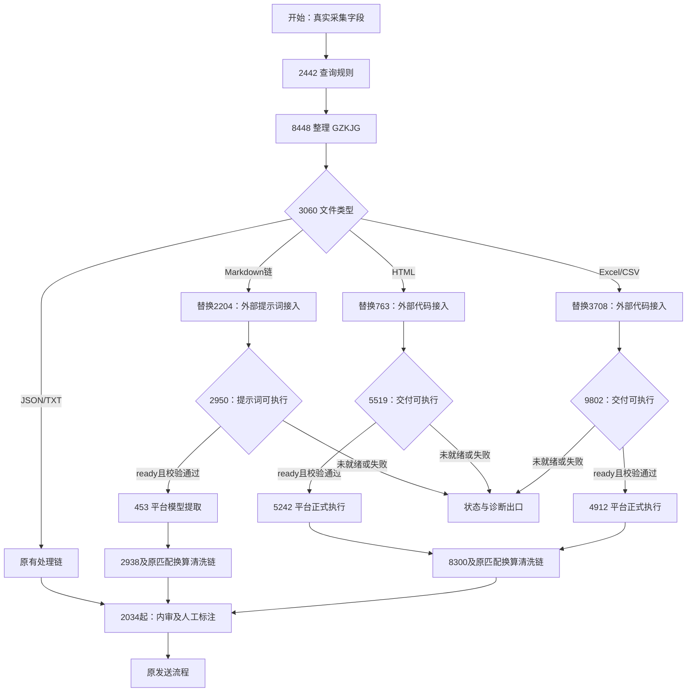

# V4 生产工作流接入：编排理解与节点替换建议

日期：2026-10-26。状态：初始方案分析，保留供追溯。

后续用户已确认三路分别接入，修订为暂时删除9802/5519/2950，修改4912/5242/453，并明确HTML统一ExcelData、PLPL即indicator_release_frequency变量别名。当前已交付0.4.0三链公开HTTP及节点代码，平台由用户亲自配置；请以[V4生产工作流节点配置手册](V4生产工作流节点配置手册.md)和[V4实施与验证记录](V4实施与验证记录.md)为准，下文原前置判断和分期建议不再作为当前配置指令。

## 1. 本次阶段决定与证据范围

用户已明确：由于平台工作流存在部分限制，暂停 V3 循环接入配置任务；现在进入 V4，以外部智能体框架接入真正的生产工作流为主要目标，循环方案留待未来 V4 阶段实现。本次先理解生产编排并提出节点替换建议。

本次分析使用本地 [workflow 导出资料](../../workflow/README.md)：工作流名称“地方经济运行自动工作流测试260928”，ID `2103026958354526210`，目标表配置 `cs_dfjjyxsjb`，快照运行方式为 `manual`。名称中的“测试”和用户本次生产接入目标分别记录；该快照不能证明线上最新版本、触发方式或真实入库回执机制。

已阅读工作流说明 01—09 及附录、18 个脚本的实现（其中重复实现对照核验）、关键节点原始 JSON、三类路由配置及相关资产接口；对照了当前框架的 Task、HTTP 输入、代码交付和验证实现。原始 graph 核对为 47 节点、59 连线；18 个脚本与 `_raw/scripts` 对应副本在统一换行后全部一致。本次没有运行这些业务脚本、下载公司源文件或调用模型/平台。

下文节点替换及实施顺序是建议，不能记作用户已经确认或生产已经部署。框架包版本和 V3 既有验收结论保持原记录。

## 2. 当前工作流的真实职责划分

入口为 `start → 2442 → 8448 → 3060`。2442 按本次 `pageTitle` 查询指标库，8448 将列式结果转成 `GZK.GZKJG`，3060 按文件类型进入五个互斥分支。生产快照没有 V3 测试台的 2229 造路径节点，应使用采集侧的真实来源字段。

| 分支 | 解析及前置处理 | 匹配、换算、清洗与汇入 |
|---|---|---|
| Excel/CSV | `3708 → 9802 → 4912`：路由 Python、空判断、正式执行 | `8300 → 4551 → 7882 → 5230 → 3451 → 2034` |
| HTML/HTM/SHTML | `763 → 5519 → 5242`：路由 Python，解析 `markdownMD5` 下载的 Markdown | 与 Excel 共用 `8300 → 4551 → 7882 → 5230 → 3451 → 2034` |
| Markdown 链 | `2204 → 2950 → 453`：路由专用提示词，平台模型读取 `markdownMD5` 正式提取 | `2938 → 2817 → 1414 → 9684 → 5545 → 2034` |
| JSON | 9513 从已传入的指标名称、值、单位、日期等标量字段匹配 GZK；此节点未下载、解析 JSON 文件 | `2952 → 7304 → 9163 → 2934 → 2034` |
| TXT | 1950 下载文件，按两字段文本行读取期间和值；4633 再尝试按名称匹配 | `4633 → 9431 → 184 → 2657 → 5545 → 2034` |

3060 的 ELSE 是目前 Markdown 链入口，不能因此声称外部服务支持任意未知文件类型。该链运行时使用已经转换的 Markdown；PDF、图片、DOC/DOCX 等原始类型不改变 Markdown 解析事实来源。

前三路的路由 Agent 只从 Skill 读取既有代码或提示词，没有代码生成职责。Excel/HTML 的 8300 按名称匹配；Markdown 的 2938 按代码复核，不能互换这两处接口。

汇入后，2034 检查统计日期与披露频率，3064/9075 决定是否查询 850/8359/1834 的日期特殊规则，再由 6387 校验代码长度、发布日期、统计期及特殊规则。8204 判断是否存在待人工处理的问题；正常路径到发送节点，问题路径经 1127 分流到 Excel 标注 3209、JSON 标注 3138 或 MD 标注 6472，再由 4185 合并并发送。2034/6387 的源码保留原 OUTDATA 并另建问题副本，不应描述成已将所有问题记录从正常数组删除。

因此后半链同时承担指标匹配、库表元数据补全、单位换算、空值拦截、内审、人工修订和发送，不能整体当成单位清洗模块替换掉。

## 3. 建议直接替换的三个节点

| 原节点 | 建议接入节点 | 外部框架交付物 | 平台后续执行 |
|---|---|---|---|
| 3708：excel Agent | Excel/CSV 外部框架接入脚本 | 复用或生成并验证后的 Python，附固定版本、hash 和状态 | 4912 用本次 `fileMd5` 执行 |
| 763：HTML Agent | HTML 外部框架接入脚本 | 复用或生成并验证后的 HTML 专用 Python | 5242 用本次 `markdownMD5` 执行 |
| 2204：md-Agent | Markdown 提示词外部框架接入脚本 | 复用或生成并审查后的专用提示词，附固定版本、hash 和状态 | 453 使用本次 Markdown 和 GZK 提取 |

上述脚本是平台调用 HTTP 服务的适配节点，不要求继续使用平台 Agent 节点类型。外部框架承担程序精确查找、缺失资产生成、源文件检查、验证/审查、有限修复、保存及复用。复用身份延续 `pageTitle + 具体 fileType`，不按相似名称选文件。

建议第一步保留 3060，把接入位置分别放在原三条分支中，三个适配节点调用同一个外部服务，共用任务、资产和报告机制。这样 JSON/TXT 仍走既有分支，且三种交付物的执行者清楚。无需为三个节点建立三套框架或三个独立生成服务。

如果后续平台编排适合合并，可以再评估共用接入节点；当前不建议在 3060 之前无差别调用外部服务，否则 JSON/TXT 也会进入当前并不支持它们的生成接口。

## 4. 配套调整、保留执行和业务节点

| 节点 | 建议 | 原因与交接点 |
|---|---|---|
| 9802 / 5519 / 2950 | 调整为交付状态及产物有效性判断，并接入诊断出口 | 原条件只检查文件名含 empty 或正文为空，无法区分 processing、无数据、规则为空、生成失败和需审查 |
| 4912 | 保留执行职责，升级交付检查和执行诊断 | 当前已是通用执行器；增加版本/hash/ready 检查及编译、加载、执行、返回契约的阶段诊断，输出仍为 `ExcelData → excel_data` |
| 5242 | 保留执行职责，升级并对齐 HTML 契约 | 必须传本次 `markdownMD5`；正式交接统一 `code/msg/ExcelData`，随后仍进入 8300 |
| 453 | 保留平台大模型提取，只按新提示词交付方式核对变量绑定 | 提示词生成和提示词执行属于两个步骤；外部框架当前没有代替平台运行该提取模型 |
| 2442 / 8448 / 3060 | 保留 | 继续提供真实 GZK 和类型分流；接入节点校验 GZK 后才提交外部任务 |
| 8300 / 2938、换算与清洗链 | 保留业务职责，必要时做有证据的字段修复 | 不把指标代码查询、频率补全、单位换算移入生成代码，不用模型替代确定性业务规则 |
| 2034 / 3064 / 9075 / 850 / 8359 / 1834 / 6387 / 8204 | 保留内审职责 | 本机代码验证不能代替生产规则查询和实际数据内审 |
| 1127 / 3209 / 3138 / 6472 / 4185 / end | 保留标注、合并和发送职责 | 生成失败尚不等于存在可人工修订的指标记录，不能直接冒充 warning_data |
| JSON/TXT 既有链 | 本轮不纳入外部生成替换 | 已有工作流节点不等于项目已有真实样本及完整生成规则；按根 AGENTS.md，不新增臆测的生成链路 |

业务成功后继续原后半链；非 ready 不执行代码或提示词。接入失败、执行失败与后处理无有效数据应有独立、可查看的状态、错误码和摘要，不能仍只走悬空出口，也不能伪造一条错误指标进入业务 out_data。

具体诊断出口和结束字段需核对生产平台的实际发送机制。现有目标表配置不是“空 out_data 必然无副作用”的证明，不能直接把 V3 测试台的错误节点到发送节点连线照搬到生产。

## 5. 建议编排

本图表示职责及成功路径，执行失败也应进入诊断处理。长任务续查/等待在未来 V4 阶段专门设计；本图没有批准或实现 V3 的 count 回环。保留持久 job_id 和幂等原则，processing 不能冒充 ready 或生成失败，也不应通过反复新建任务延长后台预算。

## 6. 当前框架还需补齐的生产接口

当前内部 Task 已区分 `python_excel / python_html / markdown_prompt`，但 V3 的公开输入和交付仍为 Excel 专用：

- [integration/contracts.py](../src/dc_agent/integration/contracts.py) 的 `ExcelJobRequest.fileType` 只接受 `xls/xlsx/csv`，没有 `markdownMD5` 公开请求字段。
- [integration/delivery.py](../src/dc_agent/integration/delivery.py) 的交付核验要求 `kind=python_excel`、`contract=main-ExcelData-v1`，只投影 Python 文件/源码。
- [validation/validator.py](../src/dc_agent/validation/validator.py) 对 Python 运行和源证据做验证；Markdown 提示词走结构与语义审查范围，没有调用 453 的真实提取模型。

因此，目标替换三处节点需要 V4 新接口或兼容扩展，不能把当前 V3 Excel 接入脚本复制三份就视为完成。应按类型校验源文件标识、交付产物种类、固定版本和原文字节 hash，分别提供 Python 与 Prompt 的交接字段。最终变量清单另行设计，当前不把 V3 的 13 个 Python 字段直接宣布为 V4 三类型完整契约。

| 类型 | 框架实际检查内容的来源 | 正式执行交接 |
|---|---|---|
| Excel/CSV | 本次 `fileMd5` 下载的原始 bytes | `main(params) → code/msg/ExcelData`，四核心字段 |
| HTML | 本次 `markdownMD5` 下载的 HTML 转换 Markdown | 同为 `code/msg/ExcelData`；不回读网页或原 HTML 兜底 |
| Markdown 链 | 本次 `markdownMD5` 下载的 Markdown | 提示词原文交 453；输出 `out_data` 五字段并按 GZK 唯一精确筛选 |

pageTitle、实际 fileType、title、publictime 和本次 GZK 应来自当前工作流。fileType 当前可能由包含判断命中分支，而 HTTP 使用有限枚举，V4 需按真实入参确定规范化规则，不能声称所有 MIME 或未知后缀都已支持。日期仍按真实统计期间及允许的运行时 title 取值，不把 publictime 当统计截止日期。

## 7. 旧资产迁移与需单列的生产兼容问题

### 7.1 资产接入

本地生产快照的配置与文件数一致：Skill 334 有 1 份 Excel Python；Skill 223 有 11 份 HTML Python；Skill 337 有 17 份专用提示词。它们应逐来源核对、登记后作为可复用候选，不要求为了接入而全部重新生成。

直接复制到 code 目录不等于已登记的合法资产；还需来源/类型、契约、固定版本、hash 和验证记录。HTML 老资产存在 OUTDATA 返回键，部分还保留样例输入回退，导入前需检查本次参数缺失时是否错误使用旧文件标识/标题。生产资料中没有当前待提取的全部真实文件，本次不宣布这些旧资产通过新的原始 bytes 回归。

### 7.2 已确认的静态差异

1. **HTML 返回键**：旧 HTML 资产返回 OUTDATA（部分冗余 out_data），5242 声明 ExcelData 且源码直接返回业务结果，未见键名转换。用户此前已明确未来统一 ExcelData，这里是实施时的兼容项，不能称为尚未决定的业务接口，也不能仅凭快照判定线上必然故障。
2. **披露频率别名（已获用户澄清）**：PLPL就是indicator_release_frequency的变量名，二者表示同一业务字段。本轮沿用生产映射，不再仅凭显示名或脚本键名差异认定线上缺失，也不据此修改8300/内审；如后续真实结果证明确有映射问题，再按当前输入输出证据定位。
3. **内审数据承接与合并**：规则节点将 problem_fin_time 写入 warning_data，而 6387 当前源码重新创建 warningdata，遍历 OUTDATA，未读取上游 warningdata。2034/6387 保留全部 OUTDATA，4185 又直接 extend 问题数组，可能保留原问题版本并追加修订版本。需结合现场结果确认规则信息承接及修订合并的业务口径；不在本轮擅自去重或重写内审。
4. **单位查询对应关系**：匹配脚本分别收集两列去重单位，换算脚本按下标将单位和比例组合。多单位场景需用真实 SQL 返回核对配对，不能用单单位 Demo 证明全部正确；换算职责仍在平台。
5. **清洗版本差别**：本生产快照 5230 已用显式 None 判断保留数字 0；不能沿用 V3 测试台旧 5230 的零值风险结论。9684/2657 仍含 `value or ""`，对应链另查零值表现。
6. **频率条件解释**：9075 原始条件为 contains 月/季/年；叶子类型和平台 contains 语义要按现场确认，不能仅凭说明文档认定“半年必走 ELSE”或多种频率一定逐条分流。

这些问题用于形成生产回归清单，不构成用外部大模型替换上述业务节点的理由。本次仅记录，未修改原始快照、脚本、规则、资产或线上平台。

## 8. 建议实施顺序与验收

1. **Excel/CSV 生产接入先行**：复用已验证过的代码交付思路，替换 3708、调整 9802、升级 4912，打通真实生产来源到完整内审、标注/发送的契约。V3 测试成功不直接当作生产验收。
2. **扩展 HTML 与 Markdown 交付**：补齐 V4 的 markdownMD5 请求、产物类别与 Prompt 交付，再替换 763/2204、适配 5519/2950/5242/453 绑定；用真实样本分别验收。
3. **未来 V4 的长任务方案**：根据平台实际支持的等待、续查或调度能力设计，再决定循环方案如何落地。当前暂停的 V3 count 方案保留为历史实现资料。

每种链路均应验证已登记资产复用、缺资产的新生成、本次文件/期间变更、有效 GZK 与空 GZK、明确无数据、生成或执行失败、后处理空结果；核对固定版本/hash、真实源值/单位/日期、频率进入内审及最终输出。错误诊断不能污染业务数据。

生产首次实施宜选小范围来源或隔离副本，保存原节点配置并提供可回退映射。最终生产节点仍由用户配置和验收。将框架部署到服务器、接收平台结果回传、通用 Skills/Tools 调用，以及更高并发运维属于后续独立设计事项，本次 V4 立项不自动表示这些能力已实现。

## 9. 继续工作入口

- 阶段与已确认决定：[PROJECT_MEMORY.md](../../PROJECT_MEMORY.md)。
- 完成情况和待办：[PROJECT_STATUS_AND_GOALS.md](../../PROJECT_STATUS_AND_GOALS.md)。
- 原生产编排：[节点与上下游清单](../../workflow/工作流说明文档/02_流程编排与节点清单.md)。
- 暂停的 V3 方案：[节点复审与交接](../workflow_agent_test_v3/V3节点代码审查与会话交接_20261026.md)。

本次产物为讨论稿及阶段记忆更新；没有运行新工程测试，不添加新的模型准确率、平台验收或生产上线结论。
