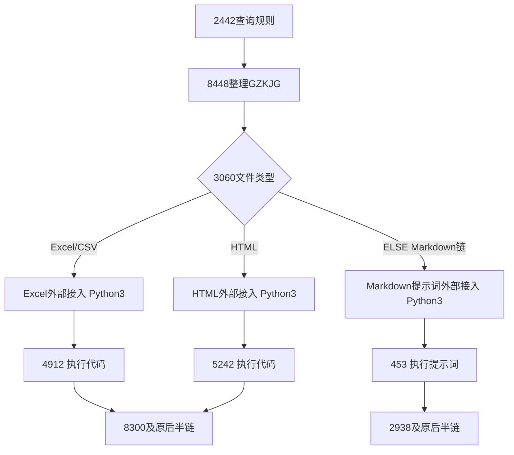

# V4 生产工作流节点配置手册

日期：2026-10-26。适用框架版本：0.4.0。平台节点、连线和参数由用户亲自配置；本手册及相邻目录提供完整脚本与配置依据。

## 1. 本轮已确认方案

1. Excel/CSV、HTML、Markdown 提示词分别使用一个外部智能体框架接入节点，随后由平台各自执行代码或提示词。
2. 暂时删除原 9802、5519、2950 三个判断节点，未来再补健壮性判断。本轮不新增判断、count 或循环节点。
3. 修改现有 4912、5242 的 Python 代码，以及 453 的提取提示词和变量绑定。
4. 三条链均有公开 HTTP 入口；Excel/HTML 的业务解析器统一返回 `code/msg/ExcelData`。
5. `PLPL` 就是 `indicator_release_frequency` 的变量别名，表示同一披露频率。本轮沿用生产业务映射，不因变量名不同改写 8300 或增加另一套频率。
6. 按用户最新确认，HTTP响应和平台agent均撤销`artifact_kind`，不增加替代字段。资产按`pageTitle + fileType`唯一定位，平台agent使用下文的15个String字段。

接入脚本只在取得完整、有效的 ready 产物后正常返回。processing 在本次等待窗口结束时抛出明确的待续查异常，交由平台既有异常重试再次查询同一后台任务；终态失败抛出带原因的安全诊断。这样没有前置判断节点也不会把空源码或空提示词交给执行节点。

本轮不恢复 V3 count 回环。平台失败日志与后台报告可用于排查；本轮不实现错误状态正常结束、平台结果回传或生产自动发布。

## 2. 先更新并启动本机服务

服务地址及独立令牌沿用已经联通的配置，原模型 `.env`、`runtime/service/service.env` 与任务预算保留。本次不需要重新生成令牌。

如果旧服务仍在运行，在原服务窗口按 Ctrl+C 停止，再执行：

```powershell
conda activate dc
cd D:\EDBPythonCode\dc_workflow\agent
python run_service.py check-config
python run_service.py serve
```

本机检查可使用 `GET /v4/health`，应返回 `protocol_version="4"`。旧 `/health` 和 V3 接口继续兼容。平台端不需要 PowerShell，用户可通过真实数据任务检查连通。

三个接入脚本开头的 `API_BASE_URL` 填相同的实际服务地址，继续使用已经联通的地址。脚本中的候选 IP 仅为历史配置参考，不能用监听地址 `0.0.0.0` 或平台自身的 `localhost` 代替。`API_TOKEN` 填服务配置中同一个 `DC_API_TOKEN`，不使用模型密钥；源码交付默认保留占位符。

## 3. 连线如何调整

| 原位置 | 用户在平台上的操作 | 调整后的路径 |
|---|---|---|
| excel Agent 3708 及条件 9802 | 用 Python3 接入节点替换 Agent，删除条件 | `3060 的 Excel/CSV 出口 → Excel接入 → 4912 → 8300` |
| HTML Agent 763 及条件 5519 | 用 Python3 接入节点替换 Agent，删除条件 | `3060 的 HTML 出口 → HTML接入 → 5242 → 8300` |
| md-Agent 2204 及条件 2950 | 用 Python3 接入节点替换 Agent，删除条件 | `3060 的 ELSE 出口 → Markdown接入 → 453 → 2938` |

3708、763、2204 是原 Agent 的定位尾号；新建 Python3 节点的实际 ID 由平台生成，不要求保留原 Agent ID。4912、5242 是原有 Python 节点，可直接替换代码并调整参数；453 保持大模型提取节点类型。

入口 `start → 2442 → 8448 → 3060` 保留。原 JSON/TXT 分支、8300/2938 后面的匹配换算清洗、内审、人工标注及发送连线继续沿用，不新增 2229 造路径节点。



任一新增接入节点异常时，平台停止当前正常路径并按节点异常配置处理；不要另接一条无条件成功边绕过异常。

## 4. 全局变量

新增或调整手工变量 `agent`：类型 `Array<Object>`，每次成功交付恰好一条对象。首次新工作流保持默认空值，不用历史成功结果作初值。接入节点不需要把 agent 当输入；异常重试由服务端的业务输入指纹关联同一个任务。

agent 的 **15 个子字段全部为 String**：

| 字段 | 用途 |
|---|---|
| status | 接入正常返回时为 ready；ready 表示资产交付完成 |
| stage | 后台集成阶段；详细生成过程见本机任务报告 |
| job_id | 对外持久任务编号 |
| PythonFile | Excel/HTML 的业务 Python 文件名；提示词链为空 |
| PythonCode | Excel/HTML 完整源码；提示词链为空 |
| code_sha256 | 当前代码或提示词正文的 UTF-8 原字节 SHA256 |
| artifact_version | 不可变资产版本 |
| cache_hit | 字符串 true 或 false |
| quality_status | accepted 或 usable_with_warnings |
| warning_summary | 所选资产的质量问题摘要 |
| error_code | ready 交付时为空 |
| message | 有界交付说明 |
| elapsed_seconds | 从后台首次受理起算的耗时字符串 |
| PromptFile | 提示词链的业务文件名；Python 链为空 |
| PromptCode | 提示词链的完整正文；Python 链为空 |

服务端 HTTP 原响应有16字段，多出的`report_ref`不配置进平台agent，接入脚本会丢弃它。HTTP与平台均不再输出或要求`artifact_kind`。如果已经按旧手册配置该子字段，请删除它，并同时更新三个接入脚本、两个执行器及重启服务。平台不接收额外元数据，不能把整个HTTP原响应直接映射成agent。

以下既有变量继续使用：

| 变量 | 类型 | 用法 |
|---|---|---|
| excel_data | 原 Array<Object> | 4912/5242 的 ExcelData 写入，含四核心字段 |
| out_data | 原 Array<Object> | 453 先写提取结果，原匹配/换算/清洗继续更新 |
| PromptFile | 原 String | Markdown 接入将文件名写入此顶层变量 |
| PromptCode | 原 String | Markdown 接入将完整正文写入此顶层变量，供453绑定 |
| GZK.GZKJG | 原结构 | 接入时读取当前规则数组；不修改规则数据 |
| unitArray、warning_data等 | 原结构 | 原生产后半链继续使用 |

原顶层 PythonFile/PythonCode 可以保留在模板中，但新执行器读取整个 agent，不再依赖这两个顶层变量。PromptCode 顶层变量继续配置，是为了供453直接插入；不要将 agent.PromptCode 可能产生的 String 数组直接当提示词字符串。

以下引用前缀以本地快照的 `#template_config__0__` 为例，现场实际前缀以变量选择器为准。

## 5. 三个外部接入节点

### 5.1 共同设置

节点类型：Python3；入口：`main(params)`；单次超时：120秒；异常重试：3次。三个脚本可独立运行，不需要平台安装本机 `dc_agent` 包。各自只填写 API_BASE_URL、API_TOKEN，保留代码正文和换行。

脚本每次最多主动等待115秒，每次服务端长轮询不超过20秒，给平台120秒限制留收尾时间。平台“3次重试”与总尝试次数的关系以现场能力为准；不能将它换算成必定能等满的固定总时长。后台生成300秒、持久任务360秒预算继续从首次受理起算，重试不重置预算。

只映射以下业务白名单。禁止把整个模板对象传给HTTP，也不向服务请求增加count、agent、本地路径、rebuild、模型配置等字段。

### 5.2 Excel/CSV 接入（替换3708）

完整代码：[01_Excel外部智能体接入_3708.py](工作流节点代码/01_Excel外部智能体接入_3708.py)。

| 输入参数名 | 类型 | 变量引用 |
|---|---|---|
| fileMd5 | String，非空 | #template_config__0__fileMd5 |
| pageTitle | String，非空 | #template_config__0__pageTitle |
| fileType | String，xls/xlsx/csv | #template_config__0__fileType |
| title | String | #template_config__0__title |
| publictime | String | #template_config__0__publictime |
| GZKJG | 当前对象数组或其一层JSON字符串 | #template_config__0__GZK.GZKJG |

输出只配置：返回键 `agent` → 整个全局父变量 `agent`，类型 Array<Object>。不要同时映射agent父变量和各个叶子。

脚本提交`POST /v4/excel/jobs`，查询`GET /v4/jobs/{job_id}`。本次`fileType`限定Excel/CSV，`pageTitle + fileType`唯一定位Python文件，正常返回PythonFile/PythonCode，提示词字段为空。

### 5.3 HTML 接入（替换763）

完整代码：[02_HTML外部智能体接入_763.py](工作流节点代码/02_HTML外部智能体接入_763.py)。

| 输入参数名 | 类型 | 变量引用 |
|---|---|---|
| markdownMD5 | String，非空 | #template_config__0__markdownMD5 |
| pageTitle | String，非空 | #template_config__0__pageTitle |
| fileType | String，html/htm/shtml | #template_config__0__fileType |
| title | String | #template_config__0__title |
| publictime | String | #template_config__0__publictime |
| GZKJG | 当前对象数组或其一层JSON字符串 | #template_config__0__GZK.GZKJG |

输出只配置：`agent → agent` 父数组。不要额外输入fileMd5，缺少markdownMD5时不回退到原HTML文件。

脚本提交`POST /v4/html/jobs`，查询通用GET。`pageTitle + fileType`唯一定位HTML链的Python文件；fileType区分资产来源类型，实际解析内容始终来自本次转换后的Markdown。

### 5.4 Markdown 提示词接入（替换2204）

完整代码：[03_Markdown提示词外部智能体接入_2204.py](工作流节点代码/03_Markdown提示词外部智能体接入_2204.py)。

输入参数与HTML接入表相同，但 fileType 接受 md、markdown、pdf、png、jpg、jpeg、doc、docx。必须绑定本次真实fileType；实际供生成和提取使用的内容均来自markdownMD5。

| 返回键 | 类型 | 写入全局变量 |
|---|---|---|
| agent | Array<Object>，恰好一条 | agent 父数组 |
| PromptFile | String | PromptFile |
| PromptCode | String | PromptCode |

脚本提交`POST /v4/markdown/jobs`。`pageTitle + fileType`唯一定位提示词文件，交付的PythonFile/PythonCode为空；专属脚本检查PromptFile/PromptCode完整且合法，不新增类型字段。只有接入成功后才继续453。

### 5.5 可选稳定运行编号

三个脚本支持可选参数 `workflow_run_id`。只有平台实际提供同一次运行及其重试都不变的可靠编号时才配置；默认不需要新增这个全局变量。不要自动把rid、当前时间、count或每轮随机UUID当作稳定运行编号。

没有运行编号时，服务按规范化业务输入指纹在默认900秒窗口内取得同一job_id。完全相同输入的重复手工测试也可能取得旧任务；修改本次实际文件标识或其他业务输入才构成不同请求。不要通过反复提交要求重新生成旧资产。

## 6. Excel平台执行器4912

完整代码：[04_Excel平台执行器_4912.py](工作流节点代码/04_Excel平台执行器_4912.py)。替换原4912代码；Python3，main(params)，超时120秒，异常重试0次。

| 输入参数名 | 类型 | 变量引用 |
|---|---|---|
| agent | Array<Object> | #template_config__0__agent，整个父变量 |
| fileMd5 | String，非空 | #template_config__0__fileMd5 |
| pageTitle | String，非空 | #template_config__0__pageTitle |
| fileType | String，xls/xlsx/csv | #template_config__0__fileType |
| title | String | #template_config__0__title |
| publictime | String | #template_config__0__publictime |

输出保持`ExcelData → excel_data`，类型沿用原Array<Object>。生产解析器本身继续返回`{"code":0,"msg":"success","ExcelData":[...]}`，四核心字段不变。执行器检查ready、本次fileType、pageTitle对应文件名、版本、质量及源码hash后在独立命名空间执行；只向main传当前业务字段，不传agent/GZK/令牌。

下游直接连接原8300。执行或结果契约失败抛出有阶段和位置的安全异常，不能正常返回空ExcelData继续业务链。

## 7. HTML平台执行器5242

完整代码：[05_HTML平台执行器_5242.py](工作流节点代码/05_HTML平台执行器_5242.py)。替换原5242代码；Python3，main(params)，超时120秒，异常重试0次。

输入配置与4912相同，仅将`fileMd5`换为`markdownMD5 → #template_config__0__markdownMD5`，fileType为html/htm/shtml。整个agent父数组必须绑定，并核对本次fileType和pageTitle对应的Python文件名。

输出同样是 `ExcelData → excel_data`，下游仍连接8300。HTML解析器必须读取本次markdownMD5并返回code/msg/ExcelData；执行器不静默把OUTDATA或out_data当ExcelData，也不回退到fileMd5。源字段正确、零值有效，数据保持原数值表示；换算、去重和业务改名仍由各自既有规则决定。

## 8. 平台执行提示词453

完整任务提示词：[06_Markdown平台执行提示词_453.md](工作流节点代码/06_Markdown平台执行提示词_453.md)。453是平台大模型提取节点，不是Python节点，不填main入口。

| 配置项 | 填写方式 |
|---|---|
| 输入文件/文件MD5 | 选择 #template_config__0__markdownMD5 |
| 模型 | 沿用现有平台提取模型，不改成本机生成模型 |
| 超时 | 120秒，沿用当前节点设置 |
| 异常重试 | 3次，沿用当前节点设置 |
| batchExecution | 1，沿用单文件处理 |
| batchRead | false，沿用现有配置 |
| 输出方式 | extractResult，输出映射到out_data父数组 |
| 下游 | 原2938，继续按指标代码复核和补全业务元数据 |

先粘贴上述453文本文件的完整正文，再用平台变量选择器将正文中的四处人工占位标记替换成真实变量token：

| 正文中的人工标记 | 用平台选择器插入的真实变量 |
|---|---|
| `{{PromptCode}}` | `PromptCode → #template_config__0__PromptCode`，完整专用提示词 |
| `{{GZK.GZKJG}}` | 沿用既有453可用绑定：`GZK → #template_config__0__GZK`，提供其中本次GZKJG数组 |
| `{{title}}` | `title → #template_config__0__title` |
| `{{publictime}}` | `publictime → #template_config__0__publictime` |

双花括号只是交付文本中的人工定位标记，不是已经验证的平台插值语法。要在原位置删掉标记并插入平台高亮变量标签，不能仅在正文外追加变量却留下未替换标记。规则区域若使用父变量GZK，模型读取其GZKJG成员；现场明确支持直接绑定GZK.GZKJG时，也可以在该区域插入对应真实子字段token。原始Markdown通过输入文件字段提供，不在提示词里写死文件MD5。

模型输出使用 `{"out_data":[...]}` 包装，每条只有五个提取字段：indicator_code、indicator_name、indicator_data、indicator_unit、end_date。前两个来自唯一精确匹配的GZK记录，后三个来自当前Markdown；无明确单位为`-`，无可靠统计日期为空。输出继续写入现有out_data；既有库表单位、频率等字段由2938和后半链补全，不要求模型新增其他规则库ID。

GZK中的名称不能证明Markdown存在对应指标。PromptCode和实际Markdown共同约束提取范围；publictime不是统计截止日期。后台对提示词的结构/语义审查不代表已经替平台运行453，最终提取准确性由真实平台任务验收。

## 9. 当前错误与重试行为

| 情况 | 节点行为与排查位置 |
|---|---|
| 输入缺失、fileType不支持、GZKJG无有效名称 | 接入节点抛字段或without_GZKJG诊断；不交付旧代码/提示词 |
| 本轮窗口结束仍processing | 抛DC_AGENT_PENDING并保留job_id；平台按异常重试相同业务输入，服务幂等取得同一任务 |
| 后台failed/review_required/invalid_input | 异常含status、stage、error_code、message、job_id；结合本机报告排查 |
| 网络失败或受理响应丢失 | 异常说明提交可能已受理；按相同输入重试，不生成随机身份 |
| 交付正文、来源文件名、hash、版本不合法 | 接入或执行器拒绝；不继续正式执行 |
| Python编译/加载/执行/返回契约失败 | 执行器抛有阶段、异常类型及可得文件行号的安全诊断 |
| 453执行失败 | 查看平台模型节点日志，不能将本机提示词ready当作提取成功 |

接入或执行器抛异常时，平台一般不会写回该次正常输出映射；因此当前阶段不能承诺错误一定出现在最终agent变量中。详细原因放在节点异常和服务端诊断，只有ready成功交付才写回agent。未来恢复健壮性判断时再增加正常的诊断结束路径，不在本轮补回已删除的判断节点。

若平台对所有异常一律重试，终态失败可能被重复查询；服务仍返回同一失败任务，不重新生成，也不延长预算。后台先失败保留实际错误码；平台先用完尝试时后台可能还在运行，节点日志中的processing不等于模型已失败或任务已取消。

后台报告位于 `runtime/tasks/<内部task_id>/`，外部job_id与内部task_id不同。可带同一服务令牌查询 `GET /v4/jobs/{job_id}/reports/quality_report.md` 或quality_report.json；报告只在任务确实产生相应文件后存在。

## 10. HTTP接口与旧版本兼容

| 方法/路径 | 用途 |
|---|---|
| GET /v4/health | V4健康状态 |
| POST /v4/excel/jobs | fileMd5 + Excel/CSV任务 |
| POST /v4/html/jobs | markdownMD5 + HTML任务 |
| POST /v4/markdown/jobs | markdownMD5 + Markdown提示词任务 |
| GET /v4/jobs/{job_id} | 三类型统一状态与固定正文交付 |
| GET /v4/jobs/{job_id}/reports/{report_name} | 白名单报告 |

除健康接口外均使用 `Authorization: Bearer <服务令牌>`。POST成功受理返回202和job_id，GET查询成功返回200及agent；HTTP200本身不等于任务ready。业务字段不包含后台本地路径、强制重建或模型凭据。

V3 Excel接口及14字段原响应继续可用，V4仅增加PromptFile、PromptCode两个提示词字段，合计16个HTTP字段，投影到平台后为15个。V3 URL查询非Excel任务会拒绝，不能用它读取V4HTML/Markdown。平台配置本手册的V4脚本，不与V3循环脚本混用。

## 11. 用户配置后的验证顺序

1. 重启本机服务加载0.4.0，保留原地址、令牌、规则文件和模型配置。
2. 在模板创建agent15个String子字段；已配置旧版时删除artifact_kind，确认现有PromptFile/PromptCode及excel_data/out_data可用。
3. 先配置Excel链：替换3708、删除9802、替换4912，核对各自输入输出，再用真实已有资产任务检查交付、执行与原后半链。
4. 配置HTML链：替换763、删除5519、替换5242，确认实际读取markdownMD5并输出ExcelData。
5. 配置Markdown链：替换2204、删除2950，接入输出Prompt*顶层字段，修改453的四个变量token和任务正文，核对五字段out_data。
6. 分别选择todo中已唯一登记且没有资产的真实来源验证新生成；代码/提示词复用仍按pageTitle+具体fileType，输入文件或期间更换后应使用当前源执行。
7. 检查错误任务、等待重试及job_id稳定性，确认下游没有使用历史成功代码或提示词；检查最终数值、单位、日期及生产内审结果。

本次不自动导入或改写历史Skill资产。HTML旧文件仍是OUTDATA时，需按真实源与既有规则核对后转换/重建并登记，不能只把文件复制进code目录就当作合法资产。新生成仍要求todo精确唯一任务，参考Sheet缺失可继续，规则工作簿本身应存在并可读取。

完整工程验证、保护文件hash和已知边界见[V4实施与验证记录](V4实施与验证记录.md)。本地受控测试通过与用户真实生产工作流验收分别记录。
