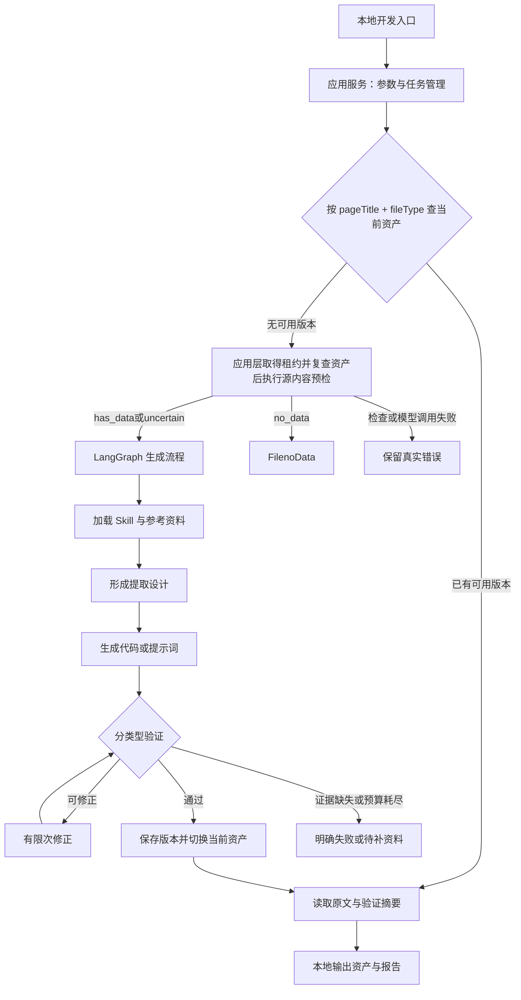

# 外部智能体框架设计指导书

版本：V0.5（V2可用候选保留与完整报告）  
初稿日期：2026-10-15；本次同步：2026-10-20（北京时间）  
状态：用户于2026-10-20确认第二版暂时迭代完成，交接代码基线0.2.2；第三版具体需求待新会话明确。[阶段总结与交接](docs/V2阶段总结与V3交接.md)记录最终范围、当前实际资产及报告。运行行为以[候选保留说明](docs/V2候选保留与质量报告.md)、[验证记录](docs/V2实施与验证记录.md)和第20节为准；后续服务器或通信能力不视为已实现。

V1生产接口保留；source_rules_v2包含任务参考、源事实优先和有限改进。外部Skill只读、local默认/Docker可选、平台通信后置。预检模型粗判、uncertain放行，Skills/Tools仅预留。.env仅同步修复参数4/2/2，其他配置/密钥保留；原输入和默认业务代码未改，无新增依赖。

本地运行补充约定：用户要求先在dc环境直接跑通，不依赖Docker。当前默认LocalProcessRunner，保留Docker为可选执行器；默认选择与切换回归后42项测试通过。

当前本地全量254项64.19秒通过，Ruff及格式检查通过。旧三轮回复配合真实源执行的独立回放保留candidate-0的67条，并明确未修复语义问题，零新增模型请求。0.2.1真实模型和平台历史证据分别保留。

关联记录：[项目记忆](../PROJECT_MEMORY.md)、[项目现状与目标清单](../PROJECT_STATUS_AND_GOALS.md)。

## 1. 目标、边界与已确认决策

### 1.1 要解决的实际问题

当前需要人工整理数据，在 Codex、Claude Code 等外部智能体中借助生成 Skill 编写代码或提示词，再分类打包上传平台 Skill，供三个路由 Agent 读取。希望将这段人工资产生产流程自动化。

目标处理方式：任务包含真实文件标识、pageTitle、fileType 和非空有效 GZKJG；外部框架先查已有资产，没有时读取文件、加载生成 Skill 和参考材料、生成并验证，再保存资产并返回。相同来源以后复用已有资产。

### 1.2 用户已经确认的约定

| 项目 | 已确认内容 |
|---|---|
| 开发环境 | 用户新建的 Conda 环境 `dc`，依赖以后按需安装 |
| 当前V2交付 | 核心代码、目录/资产迁移、程序定位、模型粗判及验证已完成；Skills/Tools仅预留，运行实现未来再做 |
| 开发和部署顺序 | 先本地开发、调试，未来部署服务器 |
| 职责划分 | 普通应用服务管理任务与资产，生成模块负责模型相关工作；分层解耦 |
| 资产复用 | 一个 `pageTitle + fileType` 对应一套当前可用资产；先按结构基本稳定处理，遇到具体问题再扩展 |
| 参考资料 | todo唯一任务必须匹配，按类型/路径代码精确选名称或正则Sheet；Sheet可选、缺失直接继续，冲突以实际源为准 |
| 验证 | 代码实际运行及基本正确性检查；完整性为非阻塞质量建议；提示词做生成/结构/语义审查，目标模型由平台执行 |
| 输出契约 | Excel 和 HTML 的 Python 解析器均输出 `ExcelData`；HTML 运行时只读取 markdownMD5 对应 Markdown |
| 工作流通信 | 当前不实现；保留调用边界，未来倾向同步请求等待结果 |
| 工程要求 | 健壮、稳定、可维护、可扩展；未实现能力必须显式标识 |
| V2资产安排 | 生成正文统一放code/，按excel/html/md分类；实际文件按pageTitle命名，反斜杠替换下划线；查找由程序完成 |
| V2前置校验 | 进入生成前检查真实输入，有充分证据确认无有效数据时返回精确FilenoData；保留Skills/Tools管理与扩展接口 |

### 1.3 第一版范围

实现目标覆盖 Excel/CSV 专用 Python、HTML 对应 Markdown 专用 Python，以及 Markdown 表格专用提示词三条资产生成路径。可以分阶段交付，但架构设计同时容纳三条路径。

本阶段方案不包含：平台 API 联调、回调恢复、线上保存或发布、替换平台执行节点、自动入库、通用 TXT/JSON 解析、自动修复历史工作流节点、复杂版式聚类、向量检索或多智能体协作体系。

说明：未来本地框架可以使用一个 JSON 任务描述文件接收开发参数。这是开发控制协议，不是为 JSON 业务文件新增指标解析链路；生成的解析器仍保持原有 main(params) 和下载接口，不新增 stdin、人工选文件或命令行业务入口。

## 2. 总体设计建议

建议采用：**模块化单体应用 + LangGraph 有状态编排 + 可替换模型适配器 + 独立代码验证执行器 + SQLite 与文件资产库**。

模块化单体指先在一个工程中实现清楚的模块边界，不一开始拆成多个网络服务。本地一个应用进程管理任务，代码验证由独立进程或容器执行；未来需要并发扩容时再把任务运行部分独立部署。

框架最重要的能力不是自由规划所有步骤，而是让生成过程遵守已定义的业务流程，同时允许模型在检查、生成和修正步骤中使用受控工具。



本图已按V2实现更新：普通应用先完整读取文件并直接调用模型粗判，只有明确no_data拦截，uncertain继续生成。缓存命中不调用模型。工作流API仍在后续阶段；通过只表示满足当前声明范围。

## 3. 技术选型与理由

以下保留原选型依据。V1已实际使用LangGraph、Pydantic、SQLAlchemy/SQLite、HTTPX与独立本地执行器并通过单个真实案例；Alembic迁移、其他备选框架、未来服务器/多worker能力不据此算作已实现。V2沿用已验证组件，主要整理职责和接口，不因目录调整更换技术栈。

| 职责 | 建议技术 | 采用范围与理由 |
|---|---|---|
| 语言与环境 | Python，Conda `dc` | 延续现有 Python 解析器与工具生态；先核对 dc 内 Python 版本，再确定兼容版本，不另建一套运行环境 |
| 生成流程编排 | LangGraph 的 StateGraph | 明确节点、分支、修正循环、检查点；只承担生成流程编排 |
| 参数和结果契约 | Pydantic v2、pydantic-settings | 对任务、模型产物、报告进行结构校验；标识、日期文本和数值字符串按字段设计，避免意外类型转换 |
| 模型连接 | 自定义 ModelGateway 接口，按实际提供商实现适配器 | 上层不绑定某家模型；可按需使用 LangChain 模型适配包，不强制引入完整 Agent 产品栈 |
| 数据库访问 | SQLAlchemy 2、Alembic | 任务和资产元数据；迁移脚本从初版开始维护 |
| 本地数据库 | SQLite | 单机初期使用；单任务写入、短事务，后续多进程扩展再验证并发能力 |
| 生成流程检查点 | LangGraph SQLite checkpointer | 与任务元数据库分开，避免把检查点当资产目录 |
| 文件获取 | HTTPX；本地测试使用已登记文件映射 | 下载真实 bytes，并控制超时、大小、重试；不依赖工作流通信先完成 |
| Excel/CSV 检查 | openpyxl、xlrd、Python csv | XLS 直接读取原始 bytes 和 ctype；CSV 不先强制转换为 DataFrame |
| Markdown 检查 | 原始文本 + 必要时 markdown-it-py 辅助 | 保留原始行号和文本；不能把不规范转换表格全部交给通用语法树而丢失内容 |
| 验证执行 | ExecutionRunner 接口；本地开发默认LocalProcessRunner，Docker可选 | 与应用进程分离，使用dc当前Python；本地子进程不能称为安全沙箱，Docker按需启用 |
| 测试和质量 | pytest、Ruff；类型检查工具按需加入 | 覆盖任务状态、复用、失败恢复和真实解析样本；不以只有模型模拟的测试代替真实验证 |
| 日志 | Python logging 输出 JSON Lines | 本地完整追踪，不要求引入外部追踪 SaaS |
| 未来通信 | FastAPI 适配层候选 | 当前不安装、不实现 HTTP 路由；由后续集成阶段确定 |

LangGraph 的官方定位包括确定性步骤与模型步骤混合编排、持久状态及恢复，符合本项目生成—验证—修正流程。它可以独立使用，不强制购买托管平台或启用云追踪。[官方总览](https://docs.langchain.com/oss/python/langgraph/overview)、[持久化说明](https://docs.langchain.com/oss/python/langgraph/persistence)。

选型比较：

- 纯 Python 状态机：依赖最少，但恢复、节点历史与修正循环会逐渐自建。适合极简原型；本项目预计持续扩展，建议使用 LangGraph，但将它隔离在编排层。
- PydanticAI：适合类型化模型调用和工具交互，可以作为另一种生成引擎候选；本项目优先级是清楚控制流程，因此本稿选择 LangGraph，不在第一版同时维护两套 Agent 框架。[官方文档](https://ai.pydantic.dev/)。
- Deep Agents：已经提供文件、Skill、上下文管理等能力，值得后续评估是否嵌入生成节点；当前生成顺序较明确，建议先用显式工具和有界模型循环，不默认开放通用文件修改、任意命令或委派能力。[官方文档](https://docs.langchain.com/oss/python/deepagents/overview)。

模型的具体提供商和型号本稿不指定。先用现有真实样本评估生成质量、修正成功率、耗时、成本和工具调用兼容性，再锁定配置。当前聊天产品或桌面工具可用，不代表外部框架天然具有可调用的模型凭据。

## 4. 分层职责与依赖方向

| 层 | 负责内容 | 不应承担的内容 |
|---|---|---|
| 入口层 | 本地任务文件、命令调用；未来 HTTP 请求到任务模型的转换 | 生成业务逻辑、数据库细节 |
| 应用层 | 输入检查、任务幂等、资产查找、来源锁、调用编排、结果汇总 | 直接操作模型消息或解析工作簿单元格 |
| 领域层 | 任务、资产、类型、验证范围、状态、发布规则和错误分类 | 依赖 LangGraph、HTTP 或某家 SDK |
| 编排层 | 按节点组织检查、设计、生成、验证、修正与结束 | 自己复制资产存储或验证规则实现 |
| 生成层 | 上下文装配、Skill 使用、模型调用与候选产物生成 | 自己决定验证通过或激活版本 |
| 检查与验证层 | 原始文件检查、代码执行、字段检查、证据回归、提示词审查 | 为了命中 GZK 改写正确源数据 |
| 基础设施层 | 文件服务、模型 SDK、数据库、文件系统、执行器、日志 | 定义业务口径 |

依赖规则：领域层不依赖外层；应用层依赖领域和接口；基础设施实现接口；编排层调用应用能力和生成/验证服务。依赖注入在应用启动处完成。

扩展接口针对已有变化点。当前ports含ModelGateway、SourceProvider、ReferenceProvider、ExecutionRunner，以及仅预留的SkillProvider/ToolRegistry；内容门禁由独立ContentPreflight直接调用模型。TaskRepository、ArtifactRepository等仍属总体设计边界，不把本节所有建议都当作已存在协议。

## 5. 任务输入与契约

### 5.1 开发任务描述

| 字段 | 作用与校验 |
|---|---|
| request_id | 调用方提供的幂等标识；本地未提供时由入口创建 |
| pageTitle | 非空完整业务路径，保留原始文本；不得从文件名猜测 |
| fileType | 显式文件类型；大小写、扩展名前导点按已登记映射处理，不做模糊 contains 路由 |
| fileMd5 / markdownMD5 | 按生成路径选择实际下载标识，不要求两个字段同时存在 |
| GZKJG | 至少一条有效非空 rule_indicator_name；保留原始规则及快照摘要 |
| title / publictime | 可选运行时上下文；只有对应规则明确允许时用于日期 |
| source_metadata | 可选来源编码、路径代码、目标表、原始文件名等；未知就不填写 |
| reference_bindings | 显式参考资料绑定；来源可以是本地目录，未来可扩展数据服务 |
| generation_policy | 引用配置中的策略名；不能由不受信任文档放宽验证或执行权限 |

非空名称是进入生成的必要条件，不是完成验证的充分条件。Markdown 最终需要同一规则记录的 code/name；名称有效而代码缺失时，报告规则不完整，不能虚构代码。规则重复和标准化后歧义需要保留并报告，不能静默取第一条。

请求幂等与资产复用分开：request_id 识别同一次任务；pageTitle + fileType 识别可复用资产。相同 request_id 携带不同输入摘要应报冲突；不同日期文件可以是不同任务，却复用同一资产。

### 5.2 类型与资产的确定

| 显式类型 | 处理路径 | 必要文件 | 产物 |
|---|---|---|---|
| xls / xlsx / csv | excel_parser | fileMd5 或开发映射的真实 bytes | Python，main(params)，ExcelData |
| html / htm / shtml | html_markdown_parser | markdownMD5 或对应真实 Markdown | Python，main(params)，ExcelData |
| md / markdown | markdown_prompt | markdownMD5 或真实 Markdown | 专用提示词 |
| pdf / png / jpg / jpeg / doc / docx | 已登记的Markdown路径，必须有真实转换Markdown | markdownMD5 | 提示词；原始类型仅分类和审查信息 |
| txt / json 或未知类型 | 当前不支持 | — | UNSUPPORTED_FILE_TYPE |

类型别名需要登记。例如 MIME 到 xlsx 的映射必须明确；不能把所有未知类型自动交给提示词路径。不同 fileType 的同一 pageTitle 是不同资产，xls 与 xlsx 第一版也不自动合并。

V2实际正文已进入code/excel或html或md/具体fileType/pageTitle文件；具体类型层防止不同资产同名覆盖，非法名称和路径碰撞明确报错。详见[V2方案](docs/V2迭代实施方案.md)。

文件 magic 用于验证或选择实际读取器，不改变业务资产键。同一显式类型下发现 gzip、ZIP 或内容与扩展名不一致时保留诊断；不能静默将任务路由到另一来源或另一资产。

## 6. 普通应用服务：先查资产，再决定是否生成

1. 校验任务契约及有效 GZK；在缓存命中前也必须验证任务入口条件。
2. 以 pageTitle + 明确规范化 fileType 查询当前资产；第一版按精确键查询，不做向量检索、相似匹配或自动改名。
3. 可用资产必须存在、校验和一致、契约相容、验证范围满足当前策略。
4. 命中则返回原文和元数据，不调用模型重述、复制或重新生成内容。
5. 未命中时获取来源生成锁；同键并发到达只允许一个生成者，等待方可以取得明确处理中状态。
6. 获取锁后再次查资产，避免等待期间其他任务已经完成。
7. V2先程序读取todo当前快照，pageTitle零行/多行返回指定错误，唯一行按类型加载可选同名参考Sheet，再下载真实bytes并模型粗判；has_data或uncertain进入生成，明确no_data返回FilenoData。
8. 将同一源bytes、SHA256、检查及预检报告交给生成编排，保存候选、验证并发布后释放锁，避免重复下载产生前后不一致。

当前只在生成/重建前预检；缓存命中不下载当前源、不调用模型，明确preflight.status=not_run。每请求预检尚未实现，不能把ready资产当本次输入已经检查。

同一来源的第一个样本不是所有后续文件的完整证明。第一版不做自动版式分类或每次重新生成；保留实际运行反馈、手动停用、强制重建和版本回退入口。后续出现具体问题再增加结构检查。

## 7. Skill 与参考资料如何真正接入

### 7.1 Skill 是带依赖的生成规范

已有三个生成 Skill 都不是“只提供一段系统提示词”：

- Excel Skill 依赖实际源表检查、excelrule 规则、按路径代码精确定位的 GZK 名称参考及原始 bytes 运行回归。
- HTML Skill 依赖 HTML 规则表、精确名称/正则参考、设计期网页证据与实际 Markdown，并规定了缺失参考时的限制。
- Markdown Skill 依赖当前 prompt_rule、md_rule、原始来源审查材料和真实 Markdown，规定审查头、17 个章节与五字段输出。

因此使用 SkillRegistry 登记每种路径所用 Skill 的正文、相关 references、验证脚本、工具需求和版本摘要。工具由框架实现，Skill 描述不能自动赋予读取文件、检查 Excel 或执行 Python 的能力。

现有SkillRegistry继续外部只读，任务适配为source_rules_v2，已替代旧source_gzk_v1的“名称/正则资料未提供”前提。Skills/Tools仍只有目录说明和协议，没有新注册器、动态调度或原生tool-calling。

Skill 可从当前机器的外部目录只读加载，但正式工程应通过显式清单记录依赖文件及 hash；不要把 C:/Users/YOUR_USER 的路径写死进业务代码，也不自动修改用户原始 Skill。

### 7.2 必需材料与可选扩展源

当前RuleContextProvider返回程序匹配的task_info与可选references，包含任务行/Sheet定位、文件hash和实际单元格内容；原ReferenceProvider保留显式文本参考。优先使用精确pageTitle和路径代码，不按相似名称猜对应行或Sheet，不增加缺Sheet标记。

第一版可实现本地参考目录和传入 GZK；后续可接规则 API、数据库、历史审查结果等。扩展参考源时增加 Provider，不改生成流程主体。

原Skill的离线资料前提已由用户授权的source_rules_v2覆盖：todo唯一任务必需，可选名称/正则Sheet未找到时直接继续，其他未提供的离线材料不作为新增阻塞条件。只记录实际使用资料，不声称原Skill的所有离线前提都已满足。

在自动化流程中，先形成每任务的提取设计与审查侧档，记录名称、单位、日期逻辑和真实位置；它们不等于自动修改共享规则工作簿。需要回写原参考文件时另行确认范围，避免一个生成任务改动所有来源的参考规则。

### 7.3 上下文装配

固定顺序：已确认项目契约 → 选中 Skill 与必要 references → 真实源文件检查证据 → 对应规则资料 → GZK → 任务上下文 → 本轮失败报告。

大文件先列出全部 Sheet/表格，再分段读取。检查覆盖范围需要可追踪，不能只截取前几十行就宣称读完全部文件。保留英语名称有语义的内部空格，不能把文本标准化简单实现为删除全部空白。

数据文件和参考文档中的文字当作数据，不作为允许修改工程、泄露凭据或跳过验证的指令。模型只能使用当前路径登记的工具，并只读访问参考材料、写入本任务候选区。

## 8. 生成编排与模型使用

### 8.1 有界流程

V2实际应用流程：validate_input → resolve_asset → acquire_generation_lease并复查 → resolve_rule_context → inspect_source → model_preflight → load_Skill → build_design → generate_candidate → validate/review/repair → publish。task_info及可选references为同一快照；asset_contract从设计阶段明确Python四字段/GZK仅诊断与Markdown五字段/GZK筛选的区别。明确no_data终止，uncertain放行；完整性仅提示。

分支：资产命中直接结束；todo零行/重复返回指定错误，缺Sheet直接继续；代码与提示词进入不同验证器；正确性问题和明确遗漏可进入有限repair。每次基本校验通过保留Python候选，停止时择优发布并标明未解决意见；全部基本失败才无资产退出。修正次数、完整性小预算、无进展次数和总耗时共同限制。

任务状态建议：RECEIVED、RUNNING、WAITING_REFERENCE、SUCCEEDED、FAILED、CANCELLED。节点阶段单独记录，例如 INSPECTING、GENERATING、VALIDATING、REPAIRING，不把它们与业务结果混用。来源锁竞争返回处理中信息，不误记为生成失败。

图中只保存任务引用、材料引用、候选版本、预算、报告和当前阶段；大文件及完整输出放文件资产区，避免不断向模型历史追加全部 bytes 和日志。LangGraph 检查点用于恢复当前图进度，业务任务状态与最终资产仍由应用数据库管理。

检查点不提供端到端 exactly-once 保证。下载缓存、模型调用记录、候选落盘与发布都要有独立操作标识；进程中断后根据已保存结果决定续跑，不能仅因图恢复就假定外部副作用不会重复。

### 8.2 模型调用方式

第一版使用一个可配置的生成模型，检查、生成、修正可以分次调用同一模型，不默认引入多智能体。后续可分别配置生成与审查模型；换模型通过 ModelGateway 完成。

需要验证的能力：工具调用、长文本完整返回、代码生成、结构化输出、上下文容量和用量统计。声称兼容某 API 不代表工具和结构化输出行为完全相同，需要适配器契约测试。

模型输出至少分为：ExtractionDesign、CandidateArtifact 和 ReviewFindings。Pydantic 校验结构不代表业务语义正确。代码或提示词正文按原文落盘并计算 hash，应用服务从文件读取返回；不再让模型转述一次。

工具建议：查看文件清单、查看 Excel Sheet/合并范围/单元格类型、分段读 Markdown、按精确键读规则、读取 Skill reference、写候选、申请验证。验证结果由执行器产生，模型无权把自己标记为验证成功或发布资产。

## 9. 验证体系：按产物区别对待

### 9.1 通用验证

- 输入健康：真实源可读取，直接模型粗判、uncertain放行。后续执行/源值/基本语义检查保留，覆盖只作质量提示。
- 产物完整：文件名、类型、非空内容、契约版本、Skill 和参考资料版本有记录。
- 来源审查：头部元数据真实，未知信息不编造；单位与日期的位置描述可复核。
- 预算与权限：执行未越界、输出未截断、报告不含未完成却标通过的检查。
- 分别记录检查项的 pass / fail / warning / not_run；not_run 不能按 pass 处理。

### 9.2 Python 解析器验证

1. 静态检查：可编译、存在可调用 main(params)、当前返回键 ExcelData；检测硬编码示例日期/数据、交互输入和不允许的依赖等风险。静态检查不是执行隔离的替代品。
2. 用本次真实 bytes 运行 main(params)。生产代码保留下载行为；测试在隔离环境中拦截既有下载路径，返回已登记 bytes，不修改源文件，也不要求解析器增加本地路径或 stdin 接口。
3. 检查 code/msg、记录列表、四核心字段和严格 JSON 序列化，无 NaN/Infinity 或不可序列化对象；额外字段按既有兼容契约处理，不擅自改变运行协议。
4. 对 XLS，检查和运行均至少一次直接经过 xlrd 原始 bytes，记录关键年份/日期/单位/数值单元格 ctype、Python 类型及合并范围。
5. 从每种表头、层级、单位、期间结构抽代表记录，逐段回指名称、数值、单位、截止日期；独立单位、统计期、位次和脚注不能误拼名称。
6. 保留零、负数和源精度，跳过明确无效值；无有效单位使用 -；不默认换算、去重或四舍五入。
7. 与有效 GZK 名称精确诊断比较，分别报告匹配、源表有效但未覆盖、规则歧义、代码错拼、源证据不足。不能用固定匹配率当唯一验收标准，也不能要求源表输出数量等于 GZK 数量。
8. 源数据不含某条 GZK 指标时不得补造；全部无匹配时先归因，当前任务不能伪装成已形成可用下游结果。
9. 同来源如有多个真实期间样本，优先交叉回归；只有一个样本时记录“单样本验证”，不能宣称已证明所有后续月份通用。

生成的候选设计可以帮助审查，但不能直接充当独立测试答案。原始位置、数值、类型由确定性工具取出；复杂语义可由单独审查调用判断。仍存在无法自动证明的业务边界，报告需允许 REVIEW_REQUIRED，而非强行全部自动通过。

### 9.3 HTML 解析器额外要求

- 运行时仅使用 markdownMD5 对应的 Markdown，不回退原 HTML、网页 URL 或 fileMd5。
- 统一返回 ExcelData，旧 OUTDATA/out_data 不作为新契约接受。
- 按当前 Skill profile 核对精确名称/正则、方向词、同句多值、Markdown 转换丢失、重复正文与冲突命中。
- 设计期参考网页与运行时 Markdown 证据分开，缺失任一必需证据如实报告。
- 日期兜底遵循选中 HTML 规则；不能把 HTML 专属的 publictime 口径扩展给所有 Excel 或 Markdown 提示词。

### 9.4 Markdown 提示词第一阶段验证

当前不调用平台提取模型，也不在外部增加同类提取模型执行步骤。

检查真实Markdown表格、续表/重复表头、多期间绑定、层级、单位/日期位置、无效值及噪声；覆盖不全仅作质量建议。审查头、17章节和五字段out_data契约保留：先有源候选再按GZK精确唯一筛选，同条取code/name，数据/单位/日期来自Markdown；无匹配输出空out_data。

对代表性表格可制作“源证据与预期处理说明”进行规则审查，但不能将人工或审查模型写的预期 JSON 当成平台实际运行结果。

建议验证范围命名：Python 为 code_runtime_and_semantic_review；提示词为 prompt_static_and_semantic_review。提示词另有 target_model_execution=not_run。返回 ready 表示可按当前约定交给平台执行，不表示平台提取效果已验证。

未来可以增加 TargetModelEvaluator 或接收平台反馈，把真实执行结果绑定到同一资产版本；这项能力当前仅登记，不实现。

### 9.5 自动修正与停止

可修正：语法、返回键、明确字段错误、有源证据的名称/日期/单位拆解错误。不可用修正掩盖：原始内容缺失、规则缺失、GZK 未覆盖、业务语义无法判定、执行器缺少依赖。

每轮保留候选、报错和修改原因。达到轮次/时间/token 上限，或出现未解决的重大语义问题就停止；不无限试到“有数据”。原有可用资产不因失败候选被覆盖。

## 10. 验证执行环境与本地开发

应用在 Conda dc 中运行。不要在应用进程中 exec 模型生成代码；框架自身、数据库和模型凭据与候选运行隔离。

ExecutionRunner 的两种实现规划：

| 执行方式 | 使用边界 |
|---|---|
| DockerRunner | 可选执行方式；固定 Python/依赖，非 root、限制 CPU/内存/时间/输出，参考资料和源文件只读，候选与结果按任务隔离 |
| LocalProcessRunner | 用户确认的本地开发默认方式，使用dc解释器独立子进程；不是完整安全沙箱 |

默认由可信应用下载文件，验证进程通过模拟下载读取已有 bytes，可禁用外网；候选不获得模型 API 凭据、不挂载整个工程、不获得 Docker socket。Docker 本身需要显式资源限制，并非创建容器就自动具有限额。[Docker 资源限制](https://docs.docker.com/engine/containers/resource_constraints/)。

测试使用与平台一致的解析器入口、下载 mock 和运行参数；依赖版本先在本地锁定。服务器操作系统与平台执行环境未核实时，不声称本地容器通过就等于平台运行已通过。

设计期曾将dc环境信息列为待核实项；实施现已确认Conda dc的Python为3.12.15，并通过明确解释器路径完成实际验证。平台代码测试也已获用户通过确认；平台依赖的具体版本与日志未另行归档。Docker仍为可选项，不作为本地成功案例的前提；未来服务器环境按实施时的实际情况核对。

## 11. 数据与资产存储

### 11.1 元数据

初期建议以下表：

| 表 | 主要内容 |
|---|---|
| tasks | request_id、输入摘要、任务状态、阶段、结果/错误、时间与预算 |
| task_events | 节点开始结束、重试、修正、状态变化 |
| sources | 原 pageTitle、规范 fileType、唯一来源键、当前可用版本 |
| artifacts | 来源、版本、类型、相对路径、正文 hash、契约、验证范围、依赖清单 |
| validation_runs | 候选版本、真实输入 hash、检查结果、证据路径、环境版本 |
| generation_leases | 来源生成租约、持有任务、过期时间和 fencing token |

来源键继续按原始pageTitle和规范fileType序列化计算摘要，原文独立保存。V2实际业务文件名采用pageTitle反斜杠替换下划线，配合类型子目录、路径合法性和唯一性检查；不能把原文直接当目录，也不能用同名文件替代来源身份核对。内部版本仍使用来源摘要/版本，文件本身也按业务名称保存；V1仅display_name符合命名要求。

任务输入包含文件服务标识；缓存记录实际 bytes SHA-256，不能假定服务字段名字叫 MD5 就一定能作为内容完整性证明。

### 11.2 文件布局建议

以下为职责示意，当前详细目录见[README](README.md)。工程已按主要职责拆包，Skills/Tools运行注册能力仅预留：

```text
dc_workflow/agent/
  外部智能体框架设计指导书.md
  src/dc_agent/
    domain/          任务、资产、验证模型与规则
    application/     用例、幂等、资产查找、发布
    orchestration/   LangGraph 状态、节点、分支
    generation/      上下文、Skill、模型生成与修正
    inspection/      原始 bytes、Excel、Markdown 检查
    validation/      代码、提示词、语义证据验证
    ports/           已明确变化点的接口
    infrastructure/  模型、文件、数据库、执行器
    entrypoints/     本地入口；未来 HTTP 适配
  config/            profile、Skill 清单、参考源绑定
  skills/            项目级规范、外部只读Skill绑定
  tools/             受控工具清单、说明与必要的独立工具
  code/              excel/html/md分类，再按具体fileType保存业务文件、候选和版本
  tests/             单元、集成、真实样本回归
  runtime/           不入库：数据库、源缓存、任务和报告；V1旧资产暂保留
```

V2候选及当前/历史正文进入code/<分类>/<具体类型>/，版本不可变；runtime保留源缓存、任务检查/判定/验证及模型操作记录。旧V1资产和包含正文的审计JSON暂保留，新增layout_version区分路径基准；不重写历史证据。数据库初期保持runtime/tasks.sqlite，不在拆包时顺便移动。日志、缓存、凭据与业务源文件不提交Git；生成资产是否纳入版本库由后续仓库管理明确，不因目录名自动视为已入库。

### 11.3 发布和一致性

先写唯一候选版本 → 校验 hash 和报告 → 同盘原子移动为不可变版本 → 数据库短事务确认有效租约并切换 sources 当前版本。文件系统与数据库不共用事务，因此只有数据库已提交且文件完整的版本可服务。

V2已实现业务当前文件、不可变版本、跨进程发布锁及恢复记录。SQLite条件写取得写锁并确认租约后才替换当前文件和切换指针；中断依据已提交指针恢复。V1按精确登记自动导入，不改正文/hash和旧manifest，详见V2方案第6节。

崩溃可能留下未引用版本；启动恢复时识别并清理或保留供诊断，不自动激活。租约过期后的旧任务即使稍后完成，也不能越过 fencing token 检查抢占当前资产。服务启动需恢复未完成任务状态并标明中断，不能全部重置成成功或无限运行。

SQLite 适合本地单机起步；生成过程不持有长事务。以后多 worker 时迁移 PostgreSQL，并使用数据库级租约/约束；LangGraph checkpoint、任务表、来源锁必须分别处理，不认为更换 checkpoint 后自动解决并发。

## 12. 结果、错误与重试

### 12.1 内部结果

统一结果包含：status、task_id、source_key、cache_hit、artifact_version、content 或 content_ref、content_hash、validation_scope、validation_report_ref、warnings、error。2026-10-26按用户确认撤销artifact_kind字段，资产按pageTitle + fileType唯一定位；当前V4公开HTTP为16字段，平台agent投影为15个String字段，具体以V4生产工作流节点配置手册为准。

status 建议：ready、processing、reference_required、review_required、failed、invalid_input、unsupported。processing 用于已有任务仍在运行等情况；当前本地入口通常直接等待到终态，不要求先实现网络轮询。

未来工作流适配器再将资产映射成 PythonFile/PythonCode 或 PromptFile/PromptCode。框架核心不使用 empty 占位掩盖错误，也不把验证报告混入 ExcelData 或 Markdown 五字段业务结果。

### 12.2 错误分类

| 类别 | 典型错误 | 行为 |
|---|---|---|
| 输入 | INVALID_INPUT、NO_VALID_RULE_NAMES、UNSUPPORTED_FILE_TYPE | 不调用模型，报告字段与原因 |
| 数据 | DOWNLOAD_FAILED、SOURCE_CONTENT_MISSING、FORMAT_UNREADABLE | 对瞬态下载有限重试；真实缺内容不靠改代码解决 |
| V2内容预检 | FilenoData、SOURCE_INSPECTION_LIMIT及原MODEL_*错误 | 明确no_data才返回精确FilenoData；uncertain继续，检查/模型失败保留原错误 |
| V2资产路径 | INVALID_ARTIFACT_NAME、ARTIFACT_PATH_COLLISION | 不静默改名、覆盖或模糊选择 |
| 任务参考 | todoFile_no_pageTitle、pageTitle_redundancy | 程序查找失败，保留精确大小写；不调用模型 |
| 参考文件 | REFERENCE_UNAVAILABLE、REFERENCE_FORMAT、REFERENCE_TOO_LARGE | 报告文件或配置问题；正常缺Sheet不报错、不记缺失 |
| 模型 | MODEL_RATE_LIMIT、MODEL_TIMEOUT、OUTPUT_TRUNCATED、OUTPUT_SCHEMA_INVALID | 分类重试，遵守剩余预算 |
| 验证 | PARSER_EXECUTION_FAILED、SEMANTIC_VALIDATION_FAILED、REVIEW_REQUIRED | 明确可修正原因才进入修正循环 |
| 环境 | EXECUTOR_UNAVAILABLE、DEPENDENCY_MISSING | 报告环境问题，不标代码生成失败或验证成功 |
| 控制 | BUDGET_EXCEEDED、CANCELLED、IDEMPOTENCY_CONFLICT | 保存状态与已完成证据 |

每个错误记录 stage、code、可读消息、retryable、details 和证据引用。完整堆栈进任务日志，对外返回必要摘要。

V2保留Result外层并增加preflight摘要；FilenoData使用status=failed、error.code=FilenoData、stage=preflight，附原因/报告引用。异常处理已精确保留该大小写；零字节交模型判断，网络失败不混用。GZK未覆盖、提示词筛选为空和候选解析失败也不属于文件无数据。

区分网络重试、模型输出重试和代码修正；它们不是同一个计数。总体设置 deadline、模型调用数、修正轮次、token/成本上限；节点使用剩余预算，避免各自重试叠加失控。

用户倾向未来同步等待，方案保留 run-to-completion 调用方式。但 120 秒超时后的重试是多个尝试，不自动给单个 HTTP 调用连续六分钟；“3次重试”是否包括首次也需以后核实。这个问题不阻塞当前本地设计，内部幂等和检查点为将来接入保留基础。

## 13. 配置、环境与可观测性

- Conda dc 为主环境。第一步检查实际 Python 版本和依赖兼容性，再选择精确版本；不预设机器已经有 Docker、uv、模型凭据或全部业务库。
- 依赖按核心、Excel 检查、模型适配、验证执行、开发测试分组安装，锁定版本；不依赖“全部安装最新版”。Conda 环境配置与 pip 锁定清单分别记录。
- 运行配置包括数据库/工作区位置、模型、Skill/profile、参考资料、文件服务基址、执行器、预算、日志级别。密钥从环境或安全配置读取，不写入任务、产物或日志。
- 日志至少包含 task_id、source_key、stage、attempt、duration、model、token_usage、error_code、artifact_version、validation_scope。
- 每个任务生成可读报告：输入摘要、资产命中情况、检查覆盖、参考资料清单、生成/修正过程、验证通过/失败/未执行项、总耗时与最终版本。
- 保存必要的模型请求参数、正文/产物 hash 和响应证据，支持重放诊断；任务报告不依赖保存模型隐藏推理过程。
- 模型随机性存在，固定输入或温度不等于每次字节一致；可复现优先指向相同输入、资产版本、依赖和检查记录。
- 临时目录与正式证据分开；任务结束清理运行临时文件，保留正式资产和必要验证证据。按明确保留期清理缓存和失败候选，不误删用户原始资料。

## 14. 开发顺序与验收关卡

下表保留V1分阶段路线，不要求从A重新开始。V2核心范围已按用户细化要求实施，最新完成项与后续边界见第18节和验证记录。

| 阶段 | 实施内容 | 完成证据 |
|---|---|---|
| A：方案确认 | 明确本稿选型、任务样本、模型接口、Skill 依赖 | V1设计阶段已完成；V2指导现已单列 |
| B：本地基础 | dc 环境、领域契约、任务库、资产库、本地入口、日志、假的模型适配器 | 不连接平台即可提交任务、查状态、读资产；错误路径明确 |
| C：Excel 真实闭环 | 一个真实 XLS/XLSX/CSV 来源，检查、设计、生成、执行验证和修正 | bytes 与字段/语义回归报告；第二次同键复用且无生成模型调用 |
| D：HTML 与提示词 | 分别接入对应 Skill/profile；提示词只执行当前约定审查 | HTML 输出 ExcelData；提示词报告目标模型未执行；三类产物契约均通过 |
| E：可靠性 | 同键并发、进程中断恢复、错误注入、预算、版本回退 | 无重复激活、无旧任务覆盖新版本、无误报验证通过 |
| F：服务器准备 | Linux 或实际服务器环境部署、持久卷、依赖与执行器核对 | 相同真实样本回归；本地和服务器差异有记录 |
| G：工作流集成 | 再核实同步调用、超时/重试和返回映射 | 另立通信实施方案及端到端验收，不在当前实现 |

第一条业务闭环先选择一个规则齐全、有真实文件、能代表正常表格结构的来源。不要同时把几十个来源接入后才区分模型、规则和架构问题。验证框架结构的 fake model 不等于验证真实生成质量。

最低回归场景：有效/无效 GZK、不同 fileType 不串资产、同键复用、同键并发、缺文件、缺参考、下载失败、模型截断、语法错误可修正、业务证据不足停止、无效单位/日期、零值、原始 XLS 浮点年份、多 Sheet、多期间、发布中断、停用/回退、提示词 target_model_execution=not_run。

性能先测量后承诺：分别统计已有资产命中、新生成、每个模型调用、执行和语义审查的耗时。第一版不承诺每个新来源都能在六分钟内完成；复杂文件超预算时明确终止或保留可恢复状态。

## 15. 扩展点与当前明确不实现的能力

| 扩展点 | 当前设计 | 以后实现时机 |
|---|---|---|
| 工作流通信 | 应用服务入口与结果 DTO 边界 | 本地闭环稳定后 |
| 其他参考源 | ReferenceProvider 注册与证据模型 | 有具体资料和访问方式时 |
| 多模型 | ModelGateway 与角色配置 | 单模型评估显示实际收益后 |
| 平台提示词执行评估 | TargetModelEvaluator 接口与 not_run 状态 | 有平台执行接口/反馈样本后 |
| 多 worker | 数据库租约、任务状态和独立运行边界 | 单机并发不足时 |
| PostgreSQL / 对象存储 | Repository / BlobStore 可替换 | 服务器吞吐、容量和维护要求明确后 |
| 版式变化识别 | 输入摘要、运行反馈、资产重建/停用 | 同 pageTitle + fileType 出现实际差异时 |
| 资产自动修复 | 候选验证与版本发布机制 | 确认平台反馈协议后 |

未实现模块只提供必要的接口设计或未来显式抛出的 capability unavailable；不创建返回“成功”的占位实现，也不提前加入空的几十层目录。

## 16. 已确认事实与后续核实项

已确认dc为Python3.12.15、绝对解释器路径可用；用户模型配置已完成真实生成；首个xlsx及GZK已验证；source_gzk_v1已获授权；本地默认local、Docker可选。继续V2时不把这些重新列为缺失条件。

V2已核对并更新拆包导入、PROJECT_DIR保留、独立runner相邻路径及包入口，原任务恢复和原案例实际运行已验证。更多真实HTML/Markdown、服务器、平台依赖/通信和保留期在后续阶段核实。

## 17. 官方资料与使用范围

技术资料于 2026-10-15 查阅；实施时核对当时所锁版本。以下资料支持组件能力说明，不代表本项目已经测试完成。

- [LangGraph 总览](https://docs.langchain.com/oss/python/langgraph/overview)：有状态编排、混合确定性和模型步骤。
- [LangGraph 持久化](https://docs.langchain.com/oss/python/langgraph/persistence)：检查点与跨任务存储的区别、本地 SQLite 与服务器持久化选择。
- [LangChain 模型](https://docs.langchain.com/oss/python/langchain/models)：模型适配能力参考；本项目只按需使用。
- [Pydantic 严格模式](https://docs.pydantic.dev/latest/concepts/strict_mode/)：输入类型与验证设计参考。
- [SQLAlchemy 事务](https://docs.sqlalchemy.org/en/20/orm/session_transaction.html)：短事务与提交边界参考。
- [Docker 资源限制](https://docs.docker.com/engine/containers/resource_constraints/)：验证执行器的 CPU/内存限制。
- [PydanticAI](https://ai.pydantic.dev/) 与 [Deep Agents](https://docs.langchain.com/oss/python/deepagents/overview)：备选框架比较。

本方案的模块划分、状态、验收标准和实施顺序是结合本项目提出的设计建议，不是上述框架官方保证。

## 18. V2实施结果与后续边界（2026-10-16）

已完成：工程职责拆包，code三分类/具体类型/业务文件名，程序精确定位，V1自动导入，独立模型内容门禁、FilenoData及有限预算，发布协调与恢复。原生产接口、源值/覆盖/日期/语义验证及恢复机制保留。

本节为2026-10-16历史基线，覆盖阻断和旧profile前提现以第19节为准。

本轮用户将内容门禁明确为直接模型粗判：has_data和uncertain均允许生成，只有no_data拦截；Skills/Tools只预留目录和接口，新注册器/工具调用未来实现。原先程序优先判定和不确定待复核建议已经被此决定替代。

实际验证：189项30.26秒、Ruff及51文件格式检查；原成功版本迁移和缓存复用，四组标题各67条实际运行；真实模型人工合成has_data与FilenoData分支通过。公司案例模型外发最初被审批拒绝，先完成合成验证；用户随后明确授权后，真实案例预检也已通过。

详细实现见[V2方案](docs/V2迭代实施方案.md)，证据见[验证记录](docs/V2实施与验证记录.md)。V1平台通过继续记录为用户确认，V2未新增平台测试；更多真实HTML/Markdown、Skills/Tools运行能力、手动版本切换CLI、服务器及平台API通信仍未实现。

## 19. 任务参考与宽松完整性（2026-10-19）

包版本0.2.1；最新用户要求和实际行为见[任务参考与宽松校验](docs/V2任务参考与宽松校验.md)。新增references模块及RuleContextProvider，读取持续维护的三工作簿；原始pageTitle精确定位唯一任务，再按fileType和C列路径代码精确选可选Sheet。不写死测试来源、行号、Sheet或任务数量；缺Sheet直接携带任务信息生成，不加缺失说明。

task_info和references贯穿设计、生成、修复、审查，保存不可变generation_context及指纹。恢复候选时内容或Skill/profile变化则重做设计；已有资产和已完成请求保持复用/幂等，资料更新后按需显式重建。参考与实际文件冲突时以真实源为准，记录具体源位置和采用依据，不由参考库反向造数据。

完整性降为质量建议：设计/审查少覆盖section、旧格位减少和纯遗漏负面意见不阻断已有有效结果；实质错误、接口/执行失败及虚构证据仍有限修正或失败。source_rules_v2明确上述政策；asset_contract从设计阶段明确产物类型，Python四字段且GZK仅诊断，Markdown五字段且精确筛选，防止两个口径混用。

审查可引用已选参考的file:sheet!A1:K36等范围，程序核验身份/边界/实际内容，合法参考不误判为虚构源位置；业务输出evidence仍只接受真实输入源。实际验证发现的问题采用通用修复，没有加入上街区特例。

最终本地全量240项45.50秒、Ruff及57文件格式检查通过，8条工作簿路由通过。授权真实新生成在隔离资产库ready/67条、四标题和5类源语义抽查通过，原默认资产、工作簿、样本、用户.env与外部Skill保留。平台通信、服务器部署、更多真实HTML/Markdown和Skills/Tools运行仍在后续范围。

## 20. 可用候选保留与完整质量报告（2026-10-20）

0.2.2按用户新要求补充CandidatePool：Python候选通过实际运行、有效非空字段、真实源值和来源证据后立即保留，后续修复失败不会删除较早可用版本。选择优先级是语义已接受、真实数据格位覆盖、是否仍有质量改进项，同等保留更早版本；不以重复记录数或GZK命中排名。

模型审查如实记录问题，不要求为发布将approved改成true。无语义已接受版本时，基本可用代码可带usable_with_warnings发布，semantic_status明确issues_found或unverified；原始review/validation不改写，发布报告附带回退警告。机械检查失败的代码不进入保留集合；Markdown没有运行提取，仍需结构和语义接受。

修复默认4轮，单纯完整性改进最多2轮，连续2轮没有择优进展停止，且受原总时限约束；无问题直接结束。模型中断、结构化回复错误或预算耗尽时仍可返回已验证候选。恢复较早代码会重新运行原始bytes，只有上下文指纹一致才继承语义判断。

diagnostics返回逐任务quality_report.json/.md及跨任务quality_issues.jsonl绝对路径；artifact.selection记录选用/最后候选、停止原因、语义与质量状态、记录数及内容hash。原始完整原因保留，不依赖终端短摘要。总账加锁追加、缓存命中不重复记账，历史已解决失败与当前选中问题可区分。

详细配置、结果契约、历史失败报告及真实源回放证据见[候选保留与质量报告](docs/V2候选保留与质量报告.md)。本轮全量254项64.19秒通过，真实源旧回复回放保留candidate-0的67条并显式标记未修复语义问题；这不是新增模型生成或平台验收。

## 21. 第二版阶段完成与第三版交接（2026-10-20）

用户已确认第二版暂时迭代完成。以0.2.2作为后续基线，不因预留Skills/Tools、未来平台通信或更多样本验证而将已确认的第二版范围重新记为未完成。第三版具体需求和优先级将在新会话明确，目前尚未实施。

收尾只读核对的当前默认示例资产为ee451d7c-e1ac-441d-86ef-eddc0de80645，任务33b26313-5733-45a7-a344-f041804a7005；candidate-0的67条以usable_with_warnings保留，后续修复因MODEL_STREAM_INTERRUPTED停止。当前模型报告的名称口径、NFKC及证据问题仍保留，不继承历史版本的平台通过结论。当前资产、历史成功版本和隔离验证分别管理，详见[V2总结与V3交接](docs/V2阶段总结与V3交接.md)。本次仅同步文档，既有测试结果不重复计数。
