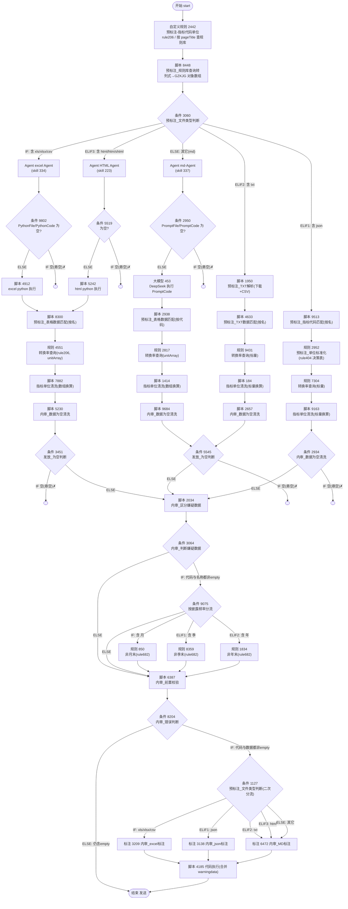

# 01 · 工作流总览

> 工作流编辑器界面截图（只读查看，图中为某个内审条件节点配置）：见 （原始界面截图未随脱敏版本发布。）。

## 1. 业务目标

地方经济运行（DFJJ）采集任务会把从各政府/统计局站点抓到的原始文件（Excel、HTML、Markdown、JSON、TXT 等）推送进来。该工作流自动完成以下处理：

1. **规则库预查询**：根据采集页面路径（`pageTitle`），从规则库查询该页面下所有指标的“标准代码 / 标准名称 / 标准单位 / 披露频率”，作为后续匹配基准（GZK）。
2. **按文件类型分流解析**：
   - Excel（xls/xlsx/csv）、HTML → 由“路由 Agent”按 `pageTitle` 选出**预先编写好的站点专属解析器（Python）**，再交给统一的代码执行节点运行，解析出结构化指标；
   - Markdown/其它（默认分支）→ 由“路由 Agent”选出**站点专属提示词（Prompt）**，再交给大模型（DeepSeek）按提示词抽取指标；
   - JSON → 直接用脚本按指标名称匹配规则库；
   - TXT → 直接下载并按“日期,值”CSV 解析。
3. **指标匹配与单位换算**：把解析结果与规则库记录匹配（得到指标代码、库表单位、单位比例），查询单位换算率，对数值做单位换算。
4. **内部校验（内审）**：
   - 空值清洗（无代码 / 无数据 / 无截止日期 → 拦截）；
   - 按披露频率校验截止日期是否为月末/季末/半年末/年末；
   - 规则库特殊性查询（价格不可为零、截止日期非末等）；
   - 前置校验：指标代码长度必须为 10 位、信息发布日期不能晚于今天、不能早于截止日期、`problem_fin_time` 特殊码校验等。
5. **人工标注分流**：存在问题的数据进入按文件类型划分的人工标注任务（EDB 标注团队，限时 1440 分钟）；人工修订后，问题数据与正常数据合并。
6. **发送结束**：合并后的数据进入结束节点（“发送”）。

---

## 2. 节点类型分布（47 个）

| 类型 | 数量 | 说明 |
|---|---|---|
| start 开始 | 1 | 单起点，声明 18 个采集入参字段 |
| end 结束 | 1 | “发送”，result 为空（不额外配置返回字段） |
| agent 智能体 | 3 | 全部是**只读“路由 Agent”**（模型 qwen-plus），不执行代码/提示词，只负责按 pageTitle 选出文件并返回原文 |
| file_extract 大模型 | 1 | 大模型执行节点（DeepSeek-V4.1-Flash，百炼），执行路由出的提示词抽取 Markdown 表格 |
| script 代码执行 | 18 | Python3 脚本节点（解析、匹配、单位换算、校验、合并） |
| condition 条件判断 | 11 | 文件类型路由、空值判断、嫌疑数据分流、错误判断 |
| custom_rule 自定义规则 | 9 | 调用外部规则引擎：动态查询（rule206/682）与决策表（rule404） |
| mark_task 标注任务 | 3 | excel / json / MD 三类人工标注任务（EDB 标注团队） |

---

## 3. 端到端流程（主流程图）

下图按实际 59 条连线绘制。标注 `IF/ELSE IF/ELSE` 的为条件分支；**红色含义的“悬空”分支**在画布上未连线，命中即终止（图中以 `✗ 终止` 标注）。

---

## 4. 五条文件类型路由与四条处理链

入口条件节点 **3060**（以及下游二次分流的 **1127**，规则相同）按 `fileType` **包含（contains）**关键字判断，顺序从上到下首个命中：

| 分支 | fileType 条件 | 路由到 | 后续处理链 |
|---|---|---|---|
| IF | 含 `xls` / `xlsx` / `csv`（OR） | excel Agent 3708 | **链 A**：4912 → 8300 → 4551 → 7882 → 5230 → 3451 |
| ELSE IF 1 | 含 `json` | 脚本 9513（无 Agent） | **链 D**：9513 → 2952 → 7304 → 9163 → 2934 |
| ELSE IF 2 | 含 `txt` | 脚本 1950（无 Agent） | **链 C**：1950 → 4633 → 9431 → 184 → 2657 → 5545 |
| ELSE IF 3 | 含 `html` / `htm` / `shtml`（OR） | HTML Agent 763 | **链 A（与 excel 共用）**：5242 → 8300 → 4551 → 7882 → 5230 → 3451 |
| ELSE | 其余（Markdown 等） | md-Agent 2204 | **链 B**：453(大模型) → 2938 → 2817 → 1414 → 9684 → 5545 |

四条链最终都汇入内审脚本 **2034**，进入统一内审与标注分流。

> 说明：
> - **excel 与 html 解析后都进入“链 A”**（共用 8300 匹配节点，按指标**名称**匹配、产出 `unitArray`）；
> - **Markdown 走大模型抽取后进入“链 B”**（2938 节点，按指标**代码**匹配）；
> - txt 与 md 最后都经过空值判断节点 **5545**，但前置匹配/换算链不同；
> - JSON 分支不经过 Agent 与代码执行，直接在脚本内匹配规则库，且单位先经规则 404 决策表标准化。

---

## 5. 三个关键拦截点（“empty” 拦截）

| 条件节点 | 所在链 | 命中条件（IF） | 命中后行为 |
|---|---|---|---|
| 9802 / 5519 / 2950 | 三个路由 Agent 之后 | 路由结果文件名含 `empty`，或代码/提示词为空（OR） | **IF 分支悬空，流程终止**（未配置解析器/路由失败时不继续） |
| 3451 | 链 A（excel/html） | `out_data.indicator_code` 含 `empty` / `out_data` 为空 / `out_data.remark` 含 `empty`（OR） | IF 悬空终止；ELSE 进 2034 |
| 5545 | 链 B（md）+ 链 C（txt） | 同上 | IF 悬空终止；ELSE 进 2034 |
| 2934 | 链 D（json） | `out_data` 含 `empty` / `out_data.indicator_data` 含 `empty`（OR） | IF 悬空终止；ELSE 进 2034 |

---

## 6. 内审阶段的两条“嫌疑数据”判定线

进入 **2034（内审_区分嫌疑数据）** 后，数据被分成两路：

- **OUTDATA**：正常数据（原样保留，脚本不删除任何数据）。
- **warningdata**：问题数据（按披露频率检查截止日期是否为对应周期末，异常记录写入 `remark`）。

随后：

1. **条件 3064**：若 `warning_data` 的指标代码、指标名称都**不含** `empty`（即确实存在问题数据，AND）→ 进 **9075** 按披露频率二次分流；否则 → 直接进 **6387**。
2. **9075** 按 `warning_data.indicator_release_frequency` 是否含“月/季/年”，分别调用规则 682 的“非月末/非季末/非年末”动态查询（850 / 8359 / 1834），结果写入 `warning_data.problem_fin_time`；三个规则节点与 ELSE 都汇入 **6387**。
3. **6387（内审_前置校验）** 对 OUTDATA 做更全面的校验（代码长度、发布日期、周期末、problem_fin_time 1002/1003/1004），异常追加进 warningdata 的 `remark`。
4. **条件 8204（内审_错误判断）**：
   - IF：`warning_data.indicator_code` 与 `indicator_data` 都**不含** `empty`（确有需人工处理的问题数据）→ 进 **1127** 二次按文件类型分流，创建对应人工标注任务；
   - ELSE：仍含 empty（无有效问题数据）→ 直接到 **结束**。
5. 三个人工标注任务完成后都汇入 **4185**，把 `warningdata` 合并（extend）进 `OUTDATA`，再到 **结束“发送”**。

---

## 7. 运行时外部依赖总览

| 依赖类型 | 标识 | 用途 | 详见 |
|---|---|---|---|
| 动态查询规则 | rule206「EDB指标代码查询」 | ①按 pageTitle 查指标代码/名称/单位/频率；②查单位换算率 | 06 文档 + 外部规则 SQL |
| 决策表规则 | rule404「EDB单位标准化」 | JSON 分支单位标准化（2279 条映射，UNIQUE 命中） | 06 文档 + CSV |
| 动态查询规则 | rule682「EDB数据特殊性查询」 | 价格不可为零、截止日期非月末/季末/年末/半年末 | 06 文档 + SQL |
| Skill 包 | 334（excel 路由器）、223（html 路由器）、337（markdown 提示词路由器） | 提供 pageTitle→解析器/提示词的映射及文件原文 | 09 文档 + skill_assets |
| 大模型 | qwen-plus（3 个 Agent）；DeepSeek-V4.1-Flash（百炼，大模型抽取） | 路由选择；Markdown 表格抽取 | 07 文档 |
| 标注模板 | 211 Excel标注第一版 / 212 json标注配置第一版 / 213 MD标注第一版 | 人工标注表单 | 08 文档 |
| 文件服务 | `http://service-1.example.invalid/api/file/download/{md5}` | 解析器/脚本下载原始文件 | 04 文档 |
